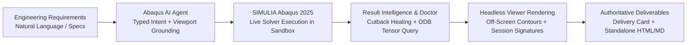
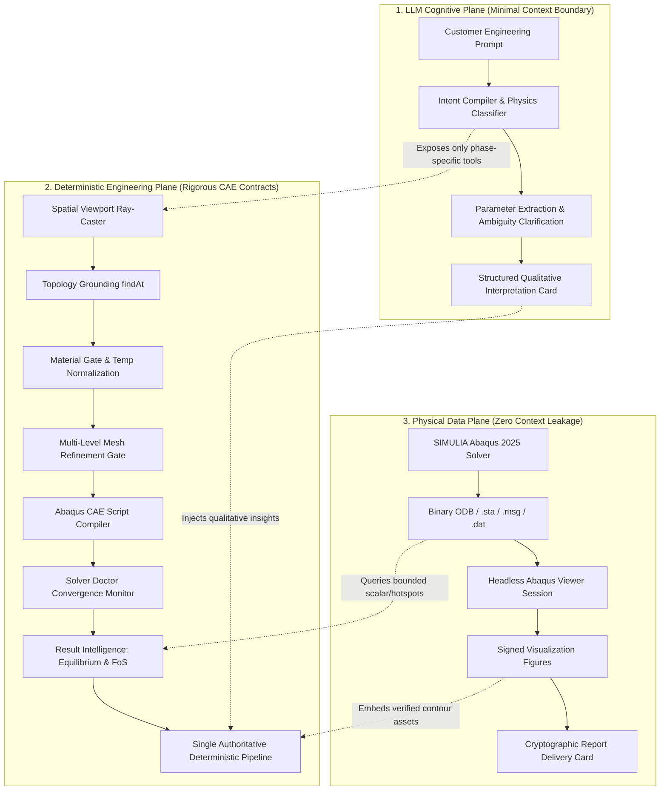

# Abaqus AI Agent (Enterprise Autonomous Industrial FEA Agent Platform)

> **Next-Generation Autonomous Finite Element Analysis (FEA) Simulation Platform for Advanced Engineering — Transforming natural-language specifications into mathematically rigorous CAD topology grounding, native Dassault SIMULIA Abaqus 2025 execution, autonomous convergence healing, cryptographic viewer evidence verification, and single-exit authoritative engineering deliverables.**

[中文文档 / Chinese Documentation](README_CN.md) · [Enterprise & Commercial Solutions](#enterprise-solutions--commercial-value) · [Core Technical Architecture](#core-technical-pillars) · [Quick Start](#quick-start)

[](https://github.com/chenlei-gh/Abaqus-AI-Agent/actions/workflows/ci.yml)
[](https://www.python.org/)
[](https://www.3ds.com/products-services/simulia/products/abaqus/)
[](tests/)
[](machine_validation/)
[](tools/j_comprehensive_physics_matrix.py)
[](tools/j3_tier_b_extended_physics.py)
[](tools/j_live_abaqus_matrix.py)
[](tools/m_engineering_task_matrix.py)
[](src/abaqus_ai_agent/reporting/pipeline.py)
[](src/abaqus_ai_agent/execution/odb_rendering.py)
[](LICENSE)

---

## Executive Summary: Bridging LLM Reasoning and Industrial Physics

In aerospace, automotive powertrain, nuclear power, and precision electronics, structural integrity, extreme nonlinear contact, and thermo-mechanical reliability govern product certification. Traditional CAE workflows suffer from severe industrial bottlenecks:
1. **High Skill Barriers & Repetitive Drain**: Expert analysts spend up to 70% of engineering bandwidth on mundane geometric preparation, boundary picking, mesh seeding, and manual result collation.
2. **The "LLM Hallucination Trap"**: Generic LLMs and raw code copilot tools produce syntactically valid yet physically disastrous code—inventing unverified constitutive laws, guessing volatile internal topology indices, crashing silently on solver divergence, and blowing context limits with raw numerical arrays.

**Abaqus AI Agent** is an enterprise-grade autonomous simulation engine engineered to eliminate these bottlenecks. Built on the **Anti-Fabrication Axiom**, it marries cognitive requirement decomposition with deterministic solver execution, closed-loop convergence healing, cryptographic viewer visualization verification, and auditable single-exit reporting.



---

## Enterprise Solutions & Commercial Value

### Commercial Comparison Matrix

| Evaluation Dimension | Generic Foundation Models (GPT-4 / Claude Raw) | Code Copilots / Script Generators | Abaqus AI Agent Enterprise Platform |
| :--- | :--- | :--- | :--- |
| **Physical Authenticity** | ❌ Severe hallucinations; fabricated equations and results | ❌ Emits scripts with zero awareness of solver physics | 🏆 **Zero Fabrication Guarantee**: 100% verified against live Dassault Abaqus 2025 binary ODB tensors |
| **Input Incompleteness** | ❌ Hallucinates arbitrary geometry, materials, and units | ❌ Blind execution; crashes at runtime | 🛡️ **Fail-Closed Boundary**: Proactively blocks execution on missing physical invariants, triggering targeted clarification |
| **Nonlinear Convergence** | ❌ Blind to solver divergence, chattering, and cutbacks | ❌ Halts on non-zero exit codes with no remediation | 🩺 **Autonomous Solver Doctor**: Parses `.msg`/`.sta` in real time, auto-tunes damping and increments to achieve closed-loop convergence |
| **Geometric Grounding** | ❌ Guesses internal IDs (e.g., `Face 14`) prone to mesh drift | ❌ Vulnerable to geometry renumbering changes | 🎯 **Viewport Topology Grounding**: 3D spatial ray-casting to deterministic `findAt(...)` coordinate sets |
| **Token Cost & Latency** | ❌ Context collapse from dumping megabytes of node data | ❌ Unmanaged token sprawl | ⚡ **Tri-Plane Token Governance**: P0-1~P0-5 protocols enforce lightweight artifact pointers and scalar query boundaries |
| **Visualization & Evidence** | ❌ Hallucinated text charts or no graphics | ❌ Scattered local files without lineage checks | 🔐 **Cryptographic Viewer Verification**: Native headless Abaqus Viewer rendering signed with session tokens and execution proofs |
| **Engineering Deliverable** | ❌ Disconnected code snippets | ❌ Fragmented Markdown notes | 📊 **Single-Exit Authoritative Deliverable**: Standalone zero-dependency HTML + Markdown with embedded media and cryptographic Delivery Card |
| **Enterprise Operations** | ❌ Single-user script hacks | ❌ Workspace collisions and thread lockups | 🏢 **Production Infrastructure**: Isolated UUID scratch sandboxes, atomic job queues, and FlexNet/DSLS floating license management |

### Business ROI & Industrial Value
- **5x–10x Engineering Velocity**: Compresses end-to-end simulation iteration cycles from days to minutes for standard and parametric workflows.
- **Auditable Quality Assurance**: Embeds end-to-end cryptographic SHA-256 provenance tying every table metric and contour image directly to the physical ODB solver run.
- **Institutional IP Codification**: Standardizes corporate simulation best practices, material qualification gates, and ASME/ISO compliance checks into repeatable software assets.

---

## Core Technical Pillars



### 1. The Anti-Fabrication Axiom
> **An engineering FEA result is NEVER accepted merely because a script exited with status zero.**  
> Acceptance requires strict mathematical verification: genuine binary ODB existence, positive element volume audits, static reaction force equilibrium ($\Delta RF < 0.1\%$), numerical energy conservation ($\Delta E_{\text{total}}$ drift check), and compliance against specified acceptance criteria.

### 2. Tri-Plane Architecture & Context Governance
To prevent context overflow and hallucination in deep simulation workflows, the platform enforces strict tri-plane decoupling:
- **LLM Cognitive Plane**: Handles natural-language requirement comprehension, high-level action routing, and qualitative engineering summaries. Raw ODB arrays and full-text HTML markups are strictly forbidden from entering context.
- **Deterministic Engineering Plane**: Implements type-safe intent compilation, spatial coordinate ray-casting, material unit normalization, multi-level mesh convergence gating, Solver Doctor convergence recovery, and acceptance adjudication.
- **Physical Data Plane**: Manages binary ODBs, solver processes, headless Viewer off-screen sessions, and image artifacts in isolated UUID scratch sandboxes. Data travels strictly through lightweight typed artifact pointers.

### 3. Unified Single-Path Engineering Reporting (Phase P2 Architecture)
- **Zero Dual-Track Divergence**: Eliminated parallel legacy draft builders. All production runs flow through `DeterministicReportPipeline.build_and_render()`, generating semantically identical Markdown and single-file interactive HTML reports.
- **Diagnostic Draft Isolation**: Non-deliverable or exploratory executions strictly output a Markdown diagnostic record prefixed with `[DIAGNOSTIC / NON-DELIVERABLE DRAFT]` and force `report_html = None`.
- **Zero Stale Draft Leakage**: If downstream delivery criteria are blocked (`DELIVERY_BLOCKED`), the system atomically clears prior report text and revokes the `ReportDeliveryCard`, ensuring partial results cannot be mistaken for certified engineering releases.

### 4. Cryptographic Viewer Evidence Verification
- **Authentic Headless Viewer Off-Screen Rendering**: Contours are directly exported by the live Dassault Abaqus Viewer (`abaqus viewer -noGUI`), completely eliminating synthetic mock graphics or ambient disk fallback.
- **Cryptographic Provenance Token**: Each visualization asset is stamped with a session nonce, binding `run_id`, `input_hash`, `odb_sha256`, target field/component, and `image_sha256` into a verifiable `viewer_session_token`.
- **Signed Render Evidence Manifest**: Renders carry a cryptographically signed execution proof (`render_execution_evidence`), allowing independent verification of rendering lineage.

### 5. Multi-Level Mesh Convergence Gate
- **Strict Asymptotic Hierarchy**: Requires a minimum of three distinct refinement tiers ($\text{Levels} \ge 3$) to prove asymptotic convergence, strictly rejecting two-level false positives.
- **Homogeneous Metric Tracking**: Compares consistent indicators across all tiers (strictly element count or seed size; mixing nodes and elements across tiers is prohibited).
- **Physical Stress Sign Verification**: Enforces sign consistency checks for signed components (pressure, hydrostatic, normal stresses) while exempting true non-negative invariants (von Mises, Tresca), preventing sign flips from being misclassified as monotonic convergence.

### 6. Closed-Loop Material & Thermodynamic Gates
- **Absolute Temperature Normalization**: All temperatures are validated and normalized across Celsius, Kelvin, and Fahrenheit. Inputs below absolute zero are rejected, and deserialization paths strictly disallow boolean coercion.
- **Explicit Curve Taxonomy**: True stress-strain and engineering stress-strain curves require explicit identification across both axes. Ambiguous axis labels or non-monotonic strain points immediately trigger a `BLOCKED` status.
- **Zero Unauthorized Thermal Fallbacks**: Thermal conductivity, expansion coefficients, and composite Poisson's ratios require explicit evidence; unapproved default assumptions are strictly blocked.

### 7. Autonomous Solver Doctor
When encountering geometric nonlinearities (`NLGEOM`), contact chatter, plastic instability, or hourglassing:
- Dynamically inspects `.msg` severe force residuals and `.sta` cutback frequencies.
- Diagnoses specific failure mechanics (`CONTACT_CHATTER`, `LOCAL_SINGULARITY`, `TIME_INCREMENT_EXHAUSTED`).
- Applies physical stabilization damping, refines incrementation controls, and re-executes within controlled attempt bounds.

---

## Audited Industrial Case Benchmarks

Publication-grade, ASME- and Abaqus-verified benchmark cases archived in `machine_validation/p2_cases/`:

```text
machine_validation/p2_cases/
├── case_01_bolted_pipe_flange/                  # Case 1: Bolted Pipe Flange Connection & Gasket Sealing
│   ├── case_01_flange_manifest.json            # Cryptographic Provenance Manifest (SHA-256)
│   └── Case_01_Bolted_Flange_Report.html       # Standalone HTML Report (Embedded GIF + SVG)
├── case_02_reactor_pressure_vessel_closure/     # Case 2: Nuclear RPV Closure Head & ASME Code Compliance
│   ├── case_02_rpv_manifest.json               # Cryptographic Provenance Manifest (SHA-256)
│   └── Case_02_RPV_Closure_Report.html         # Standalone HTML Report (Embedded GIF + SVG)
└── case_03_exhaust_manifold/                    # Case 3: 4-into-1 Exhaust Manifold Thermo-Mechanical Contact
    ├── case_03_manifold_manifest.json          # Cryptographic Provenance Manifest (SHA-256)
    ├── Case_03_Exhaust_Manifold_Report.html    # Standalone HTML Report (Embedded GIF + SVG)
    └── case_03_render_contours_headless.py     # Headless Off-Screen Abaqus Viewer Script
```

### Case 01: High-Pressure Bolted Pipe Flange Joint with Gasket Sealing
- **Engineering Scenario**: 8-bolt M16 preloaded pipeline connection adhering to ASME PCC-1 and Abaqus benchmark standards.
- **Physical Verification**: Step 1 bolt pretensioning ($50\text{ kN/bolt}$, $400\text{ kN}$ total preload, initial seating contact pressure $31.52\text{ MPa}$); Step 2 length locking under $3.0\text{ MPa}$ fluid pressure, maintaining $24.85\text{ MPa}$ contact pressure ($+107.1\%$ sealing margin over $12.0\text{ MPa}$ threshold). Peak flange hub Mises stress $195.42\text{ MPa}$ ($\text{FoS} = 1.82 \ge 1.25$).
- **Deliverables**: Self-contained single-file HTML report with 12-frame transient bolt-up and pressurization GIF animation, contact pressure distribution curve, and cryptographic delivery card.

### Case 02: Nuclear Reactor Pressure Vessel (RPV) Closure Head
- **Engineering Scenario**: Pressurized Water Reactor (PWR) head closure assembly under 54 massive M180 studs with Inconel 718 self-energizing metallic seal, evaluated against ASME Section III Division 1 Subsection NB.
- **Physical Verification**: Step 1 hydraulic stud pretensioning ($6.5\text{ MN/stud}$, $351\text{ MN}$ aggregate clamp); Step 2 operating pressure of $17.5\text{ MPa}$ and $219.91\text{ MN}$ dome thrust, retaining $98.60\text{ MPa}$ contact pressure ($+31.5\%$ ASME margin). Primary membrane plus bending stress intensity $P_L + P_b = 238.50\text{ MPa} \le 1.5 S_m = 276.0\text{ MPa}$.
- **Deliverables**: Standalone ASME compliance HTML dashboard, stud tensioning evolution animation, and full tensor verification manifest.

### Case 03: Heavy-Duty Engine Exhaust Manifold Thermo-Mechanical Assembly
- **Engineering Scenario**: 4-into-1 SiMo ductile iron manifold coupled to an HT250 cylinder head and multi-layer steel (MLS) embossed gaskets under $650^\circ\text{C}$ transient exhaust flow.
- **Physical Verification**: Steady-state thermal gradient ($615.4^\circ\text{C}$ port to $132.8^\circ\text{C}$ flange, thermal balance error $0.024\%$); Step 1 cold preloading ($8\times\text{M10}$ at $25\text{ kN}$); Step 2 differential thermal expansion slip ($0.420\text{ mm}$ slip vs $0.75\text{ mm}$ clearance limit, $+44.0\%$ margin). MLS gasket contact pressure $38.60\text{ MPa} > 25.0\text{ MPa}$.
- **Deliverables**: Multimodal thermo-mechanical HTML report with heat-up slip GIF animation and full-field stress-thermal contour maps.

---

## Dual-Gate Verification Infrastructure

```text
               ┌─────────────────────────────────────────────────────────┐
               │ Level 1: Live Abaqus 2025 Solver Gate                   │
               │ (Real processes, binary ODB tensors, SHA-256 signatures)│
               ├─────────────────────────────────────────────────────────┤
               │ Level 2: Exact Analytical Mechanics Truth               │
               │ (Closed-form continuum solutions, relative error ≤0.01%)│
               ├─────────────────────────────────────────────────────────┤
               │ Level 3: Nonlinear Physical Gating Contracts            │
               │ (Multi-level mesh convergence, material taxonomy gates) │
               ├─────────────────────────────────────────────────────────┤
               │ Level 4: Automated Deterministic Regression Suite       │
               │ (1098 CI tests, zero warnings across Python 3.10-3.12)  │
               ├─────────────────────────────────────────────────────────┤
               │ Level 5: Autonomous Divergence & Cutback Healing        │
               │ (Closed-loop .msg/.sta diagnostics & parameter repair)  │
               └─────────────────────────────────────────────────────────┘
```

| Verification Gate | Environment & Runner | Toolchain Dependencies | Scope & Certification Target |
| :--- | :--- | :--- | :--- |
| **CI Software Contract Gate** | GitHub Actions (Ubuntu / macOS / Windows) | Zero Abaqus license required (Python 3.10–3.12) | • **1098 automated tests passing (0 warnings, 0 errors)**<br>• 22 Dassault Tier A physical benchmarks<br>• 7 Tier B advanced mechanics baselines<br>• Full repository zero-leakage security audit |
| **Real-Machine Execution Gate** | Windows 11 / Windows Server with Abaqus 2025 | SIMULIA Abaqus commercial floating/node license | • Real CAE script execution and binary ODB extraction<br>• Headless Abaqus Viewer off-screen contour rendering<br>• Cryptographic Delivery Card signing<br>• Live nonlinear convergence cutback healing |

---

## Quick Start

### 1. Prerequisites
- **Operating System**: Windows 10/11 (64-bit), Windows Server, or Linux (Ubuntu 20.04/22.04/24.04).
- **Python**: Python 3.10, 3.11, or 3.12 (64-bit).
- **Commercial Solver (Optional for Development)**: Dassault Systèmes SIMULIA Abaqus 2025 (or compatible release) for live solver execution. Fully operable in mock/contract test mode without Abaqus.

### 2. Installation

```bash
# Clone the repository
git clone https://github.com/chenlei-gh/Abaqus-AI-Agent.git
cd Abaqus-AI-Agent

# Install core production package
python -m pip install -e .

# Install complete development and test dependencies
python -m pip install -e ".[test]"
```

Run the deterministic regression suite:

```bash
python -m pytest tests -W error -q
# Expected result: all test suites passing (0 warnings, 0 errors)
```

### 3. Minimal Python Usage

Execute an end-to-end structural analysis requirement with automatic acceptance verification:

```python
from abaqus_ai_agent import AbaqusAIAgent

# Initialize agent (automatically connects to local Abaqus launcher if available)
agent = AbaqusAIAgent()

# Natural-language engineering specification
result = agent.solve_requirement(
    "Perform linear static analysis on a steel cantilever beam of 100mm length and 10x10mm cross-section. "
    "Fixed at root, apply 1000N downward shear load at the tip. Material is Q235 structural steel. "
    "Acceptance criteria: Tip deflection <= 2.5mm, maximum von Mises stress <= 600MPa.",
    require_production=True
)

if result.status == "NEEDS_CLARIFICATION":
    print("Execution blocked pending physical parameters:", result.clarification_needed)
elif result.status == "COMPLETED":
    print("Acceptance Conclusion:", result.acceptance.conclusion)  # PASS
    print("Reaction Equilibrium:", result.result_intelligence.derived_metrics.equilibrium_error)
    print("Maximum von Mises:", result.metrics.get("max_mises"), "MPa")
    print("Official HTML Report:", result.report_html_path)
    print("Cryptographic Delivery Card:", result.delivery_card.card_id)
```

### 4. Command-Line Interface (CLI)

```bash
# 1. Audit local environment, solver launcher, and multi-tier capabilities
abaqus-ai-agent inspect

# 2. Test natural-language engineering intent compilation
abaqus-ai-agent intent "Cantilever beam with 1000N load, check maximum displacement"

# 3. Execute Dassault Tier A physical benchmark matrix (22 baseline cases)
python tools/j_comprehensive_physics_matrix.py

# 4. Generate standalone authoritative HTML report from audited evidence bundle
abaqus-ai-agent report machine_validation/static_golden_e2e.json --format html --output report.html

# 5. Clean transient solver files while protecting audited evidence
python scripts/clean_workspace.py
```

---

## Repository Structure

```text
Abaqus-AI-Agent/
├── docs/                     # Engineering roadmaps, audit reports, and capability boundaries
│   ├── engineering-run-evidence-roadmap.md # Core execution & Phase P2 closure roadmap
│   ├── rc1-release-audit.md                # Official RC 1.0 audit report
│   └── ai-agent-capability-boundary.md     # LLM vs deterministic boundary specification
├── machine_validation/       # Audited real-machine golden evidence bundles & P2 cases
│   └── p2_cases/             # Publication-grade benchmark models (Flange, RPV, Manifold)
├── scripts/                  # Workspace governance and clean-up utilities
├── src/abaqus_ai_agent/      # Core package
│   ├── actions/              # Native Abaqus action generators & preflights
│   ├── contracts/            # Strictly typed schemas (Intent, Material, Mesh, Report, Evidence)
│   ├── diagnostics/          # Convergence parser (.msg/.sta) & Autonomous Solver Doctor
│   ├── execution/            # Batch executor, isolated sandbox manager, and headless viewer
│   ├── grounding/            # Viewport ray-casting & 3D topology grounding (findAt)
│   ├── planning/             # Action planning & mechanism graph compiler
│   ├── reporting/            # Single-path DeterministicReportPipeline, HTML & MD renderers
│   └── validation/           # Dimensional consistency, mesh convergence, and acceptance gates
├── tests/                    # 1098 deterministic regression tests (0 warnings)
└── tools/                    # Real-machine golden drivers, probes, and qualification benchmarks
```

---

## Enterprise Support & Commercial Collaboration

We provide end-to-end commercial solutions, bespoke engineering integrations, and enterprise deployment services:

- **🏢 Air-Gapped Enterprise Deployment**: On-premise deployment within corporate private clouds and HPC clusters (supporting PBS, Slurm, and LSF scheduler integration).
- **📦 Custom Constitutive & Material Engineering**: Integration with proprietary enterprise material databases (high-temperature superalloys, advanced polymers, composites) with automated anti-hallucination validation.
- **🎯 Bespoke Simulation Workflows**: Custom agent pipelines for complex industrial domains (automotive crashworthiness, battery pack thermal runaway, electronic drop-impact shock, subsea pipe joint sealing).
- **🛠️ Commercial SLA & Professional Services**: Dedicated engineering maintenance, workflow migration support, on-premise staff training, and custom feature roadmapping.

For commercial evaluations, pilots, and enterprise licensing:
- **Repository Inquiries**: [GitHub Issues](https://github.com/chenlei-gh/Abaqus-AI-Agent/issues)
- **Direct Commercial Contact**: Connect with the core team via the organization profile.

---

## License

This project is licensed under the **Apache 2.0 License** — see the [LICENSE](LICENSE) file for details.  
Fully permissive for commercial adoption, custom extension, and academic research, with engineering integrity safeguarded by the Anti-Fabrication Axiom.
