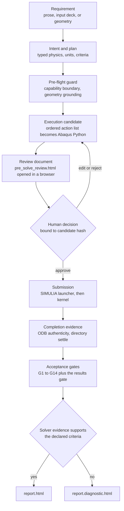

# Abaqus AI Agent

An engineering agent that sits between a stated analysis requirement and Abaqus. It compiles the requirement into a model a person can inspect, submits that model only after that person approves it, and writes a formal report only when solver-authored evidence supports the criteria that were declared up front.

[中文文档](README_CN.md)

[](https://github.com/chenlei-gh/Abaqus-AI-Agent/actions/workflows/ci.yml)
[](https://www.python.org/)
[](LICENSE)

## Three claims that are not the same claim

Most automation collapses three different statements into one success signal. This package keeps them apart, and every artifact it produces says which one it is standing on.

| Claim | What proves it | What does not |
|---|---|---|
| The script ran | A process exited with a completion marker | A return code alone |
| The job finished | An ODB that passed authenticity and integrity checks, in a settled work directory | The presence of a file with the right name |
| The answer is acceptable | Every acceptance gate passed against the criteria declared before submission | A green run, a pretty contour plot, a number that looks reasonable |

A formal report is `report.html`, and it exists only in the third case. Otherwise the deliverable is `report.diagnostic.html`. Renaming that file does not promote it.

## Architecture



The script is rendered from the action list. It is not the source of the model, and it is never a hand-edited artifact that drifts away from the plan.

| Package under `src/abaqus_ai_agent/` | Responsibility |
|---|---|
| `contracts/` | Typed records for actions, conditions, approval, artifacts, criteria |
| `reasoning/` | Requirement parsing, material and mesh inference, plausibility checks |
| `grounding/` | Resolving named regions to real geometry picks, with a policy that refuses to invent them |
| `actions/` | Turning the plan into a deterministic build script |
| `execution/` | Launcher resolution, submission, completion evidence, approval service |
| `evidence/`, `results/` | Reading what the solver actually produced, and what it did not |
| `acceptance.py` | The canonical gate order and the verdict |
| `reporting/` | Review document, formal report, diagnostic report |

## Acceptance gates

Seventeen gates run in a fixed order, because a later gate is meaningless if an earlier one has already failed. The order is declared once, in `CANONICAL_GATE_ORDER`, and enforced by the evaluator rather than by the reporter.

```mermaid
flowchart LR
    subgraph P["Provenance"]
        direction TB
        p1["G1 execution"] --> p2["G2 ODB"] --> p3["G3 evidence sufficiency"]
    end
    subgraph M["Mechanics"]
        direction TB
        m1["G4 numerical verification"] --> m2["G5 engineering checks"] --> m3["G6 mesh quality"] --> m4["G7 convergence"]
    end
    subgraph X["Procedure-specific"]
        direction TB
        x1["G8 fatigue"] --> x2["G9 contact"] --> x3["G10 procedure"] --> x4["G11 thermal balance"] --> x5["G11b stabilization"] --> x6["G11c dynamic energy"]
    end
    subgraph C["Contract closure"]
        direction TB
        c1["G12 criteria"] --> c2["G13 connector kinematics"] --> c3["G14 FMBD"] --> c4["Results gate"]
    end
    p3 --> m1
    m4 --> x1
    x6 --> c1
```



Gates that do not apply to a given analysis are recorded as skipped, not as passed. The composite results gate closes the contract that the other gates open: a job can be well converged, well meshed, and still not answer the question that was asked.

## Install

Two interpreters stay separate. This package installs into an ordinary CPython virtual environment. Abaqus keeps its own Python and is reached only through the SIMULIA launcher. Do not install this package into the Python that ships with Abaqus/CAE.

The package is not published on PyPI. Install it from this source tree, with `python -m pip`, so that it lands in the interpreter you just checked. `python setup.py install` is not supported.

Windows, from the repository root:

```bat
py -3.12 -m venv .venv
.venv\Scripts\activate.bat
python -m pip install --upgrade pip
python -m pip install .
python -m abaqus_ai_agent --help
```

macOS or Linux:

```bash
python3 -m venv .venv
source .venv/bin/activate
python -m pip install --upgrade pip
python -m pip install .
python -m abaqus_ai_agent --help
```

That installs `abaqus-ai-agent` 0.2.2. `pyproject.toml` declares `requires-python >=3.9`; CI tests 3.10, 3.11, and 3.12 on Ubuntu and Windows. The only runtime dependency is `Pillow>=9`. The console scripts are `abaqus-ai-agent` and `abaqus-agent`.

To work on the repository, install the test extra in editable mode and run the offline suite. No Abaqus installation is needed for this:

```bat
python -m pip install -e ".[test]"
python -m pytest tests -q -m unit
```

In `cmd` the quotes around `".[test]"` are required, because square brackets are wildcards. An editable install follows edits under `src/`. If dependencies or entry points in `pyproject.toml` change, run the same install command again.

### Abaqus, which this package does not install

A live solve needs an already installed, licensed Abaqus. This repository does not configure the license server, `custom_v6.env`, or token availability, and it ships no license.

The Abaqus installer creates the command directory: `C:\SIMULIA\Commands` on Windows, `/var/DassaultSystemes/SIMULIA/Commands` on Linux. The 2025 shortcut is `abq2025`; `abaqus` is the unversioned entry point.

The launcher is resolved in this order: an explicit path, `abaqus` on `PATH`, then `C:\SIMULIA\Commands\abaqus.BAT` on Windows.

```bat
where abaqus
abaqus information=release
abaqus-ai-agent inspect --json
```

A release string means the launcher runs. It does not mean a license token is free. An `inspect` run that finds no launcher means an offline host, not a broken install.

## Try it

This routes a requirement and stops. It does not start Abaqus, and it is the same command continuous integration runs.

```bat
abaqus-ai-agent ask "Apply 1000N vertical load to the free end of a 100mm cantilever beam, material steel, fixed root, check deflection <= 2.5mm." --dry-run
```

A successful dry run exits 0:

```text
Inferred Physics:   linear_static (Confidence: 0.79)
Unit System:        MM_N_MPA
Target Solver:      abaqus_standard
Completeness Score: 5.0 / 5.0
[DRY-RUN] Intent and plan contracts verified successfully. No solver invoked.
Solver invoked:     NO
Report authorized:  NO
```

The same sentence with no place for the load to act exits 2 and names `missing_load_application_region`. That stop is deliberate: an unplaced load cannot be grounded, so nothing downstream is permitted to guess it.

## Review before solve

Building a model and submitting a job go through `AbaqusAIAgent.solve_requirement`. The default does not submit. The candidate is written to `pre_solve_review.html` in the run workdir and opened in the default browser, and that file is the review: geometry, mesh, boundaries, loads, material, criteria, and the exact script that would run. There is no separate interactive UI and no hidden state to confirm.

```bat
abaqus-ai-agent approve --workdir ./run_workdir --by "analyst name"
```

Approval is recorded against the candidate's content hash. Editing the candidate in any way supersedes the approval and returns the run to the review state. The reviewer is a label in the record, not an identity proof; the hash proves which document was seen, not who saw it.

## Evidence

Two kinds of evidence ship with the repository, and they answer different questions.

Client-style delivery, `deliverables/qualifications/case_01/` — a 100 × 10 × 10 mm steel cantilever, linear static, accepted by the gate chain with `acceptance_status: PASS`:

| Tip displacement | von Mises stress |
|---|---|
|  |  |

Peak values recorded in `case_01_manifest.json`: 2.0686 mm displacement, 471.214 MPa von Mises.

Benchmark verification, `machine_validation/official_cantilever_benchmark_evidence.json` — a C3D20R cantilever with tip shear, run on a licensed Abaqus 2025 host, compared against closed-form beam theory:

| Quantity | FEM | Reference | Deviation |
|---|---|---|---|
| Tip deflection | 6.3330 mm | 6.4000 mm | 1.05 % |
| Integration-point stress | 138.89 MPa | 138.56 MPa | 0.23 % |
| Nodal surface stress | 254.12 MPa | 240.00 MPa | — |

Launcher time 16.29 s, total kernel time 17.80 s, ODB 386,836 bytes and authentic. This qualifies that case. It does not certify every procedure, element formulation, or contact definition, and the repository does not claim otherwise.

## What this does not decide for you

- It does not install Abaqus, ship a license, or manage tokens.
- It does not decide that the load path, the support condition, or the acceptance criterion was the right engineering question.
- It does not invent geometry, and it will not place a boundary or a load on a region it cannot ground.
- It does not promote a diagnostic report to a formal one.
- A generated report is not an analyst's sign-off.

## Documentation

Planning, contracts, and the audit trail live in one document: [requirements and plan](docs/PROJECT_REQUIREMENTS_AND_PLAN.md). Related records: [pre-solve approval entry matrix](docs/presolve-approval-entry-matrix.md), [geometry grounding](docs/geometry-grounding.md), [capability boundary](docs/ai-agent-capability-boundary.md).

## Help

Questions and defects: [GitHub issues](https://github.com/chenlei-gh/Abaqus-AI-Agent/issues).

## License

[Apache License 2.0](LICENSE).
