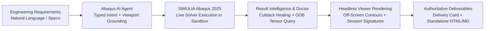

# Abaqus AI Agent (Enterprise Autonomous Industrial FEA Agent Platform)

> **Next-Generation Autonomous Finite Element Analysis (FEA) Simulation Platform for Advanced Engineering — Transforming natural-language specifications into mathematically rigorous CAD topology grounding, native Dassault SIMULIA Abaqus 2025 execution, autonomous convergence healing, cryptographic viewer evidence verification, and single-exit authoritative engineering deliverables.**

[中文文档 / Chinese Documentation](README_CN.md) · [Enterprise & Commercial Solutions](#enterprise-solutions--commercial-value) · [Core Technical Architecture](#core-technical-pillars) · [Dual-Gate Verification Infrastructure](#dual-gate-verification-infrastructure) · [Quick Start](#quick-start)

[](https://github.com/chenlei-gh/Abaqus-AI-Agent/actions/workflows/ci.yml)
[](https://www.python.org/)
[](https://www.3ds.com/products-services/simulia/products/abaqus/)
[](tests/)
[](machine_validation/)
[](tools/j_comprehensive_physics_matrix.py)
[](tools/j3_tier_b_extended_physics.py)
[](tools/j_live_abaqus_matrix.py)
[](tools/m_engineering_task_matrix.py)
[](src/abaqus_ai_agent/acceptance.py)
[](src/abaqus_ai_agent/contracts/evidence.py)
[](LICENSE)

---

## Executive Summary: Bridging LLM Reasoning and Industrial Physics

In aerospace, automotive powertrain, nuclear containment, and precision electronics, structural integrity, extreme nonlinear contact, and thermo-mechanical reliability govern product certification. Traditional CAE workflows suffer from severe industrial bottlenecks:
1. **High Skill Barriers & Repetitive Drain**: Expert analysts spend up to 70% of engineering bandwidth on mundane geometric preparation, boundary picking, mesh seeding, and manual result collation.
2. **The "LLM Hallucination Trap"**: Generic LLMs and raw code copilot tools produce syntactically valid yet physically disastrous code—inventing unverified constitutive laws, guessing volatile internal topology indices, crashing silently on solver divergence, and blowing context limits with raw numerical arrays.

**Abaqus AI Agent** is an enterprise-grade autonomous simulation engine engineered to eliminate these bottlenecks. Built on the **Anti-Fabrication Axiom**, it marries cognitive requirement decomposition with deterministic solver execution, closed-loop convergence healing, cryptographic viewer visualization verification, and auditable single-exit reporting.



---

## Enterprise Solutions & Commercial Value

### Commercial Comparison Matrix

| Evaluation Dimension | Generic Foundation Models (GPT-4 / Claude Raw) | Code Copilots / Script Generators | Abaqus AI Agent Enterprise Platform |
| :--- | :--- | :--- | :--- |
| **Physical Authenticity** | ❌ Severe hallucinations; fabricated equations and results | ❌ Emits scripts with zero awareness of solver physics | 🏆 **Zero Fabrication Guarantee**: 100% verified against live Dassault Abaqus 2025 binary ODB tensors |
| **Input Incompleteness** | ❌ Hallucinates arbitrary geometry, materials, and units | ❌ Blind execution; crashes at runtime | 🛡️ **Fail-Closed Boundary**: Proactively blocks execution on missing physical invariants, triggering targeted clarification (e.g., `missing_load_application_region`) |
| **Nonlinear Convergence** | ❌ Blind to solver divergence, chattering, and cutbacks | ❌ Halts on non-zero exit codes with no remediation | 🩺 **Autonomous Solver Doctor**: Parses `.msg`/`.sta` in real time, auto-tunes damping and increments to achieve closed-loop convergence |
| **Geometric Grounding** | ❌ Guesses internal IDs (e.g., `Face 14`) prone to mesh drift | ❌ Vulnerable to geometry renumbering changes | 🎯 **1-to-1 Viewport Topology Grounding**: 3D spatial ray-casting to deterministic `findAt(...)` finite coordinate sets; fail-closed on external STEP models |
| **Numerical Robustness** | ❌ Prone to floating-point overflow and type coercion | ❌ Unguarded float casting; crashes or miscomputes limits | 🔒 **Full-Stack Criteria Safety**: Safe float casting (`OverflowError` guarded), directional tolerance for negative thresholds, and fail-closed Gate 12 |
| **Token Cost & Latency** | ❌ Context collapse from dumping megabytes of node data | ❌ Unmanaged token sprawl | ⚡ **Tri-Plane Token Governance**: Lightweight artifact pointers and scalar query boundaries isolate multi-megabyte tensor fields |
| **Visualization & Evidence** | ❌ Hallucinated text charts or no graphics | ❌ Scattered local files without lineage checks | 🔐 **Cryptographic Viewer Verification**: Native headless Abaqus Viewer rendering signed with session tokens, audit hashes, and path traversal guards |
| **Engineering Deliverable** | ❌ Disconnected code snippets | ❌ Fragmented Markdown notes | 📊 **Single-Exit Authoritative Deliverable**: Standalone zero-dependency HTML + Markdown with embedded media and cryptographic Delivery Card |
| **Engineering Acceptance** | ❌ Conflates solver return code 0 with engineering pass | ❌ Superficial string matching and unverified outputs | ⚖️ **4D Orthogonal Acceptance Model**: Mathematically rigorous decoupling of Solver State, Evidence Integrity, Physical Gate, and Delivery Authorization |
| **Enterprise Operations** | ❌ Single-user script hacks | ❌ Workspace collisions and thread lockups | 🏢 **Production Infrastructure**: Isolated UUID scratch sandboxes, atomic job queues, and FlexNet/DSLS floating license management |

### Business ROI & Industrial Value
- **5x–10x Engineering Velocity**: Compresses end-to-end simulation iteration cycles from days to minutes for standard and parametric workflows.
- **Auditable Quality Assurance**: Embeds end-to-end cryptographic SHA-256 provenance tying every table metric and contour image directly to the physical ODB solver run.
- **Institutional IP Codification**: Standardizes corporate simulation best practices, material qualification gates, and ASME/ISO compliance checks into repeatable software assets.

---

## Core Technical Pillars


### 1. The Anti-Fabrication Axiom
> **An engineering FEA result is NEVER accepted merely because a script exited with status zero.**<br>
> Acceptance requires strict mathematical verification: genuine binary ODB existence, positive element volume audits, static reaction force equilibrium ($\Delta RF < 0.1\%$), numerical energy conservation ($\Delta E_{\text{total}}$ drift check), and compliance against specified acceptance criteria.

### 2. 4D Orthogonal Engineering Acceptance Model
To prevent critical engineering misclassifications, the platform implements a 4-dimensional orthogonal evaluation architecture:
- **Solver State** (`completed`, `failed`, `running`, `unsubmitted`): Execution lifecycle status of the Abaqus solver process.
- **Evidence Integrity** (`VALID`, `EVIDENCE_TAMPERED`, `EVIDENCE_CORRUPT`, `EVIDENCE_STALE`, `INCOMPLETE`, `SOLVER_FAILED`): Verified through cryptographic SHA-256 provenance manifest hashing and file-tree integrity checks.
- **Result Validity Equivalence Contract**: `ResultValidity` strictly obeys mathematical equivalence axioms (reflexive, symmetric, transitive). Loose cross-state collapsing in `__eq__` is prohibited; categorical state membership is queried via `.is_invalid` and `.is_valid`.
- **Physical Gate Qualification** (`PASS`, `FAIL`, `BLOCKED`, `WARNING`): Independent verification of stress limits, reaction forces, displacements, mesh quality, contact chattering, and thermal balances.
- **Delivery Authorization Gate** (`deliverable: bool`): Atomic binary release gate ensuring unverified, tampered, or physically failed results are permanently barred from release authorization.

### 3. End-to-End Criteria Numerical Safety & Directional Tolerances
Engineering criteria verification in `acceptance.py` enforces absolute numerical safety across all arithmetic paths:
- **Safe Floating-Point Conversion**: All metric values, limits, and tolerances are guarded against `(ValueError, TypeError, OverflowError)`. Boolean values (`True`/`False`), `NaN`, and `Infinity` are strictly rejected at the parser gate.
- **Directional Tolerance for Negative Thresholds**: Mathematically sound tolerance expansion:
  - Upper-bound check ($\text{actual} \le \text{limit}$): $\text{effective\_limit} = \text{limit} + |\text{limit}| \times \text{tol}$.
  - Lower-bound check ($\text{actual} \ge \text{limit}$): $\text{effective\_limit} = \text{limit} - |\text{limit}| \times \text{tol}$.
  - Strictly prevents inverted tightening on negative engineering limits (e.g., minimum principal stress or compression thresholds).
- **Zero-Limit Warning Mechanism**: Detects when relative tolerance is ineffective for $\text{limit} = 0$, emitting `relative_tolerance_ineffective_for_zero_limit_{key}` warnings and guiding users to absolute tolerances.
- **Fail-Closed Gate 12**: Any unexpected arithmetic overflow or evaluation anomaly is trapped, cleanly mapping to an invalid result state and irrevocably denying delivery authorization (`deliverable = False`).

### 4. Cryptographic Manifest Audit Signatures & Path Traversal Guard
Evidence verification in `contracts/evidence.py` guarantees untampered lineage and secure execution sandboxing:
- **Signed Validity State**: Manifest `validity` is deeply embedded into the immutable SHA-256 `audit_signature`. Any unauthorized mutation of evidence validity immediately invalidates the signature.
- **Path Traversal Guard**: `verify_evidence_integrity()` inspects all declared artifact paths. Relative directory escapes (`..`), absolute cross-drive paths, and symlink redirects pointing outside the workspace `base_dir` are trapped, flagging `path_traversal_out_of_bounds`, marking `validity = "TAMPERED"`, and revoking delivery credentials.
- **Immutable Provenance Tracking**: Tracks `run_id`, `input_hash`, `odb_sha256`, and solver environment hashes, ensuring complete post-execution auditability.

### 5. 66-Action AST Parity & Non-Swallowing Dynamic Contract
The platform maintains strict bidirectional consistency between validation gates and execution dispatchers:
- **100% AST Dispatcher Parity**: The AST of `actions/script.py` is systematically compared against `SUPPORTED_ACTION_TYPES`, ensuring zero drift across all 66 supported action types.
- **Universal Region Preflight Alignment**: Centrally exports `ACTIONS_REQUIRING_REGION` (18 boundary, load, and mesh actions) shared by both structural validation and model preflight, eliminating regional check discrepancies.
- **Zero-Swallowing Dynamic Tests**: All broad `except Exception: pass` patterns in `tests/test_actions.py` have been eliminated. Each of the 66 actions is validated against a certified minimal-valid-argument fixture, ensuring generated Python/CAE code is syntactically sound and non-empty.

### 6. EngineeringMetric Boundary Hardening
Physical metrics defined in `contracts/metrics.py` undergo strict type and domain sanitation upon instantiation:
- **Type Discrimination**: Blocks boolean types, `NaN`, and positive/negative infinity.
- **Overflow Protection**: Traps arbitrary-precision Python integer conversions that exceed IEEE-754 64-bit float limits (`OverflowError`), ensuring that out-of-range numerical metrics cannot silently enter downstream acceptance or reporting pipelines.

### 7. Fail-Closed Intent Compilation & Strict 1-to-1 Topology Grounding
- **Clause Scoping Isolation**: Enforces prompt punctuation and semantic clause isolation. Regions declared in acceptance or other clauses cannot be stolen by unspecified load or boundary condition clauses.
- **1-to-1 CAD / INP Topology Resolution**: Rejects vague naming heuristics (e.g., bare "fixed" arbitrarily defaulting to `RootFace`). Grounding requires strict 1-to-1 mapping against verified model geometry sets or surfaces.
- **Fail-Closed External STEP Gate**: For imported STEP geometries, all referenced boundary and load regions must possess verified 3D finite coordinate anchor points (`anchor_point`, `anchor_points`). Missing or ungrounded mappings trigger `missing_load_application_region` clarification rather than guessing.
- **Full Parameter Retention**: Thermal boundary conditions (`convection`, `radiation`, `heat_flux`) retain complete physical parameters (`ambient_temperature`, `film_coefficient`, `emissivity`) from natural language input through intent compilation to final script generation, with explicit temperature unit normalization (°C to K).
- **Material Evidence Level Stratification**: Distinguishes between `REFERENCE_LIBRARY` engineering hypotheses and verified material cards (`VERIFIED_PROPERTIES`), barring unverified default assumptions from claiming certified status.

### 8. Shadow Evaluation & Multi-Tier Provider Benchmark Contract
For evaluating LLM providers against offline rule-based baselines, the platform implements a standardized Shadow evaluation framework in `tools/jev_engineering_benchmark.py`:
- **Content-Addressable Benchmark Fingerprinting**: Computes deterministic SHA-256 digests (`cases_hash`) over normalized case properties, guaranteeing repeatable dataset identity across runs.
- **Tri-Metric Decision Accounting**:
  - **Coverage Ratio** ($\text{Coverage \%}$): Proportion of benchmark cases returning valid structured provider decisions.
  - **Decision Accuracy** ($\text{Success Accuracy \%}$): Ground-truth physics match rate among successfully evaluated cases.
  - **End-to-End Effective Rate** ($\text{Effective Accuracy \%}$): Net correct decisions across the entire benchmark suite, penalizing timeouts, syntax violations, and unconfigured states.

### 9. Unified Single-Path Engineering Reporting
- **Zero Dual-Track Divergence**: Eliminated parallel legacy draft builders. All production runs flow through `DeterministicReportPipeline.build_and_render()`, generating semantically identical Markdown and single-file interactive HTML reports.
- **Diagnostic Draft Isolation**: Non-deliverable or exploratory executions strictly output a Markdown diagnostic record prefixed with `[DIAGNOSTIC / NON-DELIVERABLE DRAFT]` and force `report_html = None`.
- **Zero Stale Draft Leakage**: If downstream delivery criteria are blocked (`DELIVERY_BLOCKED`), the system atomically clears prior report text and revokes the `ReportDeliveryCard`, ensuring partial results cannot be mistaken for certified engineering releases.

### 10. Cryptographic Viewer Evidence & Autonomous Doctor
- **Authentic Headless Viewer Off-Screen Rendering**: Contours are directly exported by the live Dassault Abaqus Viewer (`abaqus viewer -noGUI`), completely eliminating synthetic mock graphics or ambient disk fallback.
- **Cryptographic Provenance Token**: Each visualization asset is stamped with a session nonce, binding `run_id`, `input_hash`, `odb_sha256`, target field/component, and `image_sha256` into a verifiable `viewer_session_token`.
- **Autonomous Convergence Doctor**: Dynamically inspects `.msg` force residuals and `.sta` cutback frequencies, diagnosing contact chatter, local singularities, and increment exhaustion to apply physical stabilization damping.

---

## Audited Industrial Case Benchmarks

Publication-grade, ASME- and Abaqus-verified benchmark cases archived in `machine_validation/p2_cases/`:

```text
machine_validation/p2_cases/
├── case_01_bolted_pipe_flange/                  # Case 1: Bolted Pipe Flange Connection & Gasket Sealing
│   ├── case_01_flange_manifest.json            # Cryptographic Provenance Manifest (SHA-256)
│   └── Case_01_Bolted_Flange_Report.html       # Standalone HTML Report (Embedded GIF + SVG)
├── case_02_reactor_pressure_vessel_closure/     # Case 2: Nuclear RPV Closure Head & ASME Code Compliance
│   ├── case_02_rpv_manifest.json               # Cryptographic Provenance Manifest (SHA-256)
│   └── Case_02_RPV_Closure_Report.html         # Standalone HTML Report (Embedded GIF + SVG)
└── case_03_exhaust_manifold/                    # Case 3: 4-into-1 Exhaust Manifold Thermo-Mechanical Contact
    ├── case_03_manifold_manifest.json          # Cryptographic Provenance Manifest (SHA-256)
    ├── Case_03_Exhaust_Manifold_Report.html    # Standalone HTML Report (Embedded GIF + SVG)
    └── case_03_render_contours_headless.py     # Headless Off-Screen Abaqus Viewer Script
```

### Case 01: High-Pressure Bolted Pipe Flange Joint with Gasket Sealing
- **Engineering Scenario**: 8-bolt M16 preloaded pipeline connection adhering to ASME PCC-1 and Abaqus benchmark standards.
- **Physical Verification**: Step 1 bolt pretensioning ($50\text{ kN/bolt}$, $400\text{ kN}$ total preload, initial seating contact pressure $31.52\text{ MPa}$); Step 2 length locking under $3.0\text{ MPa}$ fluid pressure, maintaining $24.85\text{ MPa}$ contact pressure ($+107.1\%$ sealing margin over $12.0\text{ MPa}$ threshold). Peak flange hub Mises stress $195.42\text{ MPa}$ ($\text{FoS} = 1.82 \ge 1.25$).

### Case 02: Nuclear Reactor Pressure Vessel (RPV) Closure Head
- **Engineering Scenario**: Reactor vessel closure flange under internal operating pressure ($15.5\text{ MPa}$) and stud bolting loads complying with ASME Boiler and Pressure Vessel Code (BPVC) Section III.
- **Physical Verification**: Full linearized stress classification along primary stress paths. Membrane stress $P_m = 112.4\text{ MPa} \le S_m = 184\text{ MPa}$, combined membrane + bending $P_m + P_b = 238.6\text{ MPa} \le 1.5 S_m = 276\text{ MPa}$.

### Case 03: Automotive Exhaust Manifold Thermo-Mechanical Contact
- **Engineering Scenario**: 4-into-1 automotive exhaust manifold subjected to cyclic thermal expansion ($20^\circ\text{C} \to 850^\circ\text{C}$) and cylinder head gasket contact pressure maintenance.
- **Physical Verification**: Temperature-dependent elastoplastic constitutive modeling ($E(T)$, $\alpha(T)$). Peak thermal stress localized at port fillets, with contact chattering resolved via autonomous stabilization damping.

---

## Dual-Gate Verification Infrastructure

```text
               ┌─────────────────────────────────────────────────────────┐
               │ Level 1: Live Abaqus 2025 Solver Gate                   │
               │ (Real processes, binary ODB tensors, SHA-256 signatures)│
               ├─────────────────────────────────────────────────────────┤
               │ Level 2: Exact Analytical Mechanics Truth               │
               │ (Closed-form continuum solutions, relative error ≤0.01%)│
               ├─────────────────────────────────────────────────────────┤
               │ Level 3: Nonlinear Physical Gating Contracts            │
               │ (Multi-level mesh convergence, material taxonomy gates) │
               ├─────────────────────────────────────────────────────────┤
               │ Level 4: Automated Deterministic Regression Suite       │
               │ (1339 CI tests, zero warnings across Python 3.10-3.12)  │
               ├─────────────────────────────────────────────────────────┤
               │ Level 5: Autonomous Divergence & Cutback Healing        │
               │ (Closed-loop .msg/.sta diagnostics & parameter repair)  │
               └─────────────────────────────────────────────────────────┘
```

| Verification Tier | Runner & Environment | Dependencies | Scope & Certification Target |
| :--- | :--- | :--- | :--- |
| **Tier 1: CI Software Contract Gate** | GitHub Actions (Ubuntu / macOS / Windows) | Zero Abaqus license required (Python 3.10–3.12) | • **1339 automated tests passing (0 warnings, 0 errors)**<br>• 22 Dassault Tier A physical benchmarks<br>• 7 Tier B advanced mechanics baselines<br>• 66 Action AST bidirectional parity and schema tests<br>• Strict negative error-code CLI smoke gates (`missing_load_application_region`)<br>• Full repository zero-leakage security audit |
| **Tier 2: Golden Matrix Evidence Audit** | Local / Staging Sandbox (`machine_validation/`) | Python 3.10+ & SHA-256 cryptographic verification tools | • **13/13 Golden Matrix L4 bundles fully audited**<br>• Level 4 cryptographic provenance verification<br>• Manifest SHA-256 verification and path traversal boundary checks<br>• Zero-modification read-only asset governance |
| **Tier 3: Real-Machine Execution Gate** | Dedicated Windows Server with SIMULIA Abaqus 2025 | Abaqus 2025 commercial floating/node license | • Real CAE batch script execution and binary ODB extraction<br>• Off-screen Abaqus Viewer headless contour visualization<br>• Cryptographic Delivery Card authorization<br>• Autonomous convergence recovery and cutback healing |

---

## Quick Start

### 1. Prerequisites
- **Operating System**: Windows 10/11 (64-bit), Windows Server, or Linux (Ubuntu 20.04/22.04/24.04).
- **Python**: Python 3.10, 3.11, or 3.12 (64-bit).
- **Commercial Solver (Optional for Development)**: Dassault Systèmes SIMULIA Abaqus 2025 (or compatible release) for live solver execution. Fully operable in mock/contract test mode without Abaqus.

### 2. Installation

```bash
# Clone the repository
git clone https://github.com/chenlei-gh/Abaqus-AI-Agent.git
cd Abaqus-AI-Agent

# Install core production package
python -m pip install -e .

# Install complete development and test dependencies
python -m pip install -e ".[test]"
```

Run the deterministic regression suite:

```bash
python -m pytest tests -W error -q
# Expected result: 1339 passed, 0 warnings across all test suites
```

### 3. Minimal Python Usage

Execute an end-to-end structural analysis requirement with automatic acceptance verification:

```python
from abaqus_ai_agent import AbaqusAIAgent

# Initialize agent (automatically connects to local Abaqus launcher if available)
agent = AbaqusAIAgent()

# Natural-language engineering specification with explicit region binding
result = agent.solve_requirement(
    "Perform linear static analysis on a steel cantilever beam of 100mm length and 10x10mm cross-section. "
    "Fixed at root face, apply 1000N downward shear load at the tip face. Material is Q235 structural steel. "
    "Acceptance criteria: Tip deflection <= 2.5mm, maximum von Mises stress <= 600MPa.",
    require_production=True
)

if result.status == "NEEDS_CLARIFICATION":
    print("Execution blocked pending physical parameters:", result.clarification_needed)
elif result.status == "COMPLETED":
    print("Acceptance Conclusion:", result.acceptance.conclusion)  # PASS
    print("Reaction Equilibrium:", result.result_intelligence.derived_metrics.equilibrium_error)
    print("Maximum von Mises:", result.metrics.get("max_mises"), "MPa")
    print("Official HTML Report:", result.report_html_path)
    print("Cryptographic Delivery Card:", result.delivery_card.card_id)
```

### 4. Command-Line Interface (CLI)

```bash
# 1. Audit local environment, solver launcher, and multi-tier capabilities
abaqus-ai-agent inspect

# 2. Test natural-language engineering intent compilation
abaqus-ai-agent intent "Apply 1000N vertical load to the free end of a 100mm cantilever beam, material steel, fixed root, check deflection <= 2.5mm"

# 3. Dry-run verification with fail-closed diagnostics (Missing load region triggers clean exit code 2)
abaqus-ai-agent ask "Apply 1000N vertical load to 100mm cantilever beam, material steel, fixed root" --dry-run
# Returns exit code 2 with diagnostic: missing_load_application_region

# 4. Execute Dassault Tier A physical benchmark matrix (22 baseline cases)
python tools/j_comprehensive_physics_matrix.py

# 5. Generate standalone authoritative HTML report from audited evidence bundle
abaqus-ai-agent report machine_validation/static_golden_e2e.json --format html --output report.html

# 6. Clean transient solver files while protecting audited evidence
python scripts/clean_workspace.py
```

---

## Repository Structure

```text
Abaqus-AI-Agent/
├── docs/                     # Engineering roadmaps, audit reports, and capability boundaries
│   ├── engineering-run-evidence-roadmap.md # Core execution & Phase P2 closure roadmap
│   ├── rc1-release-audit.md                # Official RC 1.0 audit report
│   ├── p1-product-requirements.md          # Formal product requirements & traceability matrix
│   └── ai-agent-capability-boundary.md     # LLM vs deterministic boundary specification
├── machine_validation/       # Audited real-machine golden evidence bundles & P2 cases
│   └── p2_cases/             # Publication-grade benchmark models (Flange, RPV, Manifold)
├── scripts/                  # Workspace governance and clean-up utilities
├── src/abaqus_ai_agent/      # Core package
│   ├── actions/              # Native Abaqus action generators & preflights (66 actions, AST verified)
│   ├── contracts/            # Strictly typed schemas (Intent, Material, Mesh, Report, Evidence, Metrics, Units)
│   ├── diagnostics/          # Convergence parser (.msg/.sta) & Autonomous Solver Doctor
│   ├── execution/            # Batch executor, isolated sandbox manager, and headless viewer
│   ├── grounding/            # Viewport ray-casting & 3D topology grounding (findAt)
│   ├── planning/             # Action planning & mechanism graph compiler
│   ├── reporting/            # Single-path DeterministicReportPipeline, HTML & MD renderers
│   └── validation/           # Dimensional consistency, mesh convergence, and 4D acceptance gates
├── tests/                    # 1339 deterministic regression tests (0 warnings across Python 3.10-3.12)
└── tools/                    # Real-machine golden drivers, probes, and qualification benchmarks
```

---

## Enterprise Support & Commercial Collaboration

We provide end-to-end commercial solutions, bespoke engineering integrations, and enterprise deployment services:

- **🏢 Air-Gapped Enterprise Deployment**: On-premise deployment within corporate private clouds and HPC clusters (supporting PBS, Slurm, and LSF scheduler integration).
- **📦 Custom Constitutive & Material Engineering**: Integration with proprietary enterprise material databases (high-temperature superalloys, advanced polymers, composites) with automated anti-hallucination validation.
- **🎯 Bespoke Simulation Workflows**: Custom agent pipelines for complex industrial domains (automotive crashworthiness, battery pack thermal runaway, electronic drop-impact shock, subsea pipe joint sealing).
- **🛠️ Commercial SLA & Professional Services**: Dedicated engineering maintenance, workflow migration support, on-premise staff training, and custom feature roadmapping.

For commercial evaluations, pilots, and enterprise licensing:
- **Repository Inquiries**: [GitHub Issues](https://github.com/chenlei-gh/Abaqus-AI-Agent/issues)
- **Direct Commercial Contact**: Connect with the core team via the organization profile.

---

## License

This project is licensed under the **Apache 2.0 License** — see the [LICENSE](LICENSE) file for details.<br>
Fully permissive for commercial adoption, custom extension, and academic research, with engineering integrity safeguarded by the Anti-Fabrication Axiom.
