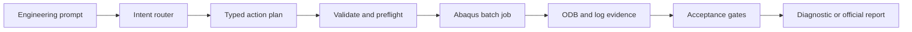

# Abaqus AI Agent

Deterministic Abaqus/CAE engineering agent. Natural language is compiled into typed actions, checked before execution, and accepted only when solver evidence and physical gates agree.

[中文文档](README_CN.md)

[](https://github.com/chenlei-gh/Abaqus-AI-Agent/actions/workflows/ci.yml)
[](https://www.python.org/)
[](https://www.3ds.com/products-services/simulia/products/abaqus/)
[](LICENSE)

This is an engineering tool, not a certified solver and not a substitute for an analyst's sign-off. Abaqus remains the solver. This repository does not ship an Abaqus license.

## What it does



1. Route a prompt into a typed engineering intent. Missing geometry, material, load, or constraint information stops with `NEEDS_CLARIFICATION`.
2. Compile supported actions into Abaqus Python. Unknown action types are rejected.
3. Run the job only when an Abaqus launcher and license are available.
4. Extract results from the ODB. Region expressions use a whitelist parser, not `eval()`.
5. Accept or block delivery from solver status, evidence, physical criteria, and an explicit deliverable flag.
6. Render one report path. A failed gate cannot be rewritten into an official deliverable.

The offline router works without an API key. TypeSafe System One (JEV) is an optional intent provider.

## What JEV is, and what it is not

JEV answers structured engineering questions: physics domain, unit system, solver family, constraint sufficiency, whether quantitative criteria exist, and a completeness score. The default endpoint is `https://api.typesafe.ai/v1/systemone` and the default model alias is `jev-latest`. Set `TYPESAFE_API_KEY`; a URL is optional. A custom HTTPS host requires an explicit trust opt-in.

JEV does **not**:

- approve code, a pull request, or a release;
- authorize a production report;
- replace Abaqus, acceptance gates, or an engineer;
- receive the full project context from `abaqus-ai-agent ask` — that command currently passes the prompt only.

`ROUTED` or `executable=true` means the intent router found enough structure to continue. It is not a physics approval. Low-confidence acceptance criteria must still be checked by the deterministic gates. If the key is absent, routing falls back to the offline rules. Draft intents are non-executable.

## Acceptance is four checks, not one exit code

A zero process exit is not an engineering pass.

| Check | Question | Failure effect |
| :--- | :--- | :--- |
| Solver state | Did the Abaqus job actually complete? | No official delivery |
| Evidence | Do the manifest, hashes, paths, and `run_id` still match? | Block or mark invalid |
| Physical gates | Do stress, reaction balance, displacement, mesh, contact, and thermal checks pass? | Fail closed |
| Delivery flag | Is `deliverable` explicitly true? | Missing flag is not a pass |

`ResultValidity` equality is strict. Reflexivity, symmetry, and transitivity are properties of that type. They are not a fifth acceptance dimension.

SHA-256 on the evidence manifest detects accidental edits, corruption, and a digest that was not recomputed. It is an integrity digest, not an HMAC and not a digital signature. Anyone who can rewrite the file can also recompute the digest. Do not describe it as non-repudiation or anti-forgery.

## Known contract boundaries

These are current code facts, not future promises.

**Model claims must match the deck.** If the caller passes `inp_text`, a declared element type or a plasticity claim that contradicts `*ELEMENT` / `*PLASTIC` forces `is_deliverable=False`. `AnalysisRunner` records deck-contract warnings on the run. A warning alone does not fail a legitimate elastic or `C3D4` model.

**Elastic stress past yield is not plasticity.** If the caller passes `elastic_validity` with a purely elastic deck, a finite yield strength, and a finite peak stress above yield, acceptance returns `RESULT_INVALID` and `deliverable=False`. The result must not be narrated as plastic deformation.

**The main path now loads the solved deck itself.** `AnalysisRunner` reads `<workdir>/<job>.inp` when it exists, records contract warnings, and builds `elastic_validity` when both yield strength and a finite extracted stress are present. `solve_requirement()` passes that deck text into `build_and_render()`. A declared element type or plasticity claim that contradicts `*ELEMENT` / `*PLASTIC` still forces `is_deliverable=False`. Peak stress and the 99.5th percentile are both reported; the percentile cannot hide the peak. A C3D4 warning does not by itself fail a legitimate model.

**The formal report file is HTML only.** `abaqus-ai-agent report` no longer accepts `--format markdown` and does not write an explicitly requested `.md` path. The gated writer also refuses Markdown, including an authorized request: it writes neither `report.md` nor `*.preview.md`. A failed gate does not create `report.html`. A diagnostic draft can only be bannered `report.diagnostic.html`. `solve_user_inp(generate_report=True)` writes neither `report.html` nor `report.md` without an Agent acceptance verdict and run record. Deleting the in-memory Markdown renderer would not stop a coding agent from writing a file with its own editor tool. That file is outside this product exit and is not an Agent deliverable.

**Tie scripts use legal Abaqus enums.** Generated `Tie` calls use `positionToleranceMethod=COMPUTED`, with a `main`/`secondary` call and a `master`/`slave` fallback. `COMPUTED_TOLERANCE` is not a legal Abaqus 2025 value and is not emitted.

**Criteria math fails closed.** Boolean values, NaN, infinities, and non-finite converted numbers are rejected. Negative limits expand in the correct direction. Relative tolerance on exact zero and on `|limit| < 1e-30` is not applied. The input bound `tolerance < 1e6` only filters absurd inputs; overflow is caught by a post-computation finiteness check. The bound is not an approved engineering tolerance.

**ODB regions fail closed.** Only whitelisted attribute and subscript syntax under `odb` is resolved. Calls, private names, and parse failures raise. They are not passed through as raw strings.

**A capability label is not this job's certificate.** `resolve_capability()` returns `qualification_level="WORKFLOW"`. That means the workflow is implemented. It does not mean this project, this run, or this machine has passed machine validation. A historical bundle marked `QUALIFIED` is not copied onto a new job.

**Self-healing does not change the problem by default.** A failed solve can be diagnosed, and proposed boundary, damping, or increment changes can be recorded. Without `confirm_model_change=True`, the agent does not add `ENCASTRE`, does not rerun, and does not replace the failed run. Mechanism models and license failures remain refused. A confirmed rerun must say what changed.

## Verification levels

Do not collapse these into one "certified" claim.

| Level | What it shows | What it does not show |
| :--- | :--- | :--- |
| Unit and contract tests | Python behavior of gates, actions, and report blocking | A live Abaqus solve |
| GitHub Actions | The CI matrix for the commit that actually ran | This README's local branch, until that commit is on the default branch and CI is green |
| Golden evidence audit | Existing evidence bundles still hash-check | A new physical solve |
| Abaqus 2025 machine run | One recorded job, ODB, and log on a licensed host | Every industrial physics capability |

Local regression on the MS13L tool-defect branch was **1373 passed** (`python -m pytest -q --tb=line`). That number is a local run, not a CI badge. CI on `main` must be read from the workflow run for that commit. Golden audit is not a machine solve. A single cantilever or handle assembly solve is not proof that contact, plasticity, thermal coupling, fatigue, and imported assemblies are all production-qualified. A workflow capability label is not that proof either.

The static cantilever production script is an integration probe. It is not a universal production certificate. Read its `require_production` setting and retained evidence before citing it.

## Quick start

Python 3.10, 3.11, or 3.12. Abaqus 2025 is required only for live solves.

```bash
git clone https://github.com/chenlei-gh/Abaqus-AI-Agent.git
cd Abaqus-AI-Agent
python -m pip install -e ".[test]"
python -m pytest -q --tb=line
```

Intent routing does not start the solver and does not authorize a report:

```bash
abaqus-ai-agent ask "Apply 1000 N downward at the tip face of a 100 mm steel cantilever, fixed at the root face" --dry-run
```

Incomplete prompts should exit 2 with a structured missing-requirement list. `ask` does not forward a project context file. To supply geometry, material, and load evidence, call `JevIntentRouter.route(prompt, context=...)` from Python.

Optional live intent provider:

```bash
# TYPESAFE_API_KEY is required for live mode.
# TYPESAFE_API_URL is optional; the official System One endpoint is the default.
abaqus-ai-agent ask "..." --mode live
```

## Repository map

```text
src/abaqus_ai_agent/
  actions/        typed Abaqus script actions and the script dispatcher
  contracts/      intent, evidence, metrics, units
  diagnostics/    solver-log and inp-contract diagnostics
  execution/      batch runner, ODB extraction, sandbox
  reporting/      single report pipeline
  typesafe_intent.py
  acceptance.py
tests/            contract and regression tests
tools/            machine probes and shadow benchmarks; not the production API
machine_validation/  audited evidence bundles; pytest and CI must not rewrite them
```

Scratch solver runs default to a user-local directory outside this repository (`%LOCALAPPDATA%\AbaqusAIAgent\runs` on Windows, `$XDG_STATE_HOME/abaqus-ai-agent/runs` elsewhere). `ABAQUS_AGENT_RUNS_DIR` can override that scratch location.

Customer delivery follows the customer directory. The formal report is `<customer directory>/delivery/report.html`, or `report.html` in an explicit `deliverables_dir`. The product does not write a Markdown engineering report, including when a caller asks for one. Delivery is not redirected to AppData and is not written into this agent repository by default. A coding agent that writes Markdown with its own file tool is outside this product exit; that file is not an Agent deliverable. `python tools/check_workspace_pollution.py` fails if `machine_validation/`, `deliverables/`, or `runs/` is dirty in git.

There are 65 supported action types in `SUPPORTED_ACTION_TYPES`. The script dispatcher is checked against that set. Do not add a second registry.

## Scope and license

Apache-2.0. See [LICENSE](LICENSE).

Commercial solver licensing, material cards, and sign-off stay with the deploying organization. Issues: <https://github.com/chenlei-gh/Abaqus-AI-Agent/issues>.

Out of scope for this README: claiming Dassault certification, claiming cryptographic anti-forgery, treating JEV output as approval, or marking an unrun Abaqus case as verified.
