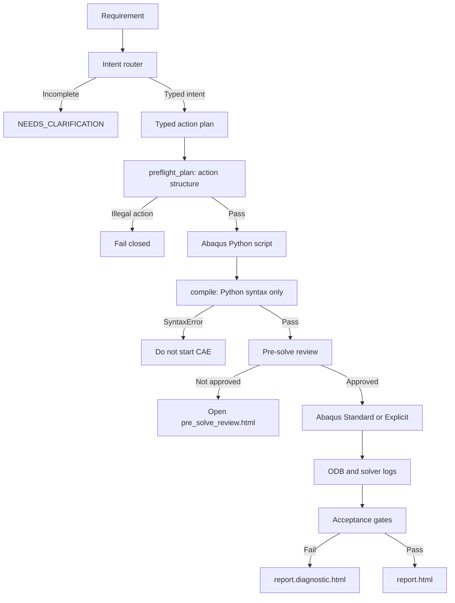

# Abaqus AI Agent

Deterministic engineering agent for Abaqus/CAE 2025. A requirement is routed into a typed action plan, checked, and submitted only after an explicit pre-solve approval. A formal report is emitted only when solver evidence and the acceptance gates agree.

[中文](README_CN.md) | [Requirements and plan](docs/PROJECT_REQUIREMENTS_AND_PLAN.md)

[](https://github.com/chenlei-gh/Abaqus-AI-Agent/actions/workflows/ci.yml)
[](https://www.python.org/)
[](https://www.3ds.com/products-services/simulia/products/abaqus/)
[](LICENSE)

This is not a certified solver and not a substitute for an analyst's sign-off. Abaqus remains the solver. This repository does not ship a license.

## Pipeline



These are separate checks. `preflight_plan()` does not parse Python. `compile()` does not check Abaqus API names, regions, units, or physics. Approval is a human gate, not a syntax gate.

| Stage | Module | Stops what | Does not decide |
|---|---|---|---|
| Intent | `typesafe_intent.py` | Missing geometry, material, BC, load, or criteria | Mesh quality or solver convergence |
| Action structure | `validation/preflight.py` | Illegal or incomplete typed actions | Python syntax |
| Script syntax | `execution/script_syntax.py` | `SyntaxError` / source `ValueError` before launch | Whether `mdb` or a region exists |
| Approval | `execution/approval_service.py` | Unapproved submission | Physical acceptability |
| Completion | `execution/batch.py` | Missing kernel sentinel on `noGUI` | Solver success |
| Acceptance | `acceptance.py` | Missing ODB evidence, imbalance, or failed criteria | That the model was the right engineering question |

`abaqus cae noGUI` has no documented syntax-check, interactive, or wait option. With `noGUI`, other command-line options are ignored. See [Abaqus/CAE Execution, 2025](https://docs.software.vt.edu/abaqusv2025/English/SIMACAEEXCRefMap/simaexc-c-caeproc.htm).

## Execution contracts

1. **No unbounded wait.** Generated solver waits use `waitForCompletion(timeOut=...)`. A bare wait is rejected.
2. **Isolated kernel namespace.** Generated fragments execute in `KernelNamespace`, not the caller's globals.
3. **Kernel sentinel, not launcher exit.** On Windows the launcher can return before `ABQcaeK.exe` finishes. `noGUI` completion is the kernel-written `completed` / `blocked` marker. A quiet workdir alone is `quiescence_only`, not proof of completion.
4. **One formal file.** A passed run writes `report.html`. A failed gate writes `report.diagnostic.html` and cannot be promoted by renaming it.
5. **Model changes stay proposals.** Diagnosis may propose a change. Re-execution requires `confirm_model_change=True`, is capped at 3 attempts, and stops immediately on a license failure. Damping and boundary changes are not applied by default.

## What is verified, and what is not

Verified on a licensed Abaqus 2025 host, for the stated cases only:

- Official cantilever, C3D20R, tip shear: deflection 6.3330 mm versus 6.4000 mm beam theory (1.05%); integration-point stress 138.89 MPa versus 138.56 MPa (0.23%). Evidence is under `machine_validation/`.
- Case 07 contact ODBs and the corrupted-ODB rejection set recorded in the same directory.
- Pre-solve approval stops submission and writes `pre_solve_review.html`. After approval, the same workdir can proceed. A content change supersedes the approval.

Not established:

- Correction time has not been shown to decrease. The JSONL recorder in `telemetry/correction.py` stores category, first-pass, diagnosis time, retry count, and extra solve time. A record is not a before/after study.
- Host `compile()` uses this environment's Python 3.14.6. Abaqus 2025 Python is 3.10.5. The gate blocks illegal Python 3; it does not prove the CAE kernel will accept the script.
- `abaqus python script.py` cannot run a script that imports CAE modules. That limitation is documented in [Executing scripts](https://docs.software.vt.edu/abaqusv2025/English/SIMACAECMDRefMap/simacmd-c-intpythonandaclexecute.htm).
- Replay is not a substitute. `replay=` continues after an error and cannot execute control flow. See [Replaying an Abaqus/CAE session](https://docs.software.vt.edu/abaqusv2025/English/SIMACAECAERefMap/simacae-c-dbsfilesreplay.htm).

Do not read a unit-test run as a live solve. `pytest` markers split `unit`, `smoke`, `acceptance`, and `live`.

## Install

Python 3.10 or newer. A licensed Abaqus 2025 installation is required only for a live solve.

```bash
git clone https://github.com/chenlei-gh/Abaqus-AI-Agent.git
cd Abaqus-AI-Agent
python -m pip install -e ".[test]"
python -m pytest tests -q -m unit
```

## API

`solve_requirement()` returns `EngineeringTaskResult`. The status is `COMPLETED`, `NEEDS_CLARIFICATION`, `BLOCKED`, `FAILED`, or `UNSUPPORTED`. There is no `is_deliverable` or `verdict` field.

```python
from abaqus_ai_agent import AbaqusAIAgent

agent = AbaqusAIAgent(executor=None)  # supply a live executor for CAE execution
result = agent.solve_requirement(
    "200 x 20 x 5 mm steel cantilever, encastre at the root, 100 N shear at the free end",
    submit_job=False,
)

print(result.status.value)
print(result.summary_card.get("status"))
print(result.summary_card.get("review_report"))
print(result.errors)
```

Default `submit_job=False`. A blocked approval does not mean the model was solved. Review `pre_solve_review.html`, approve that candidate, then rerun the same workdir. Changing the deck invalidates the approval.

```python
if result.status.value == "BLOCKED":
    raise SystemExit("submission blocked; approve the candidate before solving")

accepted = (
    result.status.value == "COMPLETED"
    and bool(getattr(result.acceptance, "passed", False))
)
```

HTML is on `result.report_html` when a report was rendered. Absence of that string is not a solver failure; read `result.errors` and `result.run.engineering_status`.

## CLI

```bash
abaqus-ai-agent ask "100 mm steel cantilever, 1000 N downward at the free end, root fixed" --dry-run --json
abaqus-ai-agent approve --workdir ./run_workdir --by "analyst name"
abaqus-ai-agent diagnose ./job_workdir --job-name Job-1
abaqus-ai-agent report ./run_evidence.json --output ./report.html
abaqus-ai-agent verify-deliverable ./run_evidence.json
```

`ask --dry-run` compiles the intent and plan. It does not submit a job. `approve --by` records a reviewer label; it is not an identity proof.

Other subcommands: `inspect`, `matrix`, `diff`, `fmbd`, `memory`, `assets`, `material`.

## Known boundary

Windows `SMALauncher.exe` can exit after spawning the CAE kernel. The sentinel covers instrumented `noGUI` scripts. An uninstrumented kernel that stops making artifacts is not a process-tree kill. `psutil` supervision would improve stall detection; it is optional and does not reduce syntax, API, or modeling errors.

## Documents

- [Requirements and plan](docs/PROJECT_REQUIREMENTS_AND_PLAN.md) is the only planning document. Update it; do not add another roadmap.
- [Machine evidence](machine_validation/)
- [Model input guide](docs/user-model-input-guide.md)
- [Test tiers](docs/test-tier-governance.md)

## License

[Apache License 2.0](LICENSE).
