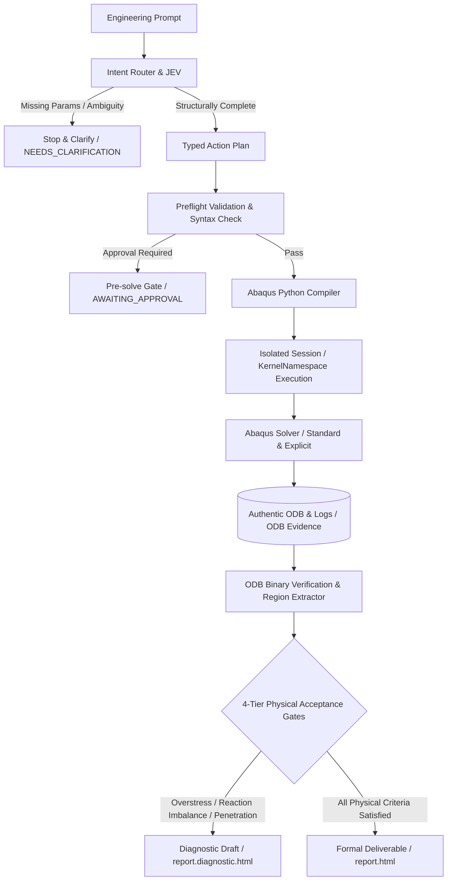

# Abaqus AI Agent

Deterministic Abaqus/CAE engineering agent. Natural language is compiled into typed actions, verified prior to execution, and accepted only when physical solver evidence and mechanical equilibrium gates agree.

[中文文档](README_CN.md) | [Master Requirements & Plan](docs/PROJECT_REQUIREMENTS_AND_PLAN.md)

[](https://github.com/chenlei-gh/Abaqus-AI-Agent/actions/workflows/ci.yml)
[](https://www.python.org/)
[](https://www.3ds.com/products-services/simulia/products/abaqus/)
[](tests/)
[](LICENSE)

> **Engineering Disclaimer**: This is an engineering decision and execution agent, not a certified solver and not a substitute for an analyst's sign-off. Commercial Abaqus remains the authoritative solver. This repository does not ship an Abaqus license.

---

## Architecture & Workflow



1. **Intent Routing**: Routes prompts into a strictly typed `EngineeringIntent`. Incomplete geometry, material, boundary conditions, or criteria reject early with `NEEDS_CLARIFICATION`.
2. **Deterministic Action Compilation**: Actions are compiled into reproducible Abaqus Python code via `compiler.py`. Unknown actions fail closed.
3. **Kernel Isolation & Sentinel Execution**: Enforces sandbox execution via `KernelNamespace` to prevent global pollution; uses a kernel-side completion sentinel contract to handle Windows launcher/kernel process separation safely.
4. **Authentic ODB Extraction**: Three-tier ODB verification (file size, header signature, structural validity). Region expressions are resolved through an AST whitelist parser—no arbitrary `eval()`.
5. **Deterministic Acceptance Gates**: Verifies solver exit, digital digest integrity, physical equilibrium (reaction force balance $< 1\%$, energy ratio, no unphysical penetration or yield detachment), and explicit deliverable authorization.
6. **Single Deliverable Channel**: Renders an integrity-stamped HTML deliverable (`report.html`). A failed gate cannot be converted into a formal deliverable.

---

## Industrial Engineering Capabilities

The agent covers the following qualified industrial FEA domains (see [`docs/PROJECT_REQUIREMENTS_AND_PLAN.md`](docs/PROJECT_REQUIREMENTS_AND_PLAN.md)):

* **Linear & Nonlinear Statics**: Geometric nonlinearity (`nlgeom=ON`), elastoplasticity, automatic incrementation.
* **Contact Mechanics**: General Contact, Surface-to-Surface, Tie constraints, Penalty friction formulation.
* **Mechanism & Assembly**: MPCs, kinematic couplings, connector elements (Revolute, Cartesian, Slot).
* **Dynamics & High-Rate Events**: Implicit dynamics (HHT), Explicit dynamics (central difference), quasi-static impact.
* **Flexible Multibody Dynamics (FMBD)**: Rigid-flexible coupled mechanisms, slider-crank linkages, large-rotation transient response.
* **Thermal & Multiphysics**: Steady/transient heat conduction, convection film conditions, radiation, coupled thermal-stress.
* **Adaptive Mesh Convergence**: Hexahedral meshing (C3D8R, C3D8I, C3D20R), localized refinement, mesh-independence convergence qualification.
* **Resource Optimization**: Host hardware core detection, 1/2/4/8 core scaling, FlexNet license token thresholding (tokens $< 5$ refuse to stall in queue).

---

## Core Engineering Contracts

| Contract | Rule & Implementation | Enforcement |
| :--- | :--- | :--- |
| **Zero Unbounded Wait** | Banned all bare `waitForCompletion()` in compiler and tools; strictly enforces `timeOut=300/600/1200` with `consistencyChecking=ON`. | Eliminates infinite process hangs from solver deadlocks. |
| **KernelNamespace Strong Isolation** | Forbids executing scripts within host `globals()`; runs exclusively inside isolated `KernelNamespace` sandboxes. | Prevents Abaqus wildcard imports from shadowing host variables, timers, or results. |
| **Kernel-Side Sentinel Contract** | In Windows, the launcher exits after spawning the kernel (compliant with 3DEXPERIENCE specs). The kernel drops a `completed/blocked` sentinel file. | Avoids false positives from premature launcher exit; fails closed if the sentinel is absent. |
| **Single HTML Deliverable Channel** | Formal deliverables are restricted to a single HTML file carrying an execution fingerprint and model snapshot hash. Markdown is deprecated for formal delivery. | Failed gates yield only a diagnostic draft (`report.diagnostic.html`). |

---

## Real-Machine Physical Validation (MV-01 ~ MV-12)

The system has undergone 12 physical validation gates on a live licensed Abaqus 2025 host (11 PASS, 1 multi-tenant commercial metering excluded by design):

* **Official Cantilever Beam Benchmark (MV-12 PASS)**:
  * Based on the official *Abaqus Scripting User's Manual* Section 8.1 benchmark using C3D20R quadratic hex elements under shear load.
  * **Tip Deflection**: FEA calculated 6.3330 mm vs. beam theory analytical solution 6.4000 mm (**1.05% relative error**).
  * **Integration Point Stress**: FEA calculated 138.89 MPa vs. analytical solution 138.56 MPa (**0.23% relative error**).
  * **Live Timing**: Launcher returned in 16.29 s, kernel completed in 17.80 s, dropping a 386 KB authentic binary ODB with valid sentinel verification.
* **Case 07 Industrial Jounce Bumper (MV-01 ~ MV-02 PASS)**:
  * Solved 3.0 MB Standard and 7.4 MB Explicit ODBs for hyperelastic/elastoplastic contact.
  * Successfully intercepted 6 synthetic corruptions (50% truncation, header corruption, zero-byte, etc.).
  * Cold extraction in 0.85 s; hot cache hit in 6.4 ms; deserialization median at 0.20 ms ($< 10\text{ ms}$).
* **Automated Test Suite**: **2558 unit and contract tests passed** with zero warnings.

---

## Getting Started

### 1. Installation
Requires Python 3.10 – 3.14. A licensed Abaqus 2025 installation is only required for live physical solves.

```bash
git clone https://github.com/chenlei-gh/Abaqus-AI-Agent.git
cd Abaqus-AI-Agent
python -m pip install -e ".[test]"
python -m pytest tests -q
```

### 2. Python API
```python
from abaqus_ai_agent import AbaqusAIAgent

agent = AbaqusAIAgent()

# Submit natural language engineering requirement
result = agent.solve_requirement(
    prompt="Apply 100 N shear load at free end of a 200x20x5 mm steel cantilever beam, encastre at root, compute deflection and Mises stress",
    workdir="./my_cantilever_run",
    generate_report=True
)

if result.is_deliverable:
    print(f"Engineering qualification passed! Formal report: {result.report_path}")
else:
    print(f"Gate rejected or clarification needed: {result.verdict}, diagnostic: {result.report_path}")
```

### 3. Command Line Interface (CLI)
```bash
# Dry-run intent routing and action compilation
abaqus-ai-agent ask "Apply 1000 N downward load at free end of 100 mm cantilever beam, fixed at root" --dry-run

# Render an audit report from existing evidence
abaqus-ai-agent report --evidence ./my_cantilever_run/run_evidence.json --output ./report.html
```

---

## Production Boundaries

1. **Process Tree Supervision Boundary (P1-LAUNCHER-01)**: On Windows, `SMALauncher.exe` exits cleanly ~1.3 s after spawning `ABQcaeK.exe`. The agent's sentinel contract reliably determines completion; if an uninstrumented custom script deadlocks in the kernel, the host relies on `waitForCompletion(timeOut=N)` to trigger kernel termination.
2. **On-Premise / Local Compute Model**: The architecture is tailored for high-trust internal engineering infrastructure, excluding public SaaS billing/metering subsystems.
3. **License Guard**: Rejects job submission if available FlexNet tokens are $< 5$ to prevent unbounded queue stalling.

---

## Project Documentation & Navigation

* **Master Requirements & Roadmap**: [`docs/PROJECT_REQUIREMENTS_AND_PLAN.md`](docs/PROJECT_REQUIREMENTS_AND_PLAN.md) (Single authoritative document for all requirements and planning)
* **Physical Validation Artifacts**: [`machine_validation/`](machine_validation/)
* **User Modeling Input Guide**: [`docs/user-model-input-guide.md`](docs/user-model-input-guide.md)
* **Test Tier Governance**: [`docs/test-tier-governance.md`](docs/test-tier-governance.md)

---

## License

Licensed under the [Apache License 2.0](LICENSE).
