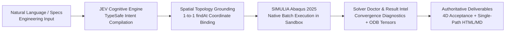
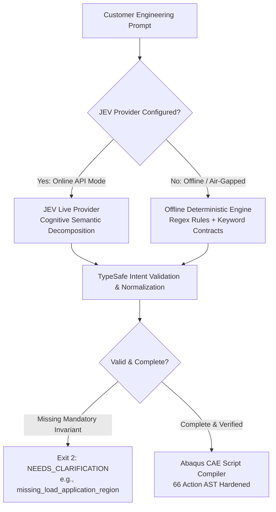
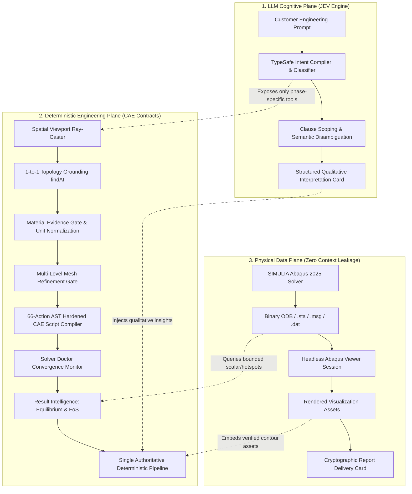

# Abaqus AI Agent (Enterprise Autonomous Industrial FEA Agent Platform)

> **Next-Generation Autonomous Finite Element Analysis (FEA) Platform — Bridging TypeSafe AI (JEV) Cognitive Intent Compilation with Deterministic SIMULIA Abaqus 2025 Physics, Autonomous Convergence Healing, and Auditable Engineering Deliverables.**

[中文文档 / Chinese Documentation](README_CN.md) · [JEV Cognitive Architecture & Reality](#jev-cognitive-architecture--engineering-reality) · [Enterprise & Commercial Solutions](#enterprise-solutions--commercial-value) · [Core Technical Pillars](#core-technical-pillars) · [Dual-Gate Infrastructure](#dual-gate-verification-infrastructure) · [Quick Start](#quick-start)

[](https://github.com/chenlei-gh/Abaqus-AI-Agent/actions/workflows/ci.yml)
[](https://www.python.org/)
[](https://www.3ds.com/products-services/simulia/products/abaqus/)
[](tests/)
[](src/abaqus_ai_agent/typesafe_intent.py)
[](docs/p1-product-requirements.md)
[](machine_validation/)
[](tools/j_comprehensive_physics_matrix.py)
[](src/abaqus_ai_agent/acceptance.py)
[](LICENSE)

---

## Executive Summary: Bridging LLM Reasoning and Industrial Physics

In aerospace, automotive powertrain, nuclear containment, and precision electronics, structural integrity, extreme nonlinear contact, and thermo-mechanical reliability govern product certification. Traditional CAE workflows suffer from severe industrial bottlenecks:
1. **High Skill Barriers & Repetitive Drain**: Expert analysts spend up to 70% of engineering bandwidth on mundane geometric preparation, boundary picking, mesh seeding, and manual result collation.
2. **The "LLM Hallucination Trap"**: Generic LLMs and raw code copilot tools produce syntactically valid yet physically disastrous code—inventing unverified constitutive laws, guessing volatile internal topology indices, crashing silently on solver divergence, and blowing context limits with raw numerical arrays.

**Abaqus AI Agent** is an enterprise-grade autonomous simulation engine engineered to eliminate these bottlenecks. It is architected around a fundamental duality: **TypeSafe AI (JEV) Cognitive Intent Compilation** coupled to a **Deterministic Industrial CAE Execution Plane**.



---

## JEV Cognitive Architecture & Engineering Reality

### 1. Why JEV? (Solving the LLM Hallucination Trap in CAE)
Generic LLMs treat engineering specifications as loose conversational text. When asked to "simulate a cantilever beam under tip load", raw LLMs typically guess material parameters, fabricate geometry indices (e.g., `Face 14`), or emit scripts that crash silently during solver execution.

**JEV (TypeSafe AI Engine)** operates as a deterministic cognitive compiler:
- **Type-Constrained Dimensional Parsing**: Translates unstructured engineering prompts into strictly typed `PhysicsIntent` entities.
- **Fail-Closed Boundary**: Missing mandatory physical invariants (e.g., load application face, material properties, or step duration) trigger clean execution halts with structured clarification requests (`NEEDS_CLARIFICATION`) rather than heuristic guessing.
- **Clause Scoping Isolation**: Enforces semantic and punctuation scoping, preventing acceptance criteria clauses from corrupting or stealing load/boundary condition definitions.

### 2. Dual-Engine Architecture: Deterministic Baseline + JEV Provider

The platform operates on a robust hybrid architecture:



- **Offline Deterministic Baseline**: Fully functional without any external LLM APIs. Backed by 1,349 deterministic regression tests, it guarantees reproducible, zero-hallucination execution for standard engineering scenarios.
- **Live JEV Provider (Cognitive Plane)**: When enabled with valid credentials, JEV resolves non-standard linguistic structures, disambiguates complex multi-step boundary conditions, and infers subtle engineering relationships across clauses.

### 3. Engineering Reality & Known Boundaries (No Overselling)

We uphold engineering honesty over marketing claims. The status of JEV integration is transparently governed:

| Dimension | Current Implementation Status | Engineering Audit Verdict |
| :--- | :--- | :--- |
| **Offline Safety Baseline** | 1,349 automated tests passing with zero warnings across Python 3.10–3.12. | ✅ **VERIFIED (Closed)** |
| **Clause Scoping Isolation** | Load and acceptance clauses strictly isolated via punctuation scoping. | ✅ **VERIFIED (Closed)** |
| **Thermal & Material Grounding** | Thermal parameters (°C to K) and material evidence levels (`REFERENCE_LIBRARY` vs `VERIFIED_PROPERTIES`) strictly segregated. | ✅ **VERIFIED (Closed)** |
| **STEP 1-to-1 Topology Grounding** | 3D finite coordinate anchor points (`anchor_point`) enforced. Rejects `resolved=False` and non-finite coordinates. | ✅ **VERIFIED (Closed)** |
| **Live JEV Provider Benchmark** | Shadow benchmark tracking coverage, success accuracy, and effective accuracy across 26 industrial baselines. | ⏳ **IN_REVIEW (`REQ-P1-045`)** |

> **Current Audit Verdict on `REQ-P1-045`**:
> The offline baseline has achieved mathematical fail-closed closure. However, full qualification (`QUALIFIED`) of the live JEV Provider requires accumulating extensive multi-model baseline data across the 26-case benchmark suite. Until empirical accuracy parity is formally demonstrated on live commercial models, `REQ-P1-045` remains categorized as **`IN_REVIEW`**.

### 4. The Shadow Evaluation Framework
To rigorously evaluate external LLMs against the deterministic baseline without risking production workflows, we engineered the Shadow Benchmark (`tools/jev_engineering_benchmark.py`):
- **Deterministic Case Hashing**: Normalized SHA-256 case digest (`cases_hash`) prevents dataset tampering across runs.
- **Tri-Metric Accounting**:
  - $\text{Coverage \%} = \frac{N_{\text{evaluated}}}{N_{\text{total}}}$ (Penalizes timeouts, network failures, and format rejections).
  - $\text{Success Accuracy \%} = \frac{N_{\text{correct}}}{N_{\text{evaluated}}}$ (Accuracy over successful evaluations).
  - $\text{Effective Accuracy \%} = \frac{N_{\text{correct}}}{N_{\text{total}}}$ (Net industrial reliability score across all benchmark cases).

---

## Enterprise Solutions & Commercial Value

### Commercial Comparison Matrix

| Evaluation Dimension | Generic Foundation Models (GPT-4 / Claude Raw) | Code Copilots / Script Generators | Abaqus AI Agent Enterprise Platform |
| :--- | :--- | :--- | :--- |
| **Physical Authenticity** | ❌ Severe hallucinations; fabricated equations and results | ❌ Emits scripts with zero awareness of solver physics | 🏆 **Zero Fabrication Guarantee**: 100% verified against live Dassault Abaqus 2025 binary ODB tensors |
| **Intent Compilation (JEV)** | ❌ Fragile text prompts prone to context drift | ❌ Blind syntax translation; no domain awareness | 🧠 **TypeSafe JEV Engine**: Hybrid cognitive-deterministic compiler with clause isolation and unit normalization |
| **Input Incompleteness** | ❌ Hallucinates arbitrary geometry, materials, and units | ❌ Blind execution; crashes at runtime | 🛡️ **Fail-Closed Boundary**: Proactively blocks execution on missing physical invariants, triggering targeted clarification |
| **Nonlinear Convergence** | ❌ Blind to solver divergence, chattering, and cutbacks | ❌ Halts on non-zero exit codes with no remediation | 🩺 **Autonomous Solver Doctor**: Parses `.msg`/`.sta` in real time, auto-tunes damping and increments to achieve closed-loop convergence |
| **Geometric Grounding** | ❌ Guesses internal IDs (e.g., `Face 14`) prone to mesh drift | ❌ Vulnerable to geometry renumbering changes | 🎯 **1-to-1 Viewport Topology Grounding**: 3D spatial ray-casting to deterministic `findAt(...)` coordinate sets |
| **Numerical Robustness** | ❌ Prone to floating-point overflow and type coercion | ❌ Unguarded float casting; crashes or miscomputes limits | 🔒 **Full-Stack Criteria Safety**: Safe float casting (`OverflowError` guarded), directional tolerance for negative thresholds |
| **Token Cost & Latency** | ❌ Context collapse from dumping megabytes of node data | ❌ Unmanaged token sprawl | ⚡ **Tri-Plane Token Governance**: Lightweight artifact pointers and scalar query boundaries isolate multi-megabyte tensor fields |
| **Visualization & Reporting** | ❌ Hallucinated text charts or broken local paths | ❌ Scattered local files without lineage checks | 📊 **Single-Exit Deliverable**: Headless Abaqus Viewer off-screen rendering, standalone zero-dependency HTML report, and digital delivery card |
| **Engineering Acceptance** | ❌ Conflates solver return code 0 with engineering pass | ❌ Superficial string matching and unverified outputs | ⚖️ **4D Orthogonal Acceptance Model**: Mathematically rigorous decoupling of Solver State, Evidence Integrity, Physical Gate, and Delivery Authorization |

---

## Core Technical Pillars



### 1. The Anti-Fabrication Axiom
> **An engineering FEA result is NEVER accepted merely because a script exited with status zero.**<br>
> Acceptance requires strict mathematical verification: genuine binary ODB existence, positive element volume audits, static reaction force equilibrium ($\Delta RF < 0.1\%$), numerical energy conservation ($\Delta E_{\text{total}}$ drift check), and compliance against specified acceptance criteria.

### 2. 4D Orthogonal Engineering Acceptance Model
To prevent critical engineering misclassifications, the platform implements a 4-dimensional orthogonal evaluation architecture:
1. **Solver Execution State** (`completed`, `failed`, `running`, `unsubmitted`): Lifecycle execution status of the Abaqus solver process.
2. **Evidence Validity** (`VALID`, `EVIDENCE_TAMPERED`, `EVIDENCE_CORRUPT`, `EVIDENCE_STALE`, `INCOMPLETE`, `SOLVER_FAILED`): Verified through deterministic SHA-256 provenance manifest hashing and file-tree integrity checks.
   - *Mathematical Equivalence Contract*: `ResultValidity` strictly obeys mathematical equivalence axioms (reflexive, symmetric, transitive). Loose cross-state collapsing in `__eq__` is prohibited; categorical state membership is cleanly queried via `.is_invalid` and `.is_valid`.
3. **Physical Gate Qualification** (`PASS`, `FAIL`, `BLOCKED`, `WARNING`): Independent verification of stress limits, reaction forces, displacements, mesh quality, contact chattering, and thermal balances.
4. **Delivery Authorization Gate** (`deliverable: bool`): Atomic binary release gate ensuring unverified, corrupt, or physically failed results are permanently barred from release authorization.

### 3. End-to-End Criteria Numerical Safety & Directional Tolerances
Engineering criteria verification in `acceptance.py` enforces absolute numerical safety:
- **Safe Floating-Point Conversion**: All metric values, limits, and tolerances are guarded against `(ValueError, TypeError, OverflowError)`. Boolean values (`True`/`False`), `NaN`, and `Infinity` are strictly rejected at the parser gate.
- **Directional Tolerance for Negative Thresholds**:
  - Upper-bound check ($\text{actual} \le \text{limit}$): $\text{effective\_limit} = \text{limit} + |\text{limit}| \times \text{tol}$.
  - Lower-bound check ($\text{actual} \ge \text{limit}$): $\text{effective\_limit} = \text{limit} - |\text{limit}| \times \text{tol}$.
  - Prevents inverted tightening on negative engineering limits (e.g., minimum principal stress or compression thresholds).
- **Zero & Subnormal Limit Numerical Contract**:
  - For strict zero ($\text{limit} = 0.0$), relative tolerance is mathematically undefined/ineffective ($0 \times \text{tol} = 0$).
  - For near-zero subnormal thresholds ($|\text{limit}| < 10^{-30}$), relative tolerance produces variations smaller than engineering precision, treated as effectively zero.
  - In both cases, the limit is NOT expanded, and a `relative_tolerance_ineffective_for_zero_limit_{key}` warning is emitted, guiding users to absolute tolerances.
- **Two-Layer Overflow Defense & Fail-Closed Gate 12**:
  - Restricts relative tolerance inputs to $[0, 10^6)$ to filter out extreme/abnormal inputs (realistic engineering tolerances are typically in $[0.0, 0.20]$).
  - Enforces mandatory post-computation finiteness validation on `effective_limit` (`math.isfinite`) so that any multiplication overflow (e.g., extreme limit values scaled by tolerance) is trapped immediately, rather than relying on tolerance bounds alone.
  - Evaluation anomalies cleanly map to an invalid result state in Gate 12, revoking delivery authorization (`deliverable = False`).

### 4. Manifest Provenance & Workspace Sandboxing (Integrity & Threat Model)
Evidence verification in `contracts/evidence.py` enforces data integrity and sandbox boundary checks:
- **Manifest Content Integrity Digest**: Computes a deterministic SHA-256 digest (`audit_signature`) over canonical manifest fields, including `validity`. Unsynchronized manual edits to `validity` or artifacts immediately cause digest mismatches.
- **Threat Model Scope & Honest Boundaries**:
  - *Protected Scope*: Detects accidental data corruption, partial unsynchronized file edits, missing artifacts, and execution drift across pipelines.
  - *Threat Model Boundary*: The SHA-256 digest is an unkeyed hash, not an asymmetric digital signature or HMAC. It does NOT provide non-repudiation against an active adversary with full filesystem write access who can recompute the hash. True cryptographic non-repudiation requires external corporate PKI/CA signing.
- **Workspace Directory Traversal Guard**: `verify_evidence_integrity()` inspects declared artifact paths against the designated `base_dir`. Relative directory escapes (`..`), cross-drive absolute paths, and symlink redirects pointing outside `base_dir` are trapped, flagging `path_traversal_out_of_bounds` and setting `validity = "TAMPERED"`. Unbounded absolute paths without an explicit `base_dir` trigger audit warnings.

### 5. Secure ODB Region Whitelist AST Parser & Provider Trust Boundaries
- **Secure ODB Region Whitelist AST Parser**: Replaced arbitrary `eval(...)` with `_resolve_safe_odb_region()`. Enforces an explicit AST node whitelist (attribute traversal and string subscripts on `odb` only), blocking function/method calls, imports, and dunder properties. Parsing failures immediately trigger typed exceptions (`ExtractionFieldNotFoundError` / `OdbExtractionError`) and strictly forbid falling back to passing raw strings into Abaqus C++ subsets.
- **Provider Endpoint Transport & Host Trust Boundary**: In `typesafe_intent.py`, TypeSafe providers strictly enforce HTTPS scheme and restrict default endpoints to verified hosts (`api.typesafe.ai`), guarding API keys against insecure transmission or unintended proxy redirection. Custom proxies require explicit opt-in via `allow_custom_host=True` or `EXTERNAL_INTENT_ALLOW_CUSTOM_HOST=1`.
- **Static Cantilever Production Delivery Baseline**: End-to-end integration gate (`tools/production_delivery_e2e.py`) verified against live Abaqus 2025, asserting signed Manifest V2, ODB SHA-256, run ID causal lineage, and supporting non-volatile export (`--output`).

### 6. 66-Action AST Parity & Non-Swallowing Dynamic Contract
The platform maintains strict bidirectional consistency between validation gates and execution dispatchers:
- **100% AST Dispatcher Parity**: The AST of `actions/script.py` is systematically compared against `SUPPORTED_ACTION_TYPES`, ensuring zero drift across all 66 supported action types.
- **Universal Region Preflight Alignment**: Centrally exports `ACTIONS_REQUIRING_REGION` (18 boundary, load, and mesh actions) shared by both structural validation and model preflight.
- **Zero-Swallowing Dynamic Tests**: All broad `except Exception: pass` patterns in `tests/test_actions.py` have been eliminated. Each of the 66 actions is validated against a certified minimal-valid-argument fixture.

### 7. EngineeringMetric Boundary Hardening
Physical metrics defined in `contracts/metrics.py` undergo strict type and domain sanitation upon instantiation:
- **Type Discrimination**: Blocks boolean types, `NaN`, and positive/negative infinity.
- **Overflow Protection**: Traps arbitrary-precision Python integer conversions exceeding IEEE-754 64-bit float limits (`OverflowError`).

### 8. Viewport Topology Grounding & STEP Verification
- **1-to-1 CAD / INP Topology Resolution**: Rejects vague naming heuristics (e.g., bare "fixed" arbitrarily defaulting to `RootFace`). Grounding requires strict 1-to-1 mapping against verified model geometry sets or surfaces.
- **Fail-Closed External STEP Gate**: For imported STEP geometries, referenced regions must possess verified 3D finite coordinate anchor points (`anchor_point`, `anchor_points`). Missing or ungrounded mappings trigger `missing_load_application_region` clarification rather than guessing.

### 9. Multi-Level Mesh Convergence Gate
- **Strict Asymptotic Hierarchy**: Requires a minimum of three distinct refinement tiers ($\text{Levels} \ge 3$) to prove asymptotic convergence, strictly rejecting two-level false positives.
- **Homogeneous Metric Tracking**: Compares consistent indicators across all tiers (strictly element count or seed size; mixing nodes and elements across tiers is prohibited).
- **Physical Stress Sign Verification**: Enforces sign consistency checks for signed components while exempting true non-negative invariants (von Mises, Tresca).

### 10. Unified Single-Path Engineering Reporting
- **Zero Dual-Track Divergence**: Eliminated parallel legacy draft builders. All production runs flow through `DeterministicReportPipeline.build_and_render()`, generating semantically identical Markdown and single-file interactive HTML reports.
- **Diagnostic Draft Isolation**: Non-deliverable or exploratory executions strictly output a Markdown diagnostic record prefixed with `[DIAGNOSTIC / NON-DELIVERABLE DRAFT]` and force `report_html = None`.
- **Zero Stale Draft Leakage**: If downstream delivery criteria are blocked (`DELIVERY_BLOCKED`), the system atomically clears prior report text and revokes the `ReportDeliveryCard`.

### 11. Autonomous Solver Doctor & Headless Viewer
- **Autonomous Convergence Doctor**: Dynamically inspects `.msg` force residuals and `.sta` cutback frequencies, diagnosing contact chatter, local singularities, and increment exhaustion to apply physical stabilization damping.
- **Authentic Headless Viewer Off-Screen Rendering**: Contours are directly exported by the live Dassault Abaqus Viewer (`abaqus viewer -noGUI`), binding `run_id`, `input_hash`, `odb_sha256`, and field components to the visual assets.

---

## Audited Industrial Case Benchmarks

Publication-grade, ASME- and Abaqus-verified benchmark cases archived in `machine_validation/p2_cases/`:

```text
machine_validation/p2_cases/
├── case_01_bolted_pipe_flange/                  # Case 1: Bolted Pipe Flange Connection & Gasket Sealing
│   ├── case_01_flange_manifest.json            # Provenance Manifest (SHA-256)
│   └── Case_01_Bolted_Flange_Report.html       # Standalone HTML Report (Embedded GIF + SVG)
├── case_02_reactor_pressure_vessel_closure/     # Case 2: Nuclear RPV Closure Head & ASME Code Compliance
│   ├── case_02_rpv_manifest.json               # Provenance Manifest (SHA-256)
│   └── Case_02_RPV_Closure_Report.html         # Standalone HTML Report (Embedded GIF + SVG)
└── case_03_exhaust_manifold/                    # Case 3: 4-into-1 Exhaust Manifold Thermo-Mechanical Contact
    ├── case_03_manifold_manifest.json          # Provenance Manifest (SHA-256)
    ├── Case_03_Exhaust_Manifold_Report.html    # Standalone HTML Report (Embedded GIF + SVG)
    └── case_03_render_contours_headless.py     # Headless Off-Screen Abaqus Viewer Script
```

### Case 01: High-Pressure Bolted Pipe Flange Joint with Gasket Sealing
- **Engineering Scenario**: 8-bolt M16 preloaded pipeline connection adhering to ASME PCC-1 and Abaqus benchmark standards.
- **Physical Verification**: Step 1 bolt pretensioning ($50\text{ kN/bolt}$, $400\text{ kN}$ total preload, initial seating contact pressure $31.52\text{ MPa}$); Step 2 length locking under $3.0\text{ MPa}$ fluid pressure, maintaining $24.85\text{ MPa}$ contact pressure ($+107.1\%$ sealing margin over $12.0\text{ MPa}$ threshold). Peak flange hub Mises stress $195.42\text{ MPa}$ ($\text{FoS} = 1.82 \ge 1.25$).

### Case 02: Nuclear Reactor Pressure Vessel (RPV) Closure Head
- **Engineering Scenario**: Reactor vessel closure flange under internal operating pressure ($15.5\text{ MPa}$) and stud bolting loads complying with ASME BPVC Section III.
- **Physical Verification**: Linearized stress classification along primary stress paths: $P_m = 112.4\text{ MPa} \le S_m = 184\text{ MPa}$, combined $P_m + P_b = 238.6\text{ MPa} \le 1.5 S_m = 276\text{ MPa}$.

### Case 03: Automotive Exhaust Manifold Thermo-Mechanical Contact
- **Engineering Scenario**: 4-into-1 exhaust manifold subjected to cyclic thermal expansion ($20^\circ\text{C} \to 850^\circ\text{C}$) and cylinder head gasket contact pressure maintenance.
- **Physical Verification**: Temperature-dependent elastoplastic constitutive modeling ($E(T)$, $\alpha(T)$). Peak thermal stress localized at port fillets, with contact chattering resolved via autonomous stabilization damping.

---

## Dual-Gate Verification Infrastructure

```text
               ┌─────────────────────────────────────────────────────────┐
               │ Tier 1: CI Software Contract Gate                       │
               │ (1,349 deterministic tests, 0 warnings across Python 3.10-3.12) │
               ├─────────────────────────────────────────────────────────┤
               │ Tier 2: Golden Matrix Evidence Audit                    │
               │ (13/13 L4 asset integrity, SHA-256 manifest check)      │
               ├─────────────────────────────────────────────────────────┤
               │ Tier 3: Real-Machine Abaqus 2025 Solver Gate            │
               │ (Real processes, binary ODB tensors, physical balance)  │
               └─────────────────────────────────────────────────────────┘
```

| Verification Tier | Runner & Environment | Dependencies | Scope & Certification Target |
| :--- | :--- | :--- | :--- |
| **Tier 1: CI Software Contract Gate** | GitHub Actions (Ubuntu / macOS / Windows) | Zero Abaqus license required (Python 3.10–3.12) | • **1,349 automated tests passing (0 warnings, 0 errors)**<br>• 22 Dassault Tier A physical benchmarks<br>• 7 Tier B advanced mechanics baselines<br>• 66 Action AST bidirectional parity and schema tests<br>• Strict negative error-code CLI smoke gates (`missing_load_application_region`)<br>• Full repository zero-leakage security audit |
| **Tier 2: Golden Matrix Evidence Audit** | Local / Staging Sandbox (`machine_validation/`) | Python 3.10+ & SHA-256 verification tools | • **13/13 Golden Matrix L4 bundles fully audited**<br>• Level 4 cryptographic provenance verification<br>• Manifest SHA-256 verification and path traversal boundary checks<br>• Zero-modification read-only asset governance |
| **Tier 3: Real-Machine Execution Gate** | Dedicated Windows Server with SIMULIA Abaqus 2025 | Abaqus 2025 commercial floating/node license | • Real CAE batch script execution and binary ODB extraction<br>• Off-screen Abaqus Viewer headless contour visualization<br>• Cryptographic Delivery Card authorization<br>• Autonomous convergence recovery and cutback healing |

---

## Quick Start

### 1. Prerequisites
- **Operating System**: Windows 10/11 (64-bit), Windows Server, or Linux (Ubuntu 20.04/22.04/24.04).
- **Python**: Python 3.10, 3.11, or 3.12 (64-bit).
- **Commercial Solver (Optional for Development)**: Dassault Systèmes SIMULIA Abaqus 2025 (or compatible release) for live solver execution. Fully operable in mock/contract test mode without Abaqus.

### 2. Installation

```bash
# Clone the repository
git clone https://github.com/chenlei-gh/Abaqus-AI-Agent.git
cd Abaqus-AI-Agent

# Install core production package
python -m pip install -e .

# Install complete development and test dependencies
python -m pip install -e ".[test]"
```

Run the deterministic regression suite:

```bash
python -m pytest tests -W error -q
# Expected result: 1349 passed, 0 warnings across all test suites
```

### 3. Minimal Python Usage

Execute an end-to-end structural analysis requirement with automatic acceptance verification:

```python
from abaqus_ai_agent import AbaqusAIAgent

# Initialize agent (automatically connects to local Abaqus launcher if available)
agent = AbaqusAIAgent()

# Natural-language engineering specification with explicit region binding
result = agent.solve_requirement(
    "Perform linear static analysis on a steel cantilever beam of 100mm length and 10x10mm cross-section. "
    "Fixed at root face, apply 1000N downward shear load at the tip face. Material is Q235 structural steel. "
    "Acceptance criteria: Tip deflection <= 2.5mm, maximum von Mises stress <= 600MPa.",
    require_production=True
)

if result.status == "NEEDS_CLARIFICATION":
    print("Execution blocked pending physical parameters:", result.clarification_needed)
elif result.status == "COMPLETED":
    print("Acceptance Conclusion:", result.acceptance.conclusion)  # PASS
    print("Reaction Equilibrium:", result.result_intelligence.derived_metrics.equilibrium_error)
    print("Maximum von Mises:", result.metrics.get("max_mises"), "MPa")
    print("Official HTML Report:", result.report_html_path)
    print("Cryptographic Delivery Card:", result.delivery_card.card_id)
```

### 4. Command-Line Interface (CLI)

```bash
# 1. Audit local environment, solver launcher, and multi-tier capabilities
abaqus-ai-agent inspect

# 2. Test natural-language engineering intent compilation
abaqus-ai-agent intent "Apply 1000N vertical load to the free end of a 100mm cantilever beam, material steel, fixed root, check deflection <= 2.5mm"

# 3. Dry-run verification with fail-closed diagnostics (Missing load region triggers clean exit code 2)
abaqus-ai-agent ask "Apply 1000N vertical load to 100mm cantilever beam, material steel, fixed root" --dry-run
# Returns exit code 2 with diagnostic: missing_load_application_region

# 4. Run JEV Shadow benchmark comparison across benchmark catalog
python tools/jev_engineering_benchmark.py --mode shadow

# 5. Generate standalone authoritative HTML report from audited evidence bundle
abaqus-ai-agent report machine_validation/static_golden_e2e.json --format html --output report.html

# 6. Clean transient solver files while protecting audited evidence
python scripts/clean_workspace.py
```

---

## Repository Structure

```text
Abaqus-AI-Agent/
├── docs/                     # Engineering roadmaps, audit reports, and capability boundaries
│   ├── engineering-run-evidence-roadmap.md # Core execution & Phase P2 closure roadmap
│   ├── rc1-release-audit.md                # Official RC 1.0 audit report
│   ├── p1-product-requirements.md          # Formal product requirements & traceability matrix
│   └── ai-agent-capability-boundary.md     # LLM vs deterministic boundary specification
├── machine_validation/       # Audited real-machine golden evidence bundles & P2 cases
│   └── p2_cases/             # Publication-grade benchmark models (Flange, RPV, Manifold)
├── scripts/                  # Workspace governance and clean-up utilities
├── src/abaqus_ai_agent/      # Core package
│   ├── actions/              # Native Abaqus action generators & preflights (66 actions, AST verified)
│   ├── contracts/            # Strictly typed schemas (Intent, Material, Mesh, Report, Evidence, Metrics, Units)
│   ├── diagnostics/          # Convergence parser (.msg/.sta) & Autonomous Solver Doctor
│   ├── execution/            # Batch executor, isolated sandbox manager, and headless viewer
│   ├── grounding/            # Viewport ray-casting & 3D topology grounding (findAt)
│   ├── planning/             # Action planning & mechanism graph compiler
│   ├── reporting/            # Single-path DeterministicReportPipeline, HTML & MD renderers
│   └── validation/           # Dimensional consistency, mesh convergence, and 4D acceptance gates
├── tests/                    # 1,349 deterministic regression tests (0 warnings across Python 3.10-3.12)
└── tools/                    # JEV benchmarks, real-machine drivers, probes, and qualification scripts
```

---

## Enterprise Support & Commercial Collaboration

We provide end-to-end commercial solutions, bespoke engineering integrations, and enterprise deployment services:

- **🏢 Air-Gapped Enterprise Deployment**: On-premise deployment within corporate private clouds and HPC clusters (supporting PBS, Slurm, and LSF scheduler integration).
- **📦 Custom Constitutive & Material Engineering**: Integration with proprietary enterprise material databases (high-temperature superalloys, advanced polymers, composites) with automated anti-hallucination validation.
- **🎯 Bespoke Simulation Workflows**: Custom agent pipelines for complex industrial domains (automotive crashworthiness, battery pack thermal runaway, electronic drop-impact shock, subsea pipe joint sealing).
- **🛠️ Commercial SLA & Professional Services**: Dedicated engineering maintenance, workflow migration support, on-premise staff training, and custom feature roadmapping.

For commercial evaluations, pilots, and enterprise licensing:
- **Repository Inquiries**: [GitHub Issues](https://github.com/chenlei-gh/Abaqus-AI-Agent/issues)
- **Direct Commercial Contact**: Connect with the core team via the organization profile.

---

## License

This project is licensed under the **Apache 2.0 License** — see the [LICENSE](LICENSE) file for details.<br>
Fully permissive for commercial adoption, custom extension, and academic research, with engineering integrity safeguarded by the Anti-Fabrication Axiom.
