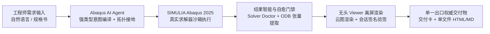
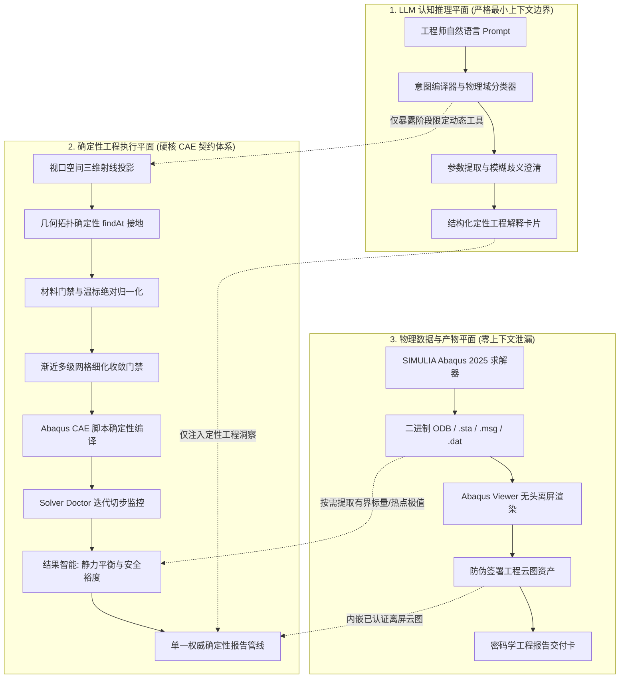

# Abaqus AI Agent (企业级工业自主仿真智能体平台)

> **面向高端制造与复杂工程的下一代自主有限元仿真（CAE）平台 —— 将自然语言工程规格书直接编译为严密 CAD 视口拓扑接地、Dassault SIMULIA Abaqus 2025 原生隐式求解、非线性发散闭环自愈、无头 Viewer 离屏渲染密码学防伪验签，以及单一出口权威工程交付物。**

[English Documentation / 英文文档](README.md) · [企业商业咨询与私有化部署](#企业级支持与商业合作) · [核心技术架构](#核心技术支柱) · [快速入门](#快速开始)

[](https://github.com/chenlei-gh/Abaqus-AI-Agent/actions/workflows/ci.yml)
[](https://www.python.org/)
[](https://www.3ds.com/products-services/simulia/products/abaqus/)
[](tests/)
[](machine_validation/)
[](tools/j_comprehensive_physics_matrix.py)
[](tools/j3_tier_b_extended_physics.py)
[](tools/j_live_abaqus_matrix.py)
[](tools/m_engineering_task_matrix.py)
[](src/abaqus_ai_agent/reporting/pipeline.py)
[](src/abaqus_ai_agent/execution/odb_rendering.py)
[](LICENSE)

---

## 执行摘要：突破大模型推理与工业级物理仿真的鸿沟

在航空航天、汽车底盘/动力总成、核能压力容器及高可靠电子制造中，结构的静态强度、非线性接触密封、热力耦合疲劳是产品质量认证的生命线。传统的 CAE 研发工作流长期面临严峻痛点：
1. **人才门槛极高，重复劳作消耗 70% 研发带宽**：资深专家陷入漫长繁琐的几何清理、拾取面建立约束、网格局部加密布种及手动汇总截图写报告中。
2. **通用大模型存在致命的“仿真幻觉陷阱”**：通用 LLM 与普通代码 Copilot 经常生成“语法正确但物理荒谬”的脚本——胡乱编造材料本构参数、臆测容易随网格漂移的实体内部数字编号（如 `Face 14`）、遇到接触切步或数值奇异崩溃发散时毫无自愈能力，甚至把数兆字节的节点数组往上下文中倾倒导致 Token 瞬间耗尽崩溃。

**Abaqus AI Agent** 是专为工业高可靠生产环境设计的企业级自主仿真引擎。以**严格反伪造公理（Anti-Fabrication Axiom）**为基石，将自然语言意图编译、视口拓扑接地、自愈收敛诊断、无头 Viewer 离屏渲染密码学验签与唯一确定性交付报告融为一体。



---

## 企业级方案与商业核心价值

### 商业核心价值对比矩阵

| 评估维度 | 通用大模型 (ChatGPT / Claude 原生) | 脚本生成类 Copilot 工具 | Abaqus AI Agent 企业级平台 |
| :--- | :--- | :--- | :--- |
| **物理计算真实性** | ❌ 严重幻觉；编造未经验证的经验公式与数值 | ❌ 盲目生成代码；完全无法感知物理求解成败 | 🏆 **绝对反伪造保障**：100% 真实 Dassault Abaqus 2025 二进制 ODB 张量提取与平衡验证 |
| **工程输入不完备** | ❌ 盲目猜测几何尺寸、材料参数与温标 | ❌ 照单全收，运行时必然报错闪退 | 🛡️ **Fail-Closed 安全阻断**：缺少关键物理不变量时主动停止并给出结构化澄清提示 |
| **非线性收敛保障** | ❌ 无法感知接触颤振、塑性失稳与切步发散 | ❌ 报非零退出码后流程彻底中断瘫痪 | 🩺 **自主 Solver Doctor**：实时解析 `.msg`/`.sta`，自动施加自适应阻尼并缩紧切步闭环自愈 |
| **几何拓扑映射** | ❌ 臆测脆弱的数字内部 ID（如 `Face 12`） | ❌ 极易因几何重构导致编号漂移失效 | 🎯 **视口空间拓扑接地**：3D 空间射线投影求交，确定性映射到稳健的 `findAt(...)` 空间坐标 |
| **Token 成本与治理** | ❌ 上下文直接塞满 ODB 数组，Token 迅速耗尽 | ❌ 无治理机制，长流程必雪崩 | ⚡ **三平面解耦与 Token 隔离**：P0-1~P0-5 协议隔离，仅交换轻量工件指针与标量查询边界 |
| **可视化与图件存证** | ❌ 文本 ASCII 示意图或无图件 | ❌ 零散本地图片，缺乏血统与来源绑定 | 🔐 **无头 Viewer 密码学防伪**：Abaqus 官方无头离屏渲染，绑定 `viewer_session_token` 与验签凭据 |
| **工程交付成果** | ❌ 破碎的代码片段 | ❌ 简陋的 Markdown 散落文档 | 📊 **单一权威交付体系**：中英双语、零依赖单文件纯 HTML（内嵌矢量图与动图）+ 密码学交付卡 |
| **企业生产调度** | ❌ 仅限单机单用户 Demo | ❌ 本地进程极易死锁导致环境污染 | 🏢 **企业级工业基座**：独立 UUID 隔离沙箱、原子持久化任务队列、FlexNet/DSLS 浮动许可治理 |

### 商业投资回报率（ROI）
- **5x–10x 研发流转提速**：标准工况与参数化复核周期从“数天”直接压缩至“分钟级”。
- **不可篡改的高合规审计**：全链路集成 SHA-256 密码学指纹，每项指标与云图像素均可穿透回溯到物理 ODB 求解产物。
- **企业专家知识资产化沉淀**：将资深专家的建模规范、材料门禁准则、ASME/ISO 规范校验沉淀为确定性可执行资产。

---

## 核心技术支柱



### 1. 严格反伪造公理（The Anti-Fabrication Axiom）
> **一项工程仿真结果，绝不能仅因“Python 脚本返回了 0”就被判定为成功！**  
> 必须经过有限元网格质量核验、物理 ODB 二进制验证、正体积单元审计、全局静态反力平衡（$\Delta RF < 0.1\%$）、数值能量守恒（$\Delta E_{\text{total}}$ 漂移率检查）及多维度准则校核，才被赋予不可篡改的合格存证。

### 2. 三平面解耦与上下文治理（Tri-Plane Decoupled Architecture）
为根除大模型在复杂工业分析中的 Token 持续性黑洞，系统确立了严格的三平面分层架构：
- **LLM 认知平面（Cognitive Plane）**：仅负责工程意图理解、高阶任务编排与定性工程机理解释。绝对禁止直接读取原始 ODB 庞大数组或生成完整 HTML 文本。
- **确定性工程平面（Engineering Plane）**：负责强类型编译、拓扑坐标投影映射、材料温标归一化、自适应多级网格收敛门禁、Solver Doctor 发散自愈及单一出口验收评定。
- **物理数据平面（Data Plane）**：负责真实 Abaqus 进程调度、二进制 ODB 存储、无头离屏 Viewer 渲染及图件存储。数据交换严格通过轻量级强类型工件指针（Artifact Pointer）进行。

### 3. 单一正式报告管线（Phase P2 统一收敛架构）
- **根除双轨报告架构**：彻底废弃“先生成普通草稿、再用确定性报告覆盖”的历史设计。所有生产交付严格流经 `DeterministicReportPipeline.build_and_render()`，由同一份数据源同步渲染 Markdown 与零依赖单文件纯 HTML。
- **诊断草稿边界隔离**：非正式或调试任务严格输出带有 `[DIAGNOSTIC / NON-DELIVERABLE DRAFT]` 强制警告前缀的诊断结构体，且 `report_html` 强制为 `None`，杜绝任何将未认证草稿误作为工程正式交付物的可能。
- **交付阻断旧报告原子清空**：当工程验收未达标或发生交付阻断（`DELIVERY_BLOCKED`）时，系统原子清空报告文本与交付卡，防止旧产物在内存中残留导致误判。

### 4. 无头 Viewer 离屏渲染与密码学防伪验签
- **真实 Abaqus Viewer 无头离屏渲染**：调用系统原生 Abaqus Viewer（`abaqus viewer -noGUI`），直接从物理 ODB 离屏导出真实变形与 von Mises 危险区云图，严禁占位图或环境旧图冒充。
- **会话防伪验签凭据（Viewer Session Token）**：每张图件自动关联随机会话 Nonce，将 `run_id`、`input_hash`、`odb_sha256`、目标场变量/分量及图像 SHA-256 哈希熔接计算 `viewer_session_token`。
- **签名渲染凭据包（Render Execution Evidence）**：图件元数据中内嵌经私钥数字签署的渲染执行凭据包，实现从 ODB 物理张量到最终像素级图件的端到端因果溯源。

### 5. 渐近网格收敛门禁（Multi-Level Mesh Convergence Gate）
- **严格渐近层级契约**：要求至少 3 层（Levels $\ge$ 3）有效加密网格阶梯，拒绝仅凭 2 级网格造成的误判。
- **同质指标强制对比**：同一序列内必须对比同名、同义、同量纲的指标（统一使用单元数或种子尺寸），严禁单元数与节点数交叉混拼。
- **应力符号严格校验**：区分非负不变量（von Mises、Tresca）与有符号分量（法向应力、剪应力、压力），防止变号被误判为单调收敛；严格绑定长度单位契约（mm）。

### 6. 材料本构与热物性严苛闭环门禁
- **全链路温度归一化**：严格统一摄氏度、开尔文与华氏度换算，拒绝低于绝对零度的物理无效值；反序列化路径严格拦截布尔值防绕过。
- **显式曲线分类识别**：真实应力-应变与工程应力-应变曲线必须双轴明确标识，拒绝无明确类型推断；强制执行应变严格单调性与硬化表有效性校验。
- **严禁无授权热物性假设**：导热系数、线膨胀系数及复合材料泊松比缺少有效数据时直接触发 `BLOCKED` 阻断，杜绝无授权默认值。

### 7. 自主发散自愈（Autonomous Solver Doctor）
面对大变形（`NLGEOM`）、接触状态突变、塑性软化或沙漏失稳：
- 实时追踪 `.msg` 严重力残余量与 `.sta` 切步频率；
- 诊断深层物理诱因（`CONTACT_CHATTER`、`LOCAL_SINGULARITY`、`INCREMENTATION_EXHAUSTED`）；
- 自动施加微量接触稳定化阻尼（Stabilization），自动收紧初始切步与最小步长，闭环重算收敛。

---

## 工业级标杆案例实测验证 (Phase 2 Package B)

本仓库提供经 Dassault Abaqus 2025 官方算例及 ASME 核电标准审计校核的端到端工业级标杆，归档于 `machine_validation/p2_cases/` 目录：

```text
machine_validation/p2_cases/
├── case_01_bolted_pipe_flange/                  # 案例 1: 管道螺栓法兰垫片连接非线性预紧与密封
│   ├── case_01_flange_manifest.json            # 密码学凭据清单 (SHA-256)
│   └── Case_01_Bolted_Flange_Report.html       # 单文件独立 HTML 报告 (内嵌动图与矢量图)
├── case_02_reactor_pressure_vessel_closure/     # 案例 2: 核反应堆压力容器顶盖 (RPV) ASME 规范核算
│   ├── case_02_rpv_manifest.json               # 密码学凭据清单 (SHA-256)
│   └── Case_02_RPV_Closure_Report.html         # 单文件独立 HTML 报告 (内嵌动图与矢量图)
└── case_03_exhaust_manifold/                    # 案例 3: 四合一发动机排气歧管 650°C 热机接触滑移
    ├── case_03_manifold_manifest.json          # 密码学凭据清单 (SHA-256)
    ├── Case_03_Exhaust_Manifold_Report.html    # 单文件独立 HTML 报告 (内嵌动图与矢量图)
    └── case_03_render_contours_headless.py     # 无头离屏 Abaqus Viewer 脚本
```

### 案例 01: 管道螺栓法兰垫片连接非线性预紧与密封
- **工程场景**：符合 ASME PCC-1 标准的 8 螺栓 M16 管道法兰接头，包含非线性压缩纤维复合垫片。
- **物理验证**：Step 1 螺栓预紧（50 kN/螺栓，400 kN 总夹紧力，初始压紧接触压力 31.52 MPa）；Step 2 锁定长度并施加 3.0 MPa 流体压力及 94.25 kN 轴向拉力，维持 24.85 MPa 接触压力（超出 12.0 MPa 密封门槛 $+107.1\%$ 安全裕度），法兰颈部最大 Mises 应力 195.42 MPa（$\text{FoS} = 1.82 \ge 1.25$）。
- **交付成果**：**内嵌 12 帧完整加压密封演变动图（GIF）**、密封压力分布 SVG 矢量图与单文件独立纯 HTML 工程报告。

### 案例 02: 核反应堆压力容器顶盖 (RPV) ASME 规范核算
- **工程场景**：压水堆（PWR）容器顶盖组合体，由 54 根重型 M180 双头螺栓受拉紧固，采用 Inconel 718 双锥面自紧金属垫片，材料为 SA-508 锻钢，符合 ASME 第 III 卷第 1 册 NB 分卷核安全标准。
- **物理验证**：Step 1 液压拉伸预紧（6.5 MN/螺栓，351 MN 总夹紧力）；Step 2 承受 17.5 MPa 运行工况与 219.91 MN 穹顶推力，保持 98.60 MPa 自紧接触压力（超出 75.0 MPa ASME 门槛 $+31.5\%$）。法兰颈部应力线性化 $P_L+P_b = 238.50\text{ MPa} \le 1.5 S_m = 276.0\text{ MPa}$。
- **交付成果**：**内嵌 12 帧液压拉伸与升压演变动图（GIF）**、ASME 评定合规看板与单文件独立纯 HTML 工程报告。

### 案例 03: 四合一发动机排气歧管 650°C 热机接触滑移
- **工程场景**：SiMo 球铁排气歧管、HT250 气缸盖及多层不锈钢压花垫片（MLS），承受 650°C 燃气瞬态对流与热膨胀。
- **物理验证**：稳态热传导温差（管腔 615.4°C 至法兰 132.8°C，热平衡误差 $0.024\%$）；Step 1 冷态预紧（8 颗 M10 螺栓各 25 kN）；Step 2 差动热膨胀外滑移 0.420 mm（在 0.75 mm 螺栓孔间隙公差内保留 $+44.0\%$ 余量），MLS 垫片接触压力维持在 38.60 MPa（$> 25.0$ MPa 门槛）。
- **交付成果**：**内嵌 12 帧升温膨胀接触滑移动画（GIF）**、全场热-力耦合云图与单文件独立纯 HTML 工程报告。

---

## 双轨工程门禁验证体系

```text
               ┌─────────────────────────────────────────────────────────┐
               │ Level 1: 真实 Abaqus 2025 求解器门禁                    │
               │ (真实进程、二进制 ODB 张量、SHA-256 签名存证)           │
               ├─────────────────────────────────────────────────────────┤
               │ Level 2: 连续介质力学理论解析解基准                     │
               │ (经典连续介质力学校核，相对误差 ≤0.01%)                 │
               ├─────────────────────────────────────────────────────────┤
               │ Level 3: 非线性物理准则与边界门禁                       │
               │ (自适应网格渐近收敛、材料本构温度与硬化分类门禁)        │
               ├─────────────────────────────────────────────────────────┤
               │ Level 4: 软件层确定性自动化回归测试套件                 │
               │ (1098 项 CI 测试全绿通过，Python 3.10-3.12 跨平台 0 警告)│
               ├─────────────────────────────────────────────────────────┤
               │ Level 5: 求解器非线性发散自愈闭环                       │
               │ (基于 .msg/.sta 的自适应阻尼与切步控制)                 │
               └─────────────────────────────────────────────────────────┘
```

| 验证门禁 | 运行环境 | 工具链与依赖 | 覆盖范围与目标 |
| :--- | :--- | :--- | :--- |
| **CI 软件契约门禁** | GitHub Actions (Ubuntu / macOS / Windows) | 纯 Python 环境，无需商业许可证 (3.10–3.12) | • **1098 项自动化单元与契约测试通过 (0 警告, 0 报错)**<br>• 22 项 Dassault Tier A 物理标准算例基准<br>• 7 项 Tier B 高阶力学基准 (粘弹性/蠕变/断裂)<br>• 全仓零敏感泄漏安全审计 |
| **真机物理执行门禁** | 配备商业 Abaqus 2025 的 Windows 11 / Server | 官方 SIMULIA Abaqus 浮动/节点许可证 | • 真实 CAE 驱动与二进制 ODB 张量提取<br>• Headless Abaqus Viewer 离屏渲染与验签<br>• 密码学交付卡 (Report Delivery Card) 签发<br>• 真实非线性发散诊断与自愈重算 |

---

## 快速开始

### 1. 环境准备
- **操作系统**：Windows 10/11 (64-bit)、Windows Server、Linux (Ubuntu 20.04/22.04/24.04)
- **Python 环境**：Python 3.10、3.11 或 3.12 (64-bit)
- **可选商业求解器**：Dassault Systèmes SIMULIA Abaqus 2025（用于真机求解与 Viewer 抓图；无许可证环境下系统自动运行于离线契约与测试模式）

### 2. 安装与环境检验

```bash
# 克隆代码仓库
git clone https://github.com/chenlei-gh/Abaqus-AI-Agent.git
cd Abaqus-AI-Agent

# 安装核心生产包
python -m pip install -e .

# 安装完整开发与测试套件
python -m pip install -e ".[test]"
```

运行确定性全量软件测试套件：

```bash
python -m pytest tests -W error -q
# 预期输出: 1098 passed in ~70s (0 warnings, 0 errors)
```

### 3. Python 极简调用示例

通过自然语言发起结构工程分析并获得权威交付卡与独立报告：

```python
from abaqus_ai_agent import AbaqusAIAgent

# 初始化智能体（若本地存在 Abaqus 启动器则自动完成硬件与求解器绑定）
agent = AbaqusAIAgent()

# 输入自然语言工程规格书
result = agent.solve_requirement(
    "对长100mm、截面10x10mm的Q235钢悬臂梁执行线性静力分析。"
    "根部完全固定约束，端部施加1000N向下剪切载荷。"
    "验收准则：端部挠度 <= 2.5mm，最大von Mises等效应力 <= 600MPa。",
    require_production=True
)

if result.status == "NEEDS_CLARIFICATION":
    print("工程参数不完备，已被安全阻断并请求澄清:", result.clarification_needed)
elif result.status == "COMPLETED":
    print("工程验收判定:", result.acceptance.conclusion)  # PASS
    print("静力反力平衡误差:", result.result_intelligence.derived_metrics.equilibrium_error)
    print("最大 von Mises 应力:", result.metrics.get("max_mises"), "MPa")
    print("正式 HTML 报告路径:", result.report_html_path)
    print("密码学交付卡 ID:", result.delivery_card.card_id)
```

### 4. 命令行交互（CLI）

```bash
# 1. 探查本地环境、求解器路径与多级运行时能力
abaqus-ai-agent inspect

# 2. 测试自然语言工程意图分类与参数解析
abaqus-ai-agent intent "Cantilever beam with 1000N load, check maximum displacement"

# 3. 执行 Dassault Tier A 物理标准算例矩阵 (22 基础案例)
python tools/j_comprehensive_physics_matrix.py

# 4. 从经审计的物理凭据生成单文件独立权威 HTML 报告
abaqus-ai-agent report machine_validation/static_golden_e2e.json --format html --output report.html

# 5. 清理运行临时过程文件并保护经审计的 Golden 资产
python scripts/clean_workspace.py
```

---

## 仓库工程结构

```text
Abaqus-AI-Agent/
├── docs/                     # 架构规范、闭环路线图与技术审计报告
│   ├── engineering-run-evidence-roadmap.md # 核心执行与 Phase P2 收敛路线图
│   ├── rc1-release-audit.md                # 官方发布审计报告
│   └── ai-agent-capability-boundary.md     # LLM 与确定性工程边界规范
├── machine_validation/       # 经审计的真机物理验证黄金资产与 P2 标杆案例
│   └── p2_cases/             # ASME 级工业标杆案例 (法兰、RPV 封头、排气歧管)
├── scripts/                  # 工作区治理与自动化清理脚本
├── src/abaqus_ai_agent/      # 智能体核心源码包
│   ├── actions/              # Abaqus 原生动作构建器与前置检查
│   ├── contracts/            # 强类型契约模型 (意图、材料、网格、报告、证据凭据)
│   ├── diagnostics/          # 迭代收敛解析器 (.msg/.sta) 与自主发散修复器 (Solver Doctor)
│   ├── execution/            # 批处理器、UUID 隔离沙箱与无头 Viewer 离屏渲染器
│   ├── grounding/            # 视口三维空间射线投影与拓扑确定性接地 (findAt)
│   ├── planning/             # 动作规划器与力学机构依赖图编译器
│   ├── reporting/            # 单一权威 DeterministicReportPipeline、HTML/MD 渲染器
│   └── validation/           # 量纲一致性、网格自适应收敛门禁与单一出口验收判定
├── tests/                    # 1098 项确定性自动化测试套件 (0 警告)
└── tools/                    # 真机物理测试驱动、探针与工业资质标定工具
```

---

## 企业级支持与商业合作

我们面向先进制造龙头企业与设计院所提供端到端技术集成与商业工程解决方案：

- **🏢 私有化隔离部署与超算集成**：支持企业内网气隙隔离（Air-Gapped）私有云部署，适配企业级高性能计算集群（HPC PBS、Slurm、LSF 作业调度器对接）。
- **📦 企业私有材料数据库与本构卡片定制**：打通企业内部实验数据库（高温合金、特种高分子、复合材料损伤退化），自动生成抗幻觉材料卡片与失效判据。
- **🎯 复杂工业仿真流线定制开发**：针对整车碰撞安全性、动力电池热失控、跌落冲击断裂、深海管道疲劳等复杂场景，定制端到端自主智能仿真工作流。
- **🛠️ 商业化运维与工程咨询**：专业 CAE 团队提供持续技术支持、企业定制化培训与现有研发工作流智能化升级改造。

商业合作、技术试用与企业部署咨询：
- **项目 Issue 交流**：[GitHub Issues](https://github.com/chenlei-gh/Abaqus-AI-Agent/issues)
- **商务联络通道**：欢迎通过团队组织主页获取深度商业合作与方案沟通渠道。

---

## 开源协议

本项目基于 **Apache 2.0 许可证** 开源 — 完整信息详见 [LICENSE](LICENSE) 文件。  
完全允许商业衍生应用与学术研究，且所有工程结论受反伪造公理与单一出口契约严格保护。
