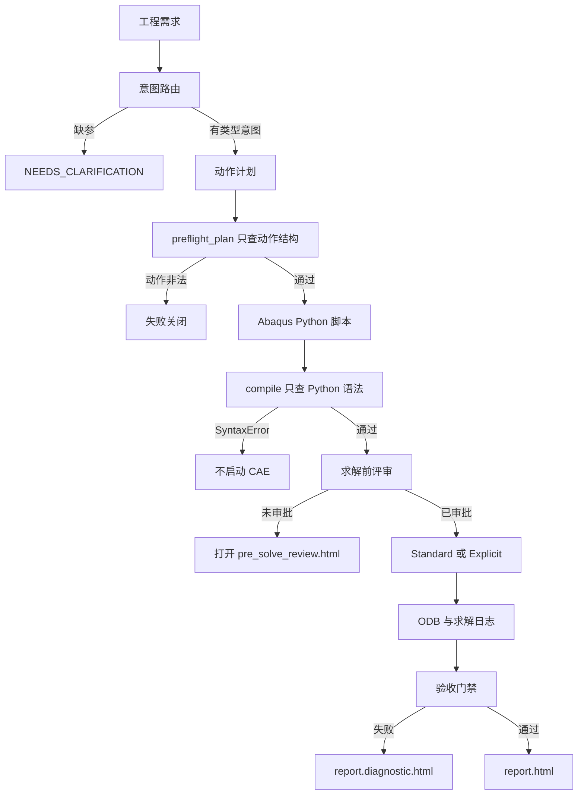

# Abaqus AI Agent

面向 Abaqus/CAE 2025 的确定性工程代理。需求先路由成有类型的动作计划，经过结构校验、语法检查和求解前审批后才允许提交。只有求解证据和验收门禁一致时，才写出正式报告。

[English](README.md) | [需求与规划](docs/PROJECT_REQUIREMENTS_AND_PLAN.md)

[](https://github.com/chenlei-gh/Abaqus-AI-Agent/actions/workflows/ci.yml)
[](https://www.python.org/)
[](https://www.3ds.com/products-services/simulia/products/abaqus/)
[](LICENSE)

本仓库不是认证求解器，也不能代替分析人员签字。求解器仍是 Abaqus。仓库不包含许可证。

## 流水线



这几步不是同一个检查。`preflight_plan()` 不解析 Python。`compile()` 不检查 Abaqus API、区域、单位或物理是否正确。审批是人工门，不是语法门。

| 阶段 | 模块 | 拦住什么 | 不判断什么 |
|---|---|---|---|
| 意图 | `typesafe_intent.py` | 几何、材料、边界、载荷或验收标准缺失 | 网格质量、收敛 |
| 动作结构 | `validation/preflight.py` | 动作类型或参数不完整 | Python 语法 |
| 脚本语法 | `execution/script_syntax.py` | 启动前的 `SyntaxError` / 源码 `ValueError` | `mdb` 或区域是否存在 |
| 审批 | `execution/approval_service.py` | 未审批就提交 | 结果是否可接受 |
| 完成信号 | `execution/batch.py` | `noGUI` 没有内核 sentinel | 求解是否成功 |
| 验收 | `acceptance.py` | ODB 证据缺失、反力不平衡、准则失败 | 这个问题本身是否提对 |

`abaqus cae noGUI` 没有文档化的语法检查、interactive 或 wait 选项。使用 `noGUI` 时，其他命令行选项会被忽略。依据：[Abaqus/CAE Execution, 2025](https://docs.software.vt.edu/abaqusv2025/English/SIMACAEEXCRefMap/simaexc-c-caeproc.htm)。

## 执行契约

1. **禁止无界等待。** 生成的求解等待必须带 `waitForCompletion(timeOut=...)`。裸等待会被拒绝。
2. **内核命名空间隔离。** 生成片段在 `KernelNamespace` 中执行，不进入调用方 globals。
3. **完成看内核 sentinel，不看启动器退出码。** Windows 上启动器可以先于 `ABQcaeK.exe` 返回。`noGUI` 的完成信号是内核写下的 `completed` / `blocked`。只有工作目录静止时，证据是 `quiescence_only`，不是脚本完成。
4. **正式文件只有一个。** 通过的运行写 `report.html`。门禁失败写 `report.diagnostic.html`，不能靠改名变成正式件。
5. **改模型默认只提案。** 诊断可以给出修改提案。重算必须显式 `confirm_model_change=True`，最多 3 次；许可证失败立即停止。默认不加阻尼、不改边界。

## 已核实与未核实

已在带许可证的 Abaqus 2025 上核实，范围只限对应算例：

- 官方悬臂梁，C3D20R，端部剪切：挠度 6.3330 mm，梁理论 6.4000 mm，相对差 1.05%；积分点应力 138.89 MPa，解析 138.56 MPa，相对差 0.23%。证据在 `machine_validation/`。
- Case 07 接触 ODB，以及同目录记录的损坏 ODB 拒绝集。
- 求解前审批会阻止提交并写出 `pre_solve_review.html`。同一工作目录审批后可以继续。模型内容变化会使原审批失效。

尚未成立：

- 不能声称纠错耗时已经下降。`telemetry/correction.py` 只把错误类别、首次通过、诊断耗时、重试次数和额外求解时间写入 JSONL。记录不是前后对照。
- 宿主 `compile()` 使用本环境 Python 3.14.6。Abaqus 2025 的 Python 是 3.10.5。语法门能拦非法 Python 3，不能证明 CAE 内核会接受该脚本。
- `abaqus python script.py` 不能运行导入 CAE 模块的脚本。依据：[Executing scripts](https://docs.software.vt.edu/abaqusv2025/English/SIMACAECMDRefMap/simacmd-c-intpythonandaclexecute.htm)。
- replay 不能替代生成脚本。`replay=` 遇错继续，且不能执行带控制流的脚本。依据：[Replaying an Abaqus/CAE session](https://docs.software.vt.edu/abaqusv2025/English/SIMACAECAERefMap/simacae-c-dbsfilesreplay.htm)。

单元测试通过不等于真机求解通过。`pytest` 标记分为 `unit`、`smoke`、`acceptance`、`live`。

## 安装

Python 3.10 及以上。只有真机求解才需要带许可证的 Abaqus 2025。

```bash
git clone https://github.com/chenlei-gh/Abaqus-AI-Agent.git
cd Abaqus-AI-Agent
python -m pip install -e ".[test]"
python -m pytest tests -q -m unit
```

## API

`solve_requirement()` 返回 `EngineeringTaskResult`。状态是 `COMPLETED`、`NEEDS_CLARIFICATION`、`BLOCKED`、`FAILED` 或 `UNSUPPORTED`。没有 `is_deliverable`，也没有 `verdict`。

```python
from abaqus_ai_agent import AbaqusAIAgent

agent = AbaqusAIAgent(executor=None)  # 真机执行时传入 live executor
result = agent.solve_requirement(
    "200 x 20 x 5 mm 钢悬臂梁，根部固定，自由端 100 N 剪切",
    submit_job=False,
)

print(result.status.value)
print(result.summary_card.get("status"))
print(result.summary_card.get("review_report"))
print(result.errors)
```

默认 `submit_job=False`。审批阻断不代表已经求解。先看 `pre_solve_review.html`，审批该候选，再在同一工作目录重跑。输入内容变化会使审批失效。

```python
if result.status.value == "BLOCKED":
    raise SystemExit("提交被阻断；求解前必须审批该候选")

accepted = (
    result.status.value == "COMPLETED"
    and bool(getattr(result.acceptance, "passed", False))
)
```

渲染成功时 HTML 在 `result.report_html`。这个字符串为空不是求解失败；失败原因看 `result.errors` 和 `result.run.engineering_status`。

## 命令行

```bash
abaqus-ai-agent ask "100 mm 钢悬臂梁，自由端向下 1000 N，根部固定" --dry-run --json
abaqus-ai-agent approve --workdir ./run_workdir --by "analyst name"
abaqus-ai-agent diagnose ./job_workdir --job-name Job-1
abaqus-ai-agent report ./run_evidence.json --output ./report.html
abaqus-ai-agent verify-deliverable ./run_evidence.json
```

`ask --dry-run` 只编译意图和计划，不提交作业。`approve --by` 记录的是审阅者标签，不是身份证明。

其余子命令：`inspect`、`matrix`、`diff`、`fmbd`、`memory`、`assets`、`material`。

## 已知边界

Windows 上 `SMALauncher.exe` 拉起 CAE 内核后可以先退出。sentinel 覆盖的是已经埋点的 `noGUI` 脚本。没有埋点、且产物不再变化的内核，当前不能靠进程树杀掉。`psutil` 进程树监督可以改进卡死检测；它是可选项，不减少语法、API 或建模理解错误。

## 文档

- [需求与规划](docs/PROJECT_REQUIREMENTS_AND_PLAN.md) 是唯一规划文档。新需求更新这一份，不再另建路线图。
- [真机证据](machine_validation/)
- [建模输入说明](docs/user-model-input-guide.md)
- [测试分级](docs/test-tier-governance.md)

## 许可证

[Apache License 2.0](LICENSE)。
