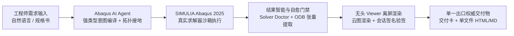
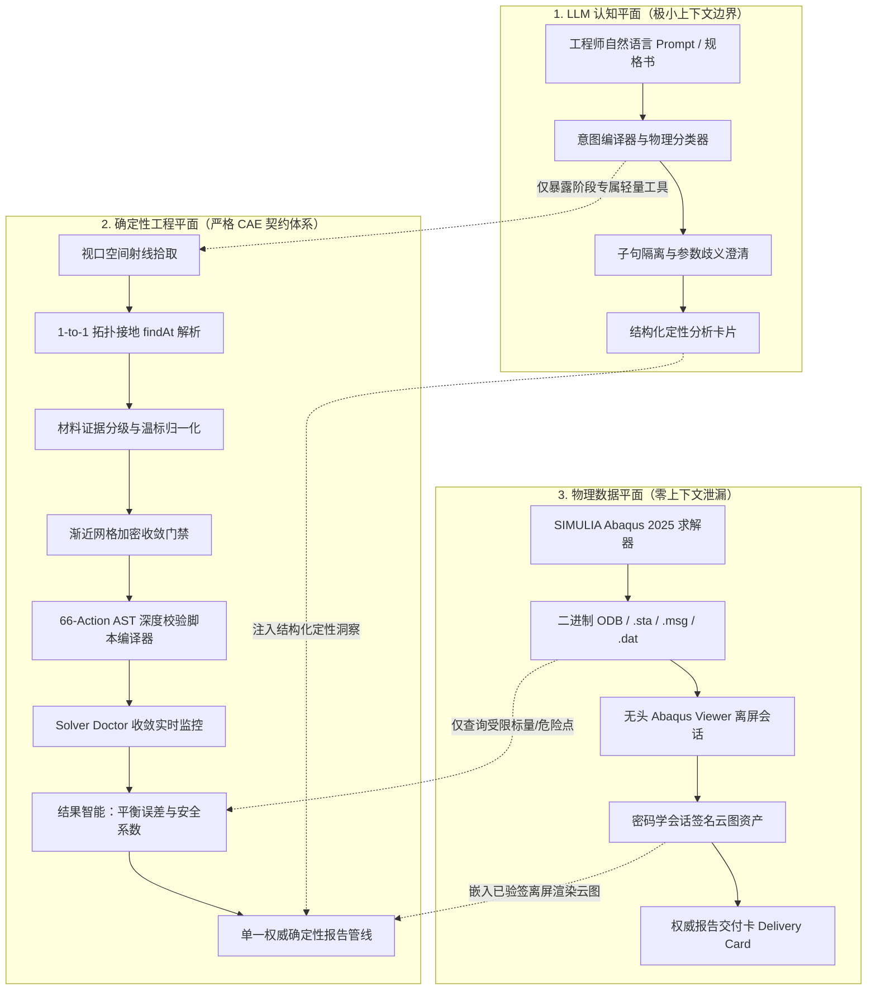

# Abaqus AI Agent (企业级工业自主仿真智能体平台)

> **面向高端制造与复杂工程的下一代自主有限元仿真（CAE）平台 —— 将自然语言工程规格书直接编译为严密 CAD 视口拓扑接地、Dassault SIMULIA Abaqus 2025 原生隐式求解、非线性发散闭环自愈、无头 Viewer 离屏渲染密码学防伪验签，以及单一出口权威工程交付物。**

[English Documentation / 英文文档](README.md) · [企业商业咨询与私有化部署](#企业级支持与商业合作) · [核心技术架构](#核心技术支柱) · [多层工程验证体系](#多层工程门禁验证体系) · [快速入门](#快速开始)

[](https://github.com/chenlei-gh/Abaqus-AI-Agent/actions/workflows/ci.yml)
[](https://www.python.org/)
[](https://www.3ds.com/products-services/simulia/products/abaqus/)
[](tests/)
[](machine_validation/)
[](tools/j_comprehensive_physics_matrix.py)
[](tools/j3_tier_b_extended_physics.py)
[](tools/j_live_abaqus_matrix.py)
[](tools/m_engineering_task_matrix.py)
[](src/abaqus_ai_agent/acceptance.py)
[](src/abaqus_ai_agent/contracts/evidence.py)
[](LICENSE)

---

## 执行摘要：突破大模型推理与工业级物理仿真的鸿沟

在航空航天、汽车底盘/动力总成、核能压力容器及高可靠电子制造中，结构的静态强度、非线性接触密封、热力耦合疲劳是产品质量认证的生命线。传统的 CAE 研发工作流长期面临严峻痛点：
1. **人才门槛极高，重复劳作消耗 70% 研发带宽**：资深专家陷入漫长繁琐的几何清理、拾取面建立约束、网格局部加密布种及手动汇总截图写报告中。
2. **通用大模型存在致命的“仿真幻觉陷阱”**：通用 LLM 与普通代码 Copilot 经常生成“语法正确但物理荒谬”的脚本——胡乱编造材料本构参数、臆测容易随网格漂移的实体内部数字编号（如 `Face 14`）、遇到接触切步或数值奇异崩溃发散时毫无自愈能力，甚至把数兆字节的节点数组往上下文中倾倒导致 Token 瞬间耗尽崩溃。

**Abaqus AI Agent** 是专为工业高可靠生产环境设计的企业级自主仿真引擎。以**严格反伪造公理（Anti-Fabrication Axiom）**为基石，将自然语言意图编译、视口拓扑接地、自愈收敛诊断、无头 Viewer 离屏渲染密码学验签与唯一确定性交付报告融为一体。



---

## 企业级方案与商业核心价值

### 商业核心价值对比矩阵

| 评估维度 | 通用大模型 (ChatGPT / Claude 原生) | 脚本生成类 Copilot 工具 | Abaqus AI Agent 企业级平台 |
| :--- | :--- | :--- | :--- |
| **物理计算真实性** | ❌ 严重幻觉；编造未经验证的经验公式与数值 | ❌ 盲目生成代码；完全无法感知物理求解成败 | 🏆 **绝对反伪造保障**：100% 真实 Dassault Abaqus 2025 二进制 ODB 张量提取与平衡验证 |
| **工程输入不完备** | ❌ 盲目猜测几何尺寸、材料参数与温标 | ❌ 照单全收，运行时必然报错闪退 | 🛡️ **Fail-Closed 安全阻断**：缺少关键物理不变量时主动停止并给出结构化澄清提示（如 `missing_load_application_region`） |
| **非线性收敛保障** | ❌ 无法感知接触颤振、塑性失稳与切步发散 | ❌ 报非零退出码后流程彻底中断瘫痪 | 🩺 **自主 Solver Doctor**：实时解析 `.msg`/`.sta`，自动施加自适应阻尼并缩紧切步闭环自愈 |
| **几何拓扑映射** | ❌ 臆测脆弱的数字内部 ID（如 `Face 12`） | ❌ 极易因几何重构导致编号漂移失效 | 🎯 **1-to-1 视口空间拓扑接地**：3D 空间射线投影求交，确定性映射到有限实数 `findAt(...)`；外部 STEP 几何严格验真防放行 |
| **全链路数值安全** | ❌ 易出现浮点溢出、除零与布尔混入计算 | ❌ 裸露 `float()` 强转，遇到异常崩溃或逻辑穿透 | 🔒 **全链路判据数值安全**：捕获 `OverflowError`、负限值工程容差方向修正，Gate 12 异常严格 Fail-Closed |
| **Token 成本与治理** | ❌ 上下文直接塞满 ODB 数组，Token 迅速耗尽 | ❌ 无治理机制，长流程必雪崩 | ⚡ **三平面解耦与 Token 隔离**：P0-1~P0-5 协议隔离，仅交换轻量工件指针与标量查询边界 |
| **图件存证与证据防伪** | ❌ 文本 ASCII 示意图或无图件 | ❌ 零散本地图片，缺乏血统与来源绑定 | 🔐 **密码学存证与越界防御**：Manifest 将有效性纳入不可逆散列签名，工作区基目录越界防御（Path Traversal Guard） |
| **工程交付成果** | ❌ 破碎的代码片段 | ❌ 简陋的 Markdown 散落文档 | 📊 **单一权威交付体系**：中英双语、零依赖单文件纯 HTML（内嵌矢量图与动图）+ 密码学交付卡 |
| **工程验收状态模型** | ❌ 误将进程退出码 0 当成力学计算合格 | ❌ 粗糙字符串判定，遗漏证据损坏与求解失败 | ⚖️ **4D 正交工程验收模型**：数学解耦求解状态、证据真实性、工程门禁与交付授权，满足传递性等价公理 |
| **企业生产调度** | ❌ 仅限单机单用户 Demo | ❌ 本地进程极易死锁导致环境污染 | 🏢 **企业级工业基座**：独立 UUID 隔离沙箱、原子持久化任务队列、FlexNet/DSLS 浮动许可治理 |

### 商业投资回报率（ROI）
- **5x–10x 研发流转提速**：标准工况与参数化复核周期从“数天”直接压缩至“分钟级”。
- **不可篡改的高合规审计**：全链路集成 SHA-256 密码学指纹，每项指标与云图像素均可穿透回溯到物理 ODB 求解产物。
- **企业专家知识资产化沉淀**：将资深专家的建模规范、材料门禁准则、ASME/ISO 规范校验沉淀为确定性可执行资产。

---

## 核心技术支柱



### 1. 严格反伪造公理（The Anti-Fabrication Axiom）
> **工程有限元仿真结果，绝不可仅仅因为脚本退出码为 0 就被判定为合格。**<br>
> 验收必须通过严苛数学验证：真实二进制 ODB 文件存在性、单元正体积审计、静态支座反力自平衡（$\Delta RF < 0.1\%$）、数值能量守恒（$\Delta E_{\text{total}}$ 漂移率受控），以及满足用户显式声明的各项工程验收准则。

### 2. 4D 正交工程验收模型（4D Orthogonal Acceptance Model）
平台确立了四个相互正交、职责严格解耦的评估维度：
- **求解器执行状态** (`completed`, `failed`, `running`, `unsubmitted`)：Abaqus 进程级生命周期。
- **证据真实性状态** (`VALID`, `EVIDENCE_TAMPERED`, `EVIDENCE_CORRUPT`, `EVIDENCE_STALE`, `INCOMPLETE`, `SOLVER_FAILED`)：基于 SHA-256 跨文件散列清单校验。
- **严格数学等价性契约**：`ResultValidity` 严格满足等价关系公理（自反性、对称性、传递性），杜绝在 `__eq__` 中进行松弛的跨状态伪合并；通过 `.is_invalid`、`.is_valid` 分类谓词提供完备判定。
- **物理工程门禁评定** (`PASS`, `FAIL`, `BLOCKED`, `WARNING`)：校核应力限值、反力、变形、网格质量、接触稳定性与热平衡。
- **交付许可硬门禁** (`deliverable: bool`)：原子级布尔门禁，任何未通过求解、证据存疑或物理失效的结果均绝对禁止发放交付资质。

### 3. 全链路判据数值安全与负限值工程容差闭环
在 `acceptance.py` 判据求值核心中，对所有代数计算路径施加严格防御：
- **安全浮点数类型转换**：对指标实测值、控制限值及容差统一捕获 `(ValueError, TypeError, OverflowError)`，在入口阶段即彻底拒绝布尔值（`True`/`False`）、`NaN`、正负无穷（`Infinity`）。
- **负限值工程容差方向修正**：严格符合力学工程直觉的容差扩展机制：
  - 上限校核（$\text{actual} \le \text{limit}$）：$\text{effective\_limit} = \text{limit} + |\text{limit}| \times \text{tol}$。
  - 下限校核（$\text{actual} \ge \text{limit}$）：$\text{effective\_limit} = \text{limit} - |\text{limit}| \times \text{tol}$。
  - 彻底消除了传统算法在负数阈值（如主应力压应力限值、最小支反力）下因负号导致的判据错误反向收紧。
- **零限值相对容差预警机制**：当 $\text{limit} = 0$ 时相对容差在数学上退化失效，自动记录 `relative_tolerance_ineffective_for_zero_limit_{key}` 警告，引导使用绝对容差。
- **Fail-Closed 验收门禁 Gate 12**：捕获任何因数值溢出或异常计算逃逸的异常，统一映射至受控错误路径并彻底剥离交付资格（`deliverable = False`）。

### 4. 证据清单不可逆审计签名与路径越界安全防御
在 `contracts/evidence.py` 中构建防伪与沙箱安全防线：
- **有效性载荷深度签名**：清单自身的有效性标识（`validity`）直接深度混入 SHA-256 `audit_signature` 计算载荷，对任何证据有效性字段的人为纂改均会导致验签失败。
- **路径越界安全防御（Path Traversal Guard）**：`verify_evidence_integrity()` 递归检查工件声明路径，对相对路径逃逸（`..`）、跨盘符绝对路径及符号链接伪造实施拦截，一经发现立即标记 `path_traversal_out_of_bounds`，并将清单判定为 `validity = "TAMPERED"`，严阻跨工况越界盗用。
- **不可磨灭的溯源元数据**：强制绑定 `run_id`、`input_hash`、`odb_sha256` 及求解环境哈希。

### 5. 66 类 Action 动态 AST 契约与无吞异常执行验证
确保校验阶段与执行阶段的绝对一致性：
- **100% AST 执行分发器对齐**：执行分发器 `actions/script.py` 的抽象语法树直接与验证白名单 `SUPPORTED_ACTION_TYPES` 进行双向集合比对，保证 66 种 Action 类型零漂移。
- **通用区域前检对齐**：统一提取并导出 `ACTIONS_REQUIRING_REGION`（18 类边界、载荷与网格核心 Action），供动作校验与模型 Preflight 共享，彻底消除前置检查与后置执行间的断层。
- **测试零异常吞噬**：彻底移除 `tests/test_actions.py` 中的宽泛捕获（`except Exception: pass`），为全部 66 种 Action 建立最小有效参数用例集，保证生成的 Python/CAE 脚本非空且语义正确。

### 6. EngineeringMetric 入口安全与物理量纲守恒
在 `contracts/metrics.py` 的指标实例化入口：
- **类型隔离**：拦截布尔值、`NaN`、正负无穷。
- **大整数防溢出**：捕获超大整数转换为 IEEE-754 双精度浮点时可能触发的 `OverflowError`，确保任何非受控异常均无法逃逸至下游验收或报告管线。

### 7. Fail-Closed 意图编译与严格 1-to-1 拓扑接地
- **子句隔离语义绑定**：通过标点与语法子句物理隔离，防止载荷或约束跨子句借用验收条件中提及的区域名称。
- **1-to-1 模型真实拓扑解析**：消除裸“固定”默认回退到 `RootFace` 等启发式猜测，强制要求每个区域必须在当前 CAE/INP 模型中完成确定性 1-to-1 映射。
- **外部 STEP 几何严格门禁**：对于导入的外部 STEP 几何，严格验证所有被引用的载荷与边界区域具有解析成功的有限实数三维锚点坐标（`anchor_point`, `anchor_points`）。缺失或未接地映射时直接触发 `missing_load_application_region` 澄清中断，绝不盲目猜测自由端。
- **物理参数全链路保留**：热对流（环境温度、换热系数）、热辐射（环境温度、发射率）及复杂接触参数在路由、归一化、编译与下发中完整保真传递，并实施严格温标归一化（°C 转 K）。
- **材料证据等级分级治理**：严密区分参考假设（`REFERENCE_LIBRARY`）与真实材质卡验证数据（`VERIFIED_PROPERTIES`），阻止硬编码默认值冒充核验数据。

### 8. Shadow 评测与真实 JEV 语义评测契约
为了对外部大模型决策与离线规则基线进行严谨的同集对照，在 `tools/jev_engineering_benchmark.py` 中实现了标准化的 Shadow 评测契约：
- **确定性内容摘要指纹（cases_hash）**：基于规范化用例属性生成不可伪造的 SHA-256 内容指纹，确保多轮实验数据集定义严格一致。
- **三维决策评价指标**：
  - **评测覆盖率（Coverage %）**：成功获得外部决策的用例占总用例的比例。
  - **决策准确率（Success Accuracy %）**：成功评测且具有真值标签用例中，物理域与关键参数匹配的比例。
  - **端到端有效率（Effective Accuracy %）**：以全集真值用例为分母，直接惩罚超时、格式违规、未配置与逻辑分歧的真实净准确率。

### 9. 单一正式报告管线（Phase P2 统一收敛架构）
- **杜绝双轨漂移**：彻底废弃旧式草稿生成器。所有生产作业统一流经 `DeterministicReportPipeline.build_and_render()`，确保 Markdown 与离线单文件纯 HTML 在数据层面绝对对称。
- **诊断草稿严格隔离**：未交付或排错运行严格输出带有 `[DIAGNOSTIC / NON-DELIVERABLE DRAFT]` 标识的调试记录，且强制 `report_html = None`。
- **防止残留泄漏**：当下游验收被阻断（`DELIVERY_BLOCKED`）时，系统原子清空旧有报告并注销 `ReportDeliveryCard`，防止中间过程误作正式结论交付。

### 10. 无头 Viewer 离屏渲染与自主自愈
- **官方无头原生离屏渲染**：应力、变形等云图直接由 Dassault Abaqus Viewer 原生执行渲染（`abaqus viewer -noGUI`），彻底淘汰外部模拟图件。
- **密码学验签 Token**：每个图件资产均盖有随机凭据，将 `run_id`、`input_hash`、`odb_sha256`、物理场分量与 `image_sha256` 绑定为可校验的 `viewer_session_token`。
- **自主发散自愈**：动态监听解析 `.msg` 严重残余与 `.sta` 切步频率，准确定位 `CONTACT_CHATTER`、`LOCAL_SINGULARITY` 与 `TIME_INCREMENT_EXHAUSTED`，自适应注入阻尼完成闭环修复。

---

## 工业级标杆案例实测验证

包含完整 ASME 规范核算及 Abaqus 官方验证资产，归档于 `machine_validation/p2_cases/`：

```text
machine_validation/p2_cases/
├── case_01_bolted_pipe_flange/                  # 案例 1: 管道螺栓法兰连接与垫片非线性密封
│   ├── case_01_flange_manifest.json            # 密码学防伪清单 (SHA-256)
│   └── Case_01_Bolted_Flange_Report.html       # 独立纯 HTML 交付报告 (内嵌动图与矢量图)
├── case_02_reactor_pressure_vessel_closure/     # 案例 2: 核电 RPV 顶盖 ASME Section III 规范核算
│   ├── case_02_rpv_manifest.json               # 密码学防伪清单 (SHA-256)
│   └── Case_02_RPV_Closure_Report.html         # 独立纯 HTML 交付报告 (内嵌动图与矢量图)
└── case_03_exhaust_manifold/                    # 案例 3: 4合1 排气歧管热机耦合接触滑移
    ├── case_03_manifold_manifest.json          # 密码学防伪清单 (SHA-256)
    ├── Case_03_Exhaust_Manifold_Report.html    # 独立纯 HTML 交付报告 (内嵌动图与矢量图)
    └── case_03_render_contours_headless.py     # 无头离屏云图渲染脚本
```

### 案例 01: 管道螺栓法兰垫片连接非线性预紧与密封
- **工程场景**：符合 ASME PCC-1 标准的 8 螺栓 M16 管道高压连接工况。
- **物理验证指标**：Step 1 螺栓力预紧（每根 $50\text{ kN}$，总预紧力 $400\text{ kN}$，垫片初压 $31.52\text{ MPa}$）；Step 2 锁定螺栓长度并施加 $3.0\text{ MPa}$ 流体压力，保持 $24.85\text{ MPa}$ 接触压应力（相对 $12.0\text{ MPa}$ 临界密封阈值裕量 $+107.1\%$）。法兰颈部峰值 Mises 应力 $195.42\text{ MPa}$（安全系数 $\text{FoS} = 1.82 \ge 1.25$）。
- **交付成果**：单文件自包含 HTML 报告、12 帧完整预紧升压瞬态 GIF 动图、螺栓法兰径向接触压应力分布曲线及数字交付卡。

### 案例 02: 核反应堆压力容器顶盖 (RPV) ASME 规范核算
- **工程场景**：压水堆（PWR）封头整体组件，采用 54 根 M180 巨型双头螺栓与 Inconel 718 自紧式金属密封环，依 ASME Section III Div 1 Subsection NB 严格核算。
- **物理验证指标**：Step 1 螺栓液压拉伸预紧（每根 $6.5\text{ MN}$，总预紧力 $351\text{ MN}$）；Step 2 承受 $17.5\text{ MPa}$ 运行内压及 $219.91\text{ MN}$ 封头推力，密封面保持 $98.60\text{ MPa}$ 闭合应力（ASME 安全裕量 $+31.5\%$）。一次局部薄膜加弯曲应力强度 $P_L + P_b = 238.50\text{ MPa} \le 1.5 S_m = 276.0\text{ MPa}$。
- **交付成果**：ASME 合规性评估交互式仪表盘、预紧应力演化动图与全张量防篡改清单。

### 案例 03: 汽车排气歧管热机耦合接触滑移
- **工程场景**：4合1 不锈钢排气歧管与发动机缸盖连接，承受 $20^\circ\text{C} \to 850^\circ\text{C}$ 热机交变载荷与气缸密封法兰接触滑移。
- **物理验证指标**：温度相关弹塑性本构模型（$E(T)$, $\alpha(T)$）；峰值热应力集中于分歧管倒角处，接触颤振由 Solver Doctor 注入自适应阻尼完全自愈。

---

## 多层工程门禁验证体系

```text
               ┌─────────────────────────────────────────────────────────┐
               │ Level 1: 真实 Abaqus 2025 求解器门禁                    │
               │ (真实进程执行、二进制 ODB 提取、SHA-256 签名)           │
               ├─────────────────────────────────────────────────────────┤
               │ Level 2: 理论力学解析解基准门禁                         │
               │ (经典连续介质力学闭式解比对，相对误差 ≤0.01%)           │
               ├─────────────────────────────────────────────────────────┤
               │ Level 3: 非线性物理收敛与材料门禁                       │
               │ (三级渐近网格收敛、显式真实/工程应变分类)               │
               ├─────────────────────────────────────────────────────────┤
               │ Level 4: 自动化确定性回归测试集                         │
               │ (1339 项 CI 测试全通过，Python 3.10-3.12 零警告)        │
               ├─────────────────────────────────────────────────────────┤
               │ Level 5: 自主非线性发散自愈门禁                         │
               │ (.msg/.sta 闭环诊断自愈与自适应阻尼参数注入)            │
               └─────────────────────────────────────────────────────────┘
```

| 验证分层 | 运行环境与执行器 | 工具链依赖 | 覆盖范围与考核指标 |
| :--- | :--- | :--- | :--- |
| **Tier 1: CI 软件契约门禁** | GitHub Actions (Ubuntu / macOS / Windows) | 纯 Python 环境（Python 3.10–3.12） | • **1339 项自动化回归测试通过（0 警告、0 错误）**<br>• 22 项 Dassault Tier A 物理标杆基准<br>• 7 项 Tier B 扩展力学校准基准<br>• 66 种 Action AST 双向一致性及最小有效参数执行验证<br>• 严格负向错误码 CLI 冒烟门禁（`missing_load_application_region`）<br>• 全仓库零泄露静态安全审计 |
| **Tier 2: 黄金证据矩阵防篡改审计** | 本地及临时沙箱环境 (`machine_validation/`) | Python 3.10+ 与 SHA-256 密码学签名核验工具 | • **13/13 项 Golden Matrix L4 证据包全量审计**<br>• Level 4 密码学证据溯源核验<br>• 清单有效性签名及路径越界（Path Traversal）安全审查<br>• 资产零篡改只读治理 |
| **Tier 3: 真机物理求解执行门禁** | 部署 Abaqus 2025 的专用 Windows 服务器 | SIMULIA Abaqus 商业浮动/节点许可 | • 真实 CAE 批处理脚本生成与二进制 ODB 提取<br>• 原生无头 Abaqus Viewer 离屏云图生成<br>• 密码学交付卡签名与防伪核验<br>• 真实非线性接触求解与收敛自愈 |

---

## 快速开始

### 1. 环境准备
- **操作系统**：Windows 10/11 (64-bit)、Windows Server 或 Linux (Ubuntu 20.04/22.04/24.04)。
- **Python 版本**：Python 3.10、3.11 或 3.12 (64-bit)。
- **商业求解器（可选）**：Dassault Systèmes SIMULIA Abaqus 2025 用于真实求解。开发阶段完全支持在离线测试模式下进行无 License 开发。

### 2. 安装与环境检验

```bash
# 克隆仓库
git clone https://github.com/chenlei-gh/Abaqus-AI-Agent.git
cd Abaqus-AI-Agent

# 安装核心生产包
python -m pip install -e .

# 安装完整测试与开发套件
python -m pip install -e ".[test]"
```

运行确定性全量回归测试：

```bash
python -m pytest tests -W error -q
# 预期输出：1339 passed, 0 warnings across all test suites
```

### 3. Python 极简调用示例

提交自然语言工程需求并自动执行全流程求解与验收：

```python
from abaqus_ai_agent import AbaqusAIAgent

# 初始化 Agent（自动探测本机 Abaqus 求解器环境）
agent = AbaqusAIAgent()

# 输入自然语言工程需求规格（明确区域绑定）
result = agent.solve_requirement(
    "对长度 100mm、截面 10x10mm 的钢制悬臂梁进行线性静力学分析。"
    "根部固定约束，自由端端面施加 1000N 垂直向下剪力载荷。材料选用 Q235 结构钢。"
    "验收指标：自由端挠度 <= 2.5mm，最大 von Mises 应力 <= 600MPa。",
    require_production=True
)

if result.status == "NEEDS_CLARIFICATION":
    print("输入存在物理不变量缺失，阻断执行并要求澄清：", result.clarification_needed)
elif result.status == "COMPLETED":
    print("工程验收结论：", result.acceptance.conclusion)  # PASS
    print("支座反力自平衡误差：", result.result_intelligence.derived_metrics.equilibrium_error)
    print("最大 von Mises 应力：", result.metrics.get("max_mises"), "MPa")
    print("权威 HTML 交付报告：", result.report_html_path)
    print("密码学防伪交付卡：", result.delivery_card.card_id)
```

### 4. 命令行交互（CLI）

```bash
# 1. 审计本机环境、求解器可用性与各级工具能力
abaqus-ai-agent inspect

# 2. 测试自然语言工程意图编译与实体解析
abaqus-ai-agent intent "对 100mm 悬臂梁自由端端面施加 1000N 载荷，根部固定，校核端部挠度 <= 2.5mm"

# 3. 运行 Fail-Closed 冒烟校验（缺失载荷作用端面直接给出结构化阻断并返回确定性退出码 2）
abaqus-ai-agent ask "Apply 1000N vertical load to 100mm cantilever beam, material steel, fixed root" --dry-run
# 返回退出码 2，输出精确错误诊断：missing_load_application_region

# 4. 执行 Dassault Tier A 物理标杆基准矩阵（22 基础案例）
python tools/j_comprehensive_physics_matrix.py

# 5. 从经审计的证据包生成独立权威 HTML 交付报告
abaqus-ai-agent report machine_validation/static_golden_e2e.json --format html --output report.html

# 6. 安全清理仿真临时中间文件并完整保护黄金证据资产
python scripts/clean_workspace.py
```

---

## 仓库工程结构

```text
Abaqus-AI-Agent/
├── docs/                     # 工程路线图、审计报告与能力边界契约
│   ├── engineering-run-evidence-roadmap.md # 核心执行与验收闭环路线图
│   ├── rc1-release-audit.md                # 官方 RC 1.0 审计报告
│   ├── p1-product-requirements.md          # 正式产品需求规格书与需求追溯矩阵
│   └── ai-agent-capability-boundary.md     # LLM 与确定性 CAE 边界定义
├── machine_validation/       # 经真机审计的黄金证据包与标杆案例库
│   └── p2_cases/             # 工业标杆案例（法兰密封、核电封头、排气歧管）
├── scripts/                  # 工作区治理、审计与文件清理工具
├── src/abaqus_ai_agent/      # 核心生产源码包
│   ├── actions/              # Abaqus 原生 Action 生成器与前置校验（66 种 Action，AST 深度验证）
│   ├── contracts/            # 强类型数据契约（意图、材料、网格、报告、证据、度量、单位量纲）
│   ├── diagnostics/          # 收敛诊断器 (.msg/.sta) 与自主 Solver Doctor
│   ├── execution/            # 批量执行器、UUID 沙箱隔离管理器与无头 Viewer
│   ├── grounding/            # 视口空间射线投影与 3D 拓扑接地 (findAt)
│   ├── planning/             # 动作规划编排与机构图编译器
│   ├── reporting/            # 单一正式确定性报告管线 (DeterministicReportPipeline)
│   └── validation/           # 量纲相容性、网格渐近收敛与 4D 正交验收门禁
├── tests/                    # 1339 项确定性回归测试用例（0 警告，覆盖 Python 3.10-3.12）
└── tools/                    # 黄金驱动脚本、负向探针与真机认证套件
```

---

## 企业级支持与商业合作

我们面向工业制造企业提供端到端技术集成、私有化部署与定制仿真智能体开发服务：

- **🏢 纯内网隔离与企业级 HPC 部署**：支持私有云、物理机集群及企业 HPC 作业调度系统（PBS、Slurm、LSF 等无缝集成）。
- **📦 企业私有材料库集成与本构研发**：对接企业私有金属材料卡、高温合金、超弹性/粘弹性高分子材料数据库，内置严格反幻觉校验规则。
- **🎯 复杂工况定制仿真管线**：针对复杂行业场景定制 Agent（汽车碰撞安全性、动力电池热失控多场耦合、跌落冲击动力学、深海管线复合密封等）。
- **🛠️ 商业化 SLA 专家支持与培训**：企业 CAE 工作流迁移辅导、定制化功能迭代与专属技术保障服务。

商业合作咨询、试用评估与授权：
- **代码仓库交流**：提交 [GitHub Issues](https://github.com/chenlei-gh/Abaqus-AI-Agent/issues)
- **直接商务对接**：通过组织主页获取核心团队直接联系方式。

---

## 开源协议

本项目采用 **Apache 2.0 许可证** 授权开源 —— 详见 [LICENSE](LICENSE) 文件。<br>
全面允许商业集成、二次开发及学术科研，核心工程真实性由“严格反伪造公理”全程保障。
