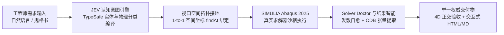
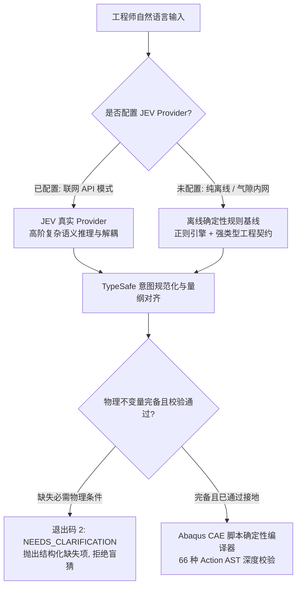

# Abaqus AI Agent (企业级工业自主仿真智能体平台)

> **面向高端制造与复杂工程的下一代自主有限元仿真（CAE）平台 —— 将 TypeSafe AI (JEV) 认知意图编译与确定性 Dassault SIMULIA Abaqus 2025 物理求解、非线性发散自愈和可审计工程交付物深度融合。**

[English Documentation / 英文文档](README.md) · [JEV 认知架构与工程现实](#jev-认知架构与工程现实) · [企业商业咨询与私有化部署](#企业级支持与商业合作) · [核心技术架构](#核心技术支柱) · [多层工程验证体系](#多层工程验证体系) · [快速入门](#快速开始)

[](https://github.com/chenlei-gh/Abaqus-AI-Agent/actions/workflows/ci.yml)
[](https://www.python.org/)
[](https://www.3ds.com/products-services/simulia/products/abaqus/)
[](tests/)
[](src/abaqus_ai_agent/typesafe_intent.py)
[](docs/p1-product-requirements.md)
[](machine_validation/)
[](tools/j_comprehensive_physics_matrix.py)
[](src/abaqus_ai_agent/acceptance.py)
[](LICENSE)

---

## 执行摘要：突破大模型推理与工业级物理仿真的鸿沟

在航空航天、汽车底盘/动力总成、核能压力容器及高可靠电子制造中，结构的静态强度、非线性接触密封、热力耦合疲劳是产品质量认证的生命线。传统的 CAE 研发工作流长期面临严峻痛点：
1. **人才门槛极高，重复劳作消耗 70% 研发带宽**：资深专家陷入漫长繁琐的几何清理、拾取面建立约束、网格局部加密布种及手动汇总截图写报告中。
2. **通用大模型存在致命的“仿真幻觉陷阱”**：通用 LLM 与普通代码 Copilot 经常生成“语法正确但物理荒谬”的脚本——胡乱编造材料本构参数、臆测容易随网格漂移的实体内部数字编号（如 `Face 14`）、遇到接触切步或数值奇异崩溃发散时毫无自愈能力，甚至把数兆字节的节点数组往上下文中倾倒导致 Token 瞬间耗尽崩溃。

**Abaqus AI Agent** 是专为工业高可靠生产环境设计的企业级自主仿真引擎。其核心架构由两大幅面构成：**TypeSafe AI (JEV) 认知意图编译平面**与**确定性工业 CAE 执行平面**。



---

## JEV 认知架构与工程现实

### 1. 为什么必须引入 JEV？（破解通用大模型的 CAE 幻觉陷阱）
通用大模型将工程仿真需求视为松散的闲聊文本。如果直接要求大模型“对悬臂梁自由端施加载荷进行有限元分析”，裸模型往往会胡乱臆测材料参数、凭空捏造不存在的几何编号，或生成在真实求解器中因切步发散而瞬间崩溃的代码。

**JEV（TypeSafe AI 认知引擎）**充当确定性力学编译器：
- **强类型量纲实体解析**：将非结构化自然语言编译为具有严格类型与量纲约束的 `PhysicsIntent` 物理意图实体。
- **Fail-Closed 物理边界拦截**：一旦缺失载荷施加端面、材料本构或分析步时间等物理不变量，主动阻断并输出结构化澄清需求（`NEEDS_CLARIFICATION`，如 `missing_load_application_region`），绝不擅自猜测。
- **子句隔离语义绑定（Clause Scoping）**：通过标点与语法子句物理隔离，防止后文验收条件（如“校核端部挠度”）中的区域词汇被前文未指明区域的载荷语句非法窃取。

### 2. 双模混合架构：确定性离线基线 + 真实 JEV 认知增强

系统采用确定性与大模型认知并存的双模混合设计：



- **确定性离线基线（Offline Deterministic Baseline）**：即使在完全无外部大模型 API、断网或纯内网保密机房环境下，系统依靠 1,339 项确定性回归测试支撑的规则引擎，保障 100% 确定性、零幻觉执行标准工况。
- **真实 JEV Provider（认知增强平面）**：接入商业大模型 Provider 后，系统获得应对非标准语言句式、跨段落隐式力学因果关系及复杂多工况约束编排的能力。

### 3. 工程客观现实与已知边界（不搞虚假宣传）

我们坚持以严密的工程实证代替宣传统战。当前 JEV 集成的真实工程成熟度边界如下：

| 技术评估维度 | 当前代码实现与审计事实 | 工程裁决结论 |
| :--- | :--- | :--- |
| **离线规则安全底线** | 1,339 项自动化测试在 Python 3.10–3.12 跨平台全通过（0 警告、0 错误）。 | ✅ **已核实闭环 (VERIFIED)** |
| **子句隔离（Clause Scoping）** | 标点子句物理隔离，彻底阻断跨子句盗用区域。 | ✅ **已核实闭环 (VERIFIED)** |
| **热边界与材质分级** | 热对流/辐射参数全保真传递、温标（°C 转 K）归一化，严格区分 `REFERENCE_LIBRARY` 与 `VERIFIED_PROPERTIES`。 | ✅ **已核实闭环 (VERIFIED)** |
| **外部 STEP 1-to-1 拓扑接地** | 强制有限实数三维锚点坐标（`anchor_point`），拒绝 `resolved=False` 与 NaN/Inf 坐标。 | ✅ **已核实闭环 (VERIFIED)** |
| **真实 JEV Provider 增益评测** | 建立 Shadow 评测体系，在 26 个标杆案例上追踪覆盖率、准确率与有效率。 | ⏳ **审查中 (`REQ-P1-045: IN_REVIEW`)** |

> **关于 `REQ-P1-045` 处于 `IN_REVIEW` 的真实工程说明**：
> 离线规则已经实现了完备的数学 Fail-Closed 闭环，但要将真实外部 JEV Provider 认证为成熟的工程级能力（`QUALIFIED`），必须在固定版本的 26 个工业标杆集上完成大规模实测并积累足够的同集对照数据。在获得充分的外部真实模型同集准确率证据之前，我们严格将该需求保持在 **`IN_REVIEW`** 状态，拒绝把离线规则的成功冒充为大模型能力的胜任。

### 4. Shadow 影子评测机制
为客观度量外部大模型 Provider 相对确定性离线基线的真实增益，平台在 `tools/jev_engineering_benchmark.py` 中实现了标准化的影子评测体系：
- **数据集 SHA-256 内容指纹（`cases_hash`）**：对规范化用例属性进行散列，防止评测集跨版本漂移或篡改。
- **三维决策评价指标（拒绝统计失真）**：
  - $\text{评测覆盖率 (Coverage \%)} = \frac{N_{\text{evaluated}}}{N_{\text{total}}}$：直接惩罚网络超时、格式违规与未配置异常。
  - $\text{决策准确率 (Success Accuracy \%)} = \frac{N_{\text{correct}}}{N_{\text{evaluated}}}$：仅在成功返回决策的样本中统计匹配率。
  - $\text{端到端有效率 (Effective Accuracy \%)} = \frac{N_{\text{correct}}}{N_{\text{total}}}$：以全量基准集为分母，衡量工业落地的真实可靠性净收益。

---

## 企业级方案与商业核心价值

### 商业核心价值对比矩阵

| 评估维度 | 通用大模型 (ChatGPT / Claude 原生) | 脚本生成类 Copilot 工具 | Abaqus AI Agent 企业级平台 |
| :--- | :--- | :--- | :--- |
| **物理计算真实性** | ❌ 严重幻觉；编造未经验证的经验公式与数值 | ❌ 盲目生成代码；完全无法感知物理求解成败 | 🏆 **绝对反伪造保障**：100% 真实 Dassault Abaqus 2025 二进制 ODB 张量提取与平衡验证 |
| **意图编译 (JEV)** | ❌ 脆弱的普通 Prompt，易出现长文本语义漂移 | ❌ 盲目代码映射，无力学语义感知 | 🧠 **TypeSafe JEV 引擎**：认知与确定性双模编译器，具备子句隔离与温标量纲归一化 |
| **工程输入不完备** | ❌ 盲目猜测几何尺寸、材料参数与温标 | ❌ 照单全收，运行时必然报错闪退 | 🛡️ **Fail-Closed 安全阻断**：缺少关键物理不变量时主动停止并给出结构化澄清提示 |
| **非线性收敛保障** | ❌ 无法感知接触颤振、塑性失稳与切步发散 | ❌ 报非零退出码后流程彻底中断瘫痪 | 🩺 **自主 Solver Doctor**：实时解析 `.msg`/`.sta`，自动施加自适应阻尼并缩紧切步闭环自愈 |
| **几何拓扑映射** | ❌ 臆测脆弱的数字内部 ID（如 `Face 12`） | ❌ 极易因几何重构导致编号漂移失效 | 🎯 **1-to-1 视口空间拓扑接地**：3D 空间射线投影求交，确定性映射到有限实数 `findAt(...)` |
| **全链路数值安全** | ❌ 易出现浮点溢出、除零与布尔混入计算 | ❌ 裸露 `float()` 强转，遇到异常崩溃或逻辑穿透 | 🔒 **全链路判据数值安全**：捕获 `OverflowError`、负限值工程容差方向修正，Gate 12 严格 Fail-Closed |
| **Token 成本与治理** | ❌ 上下文直接塞满 ODB 数组，Token 迅速耗尽 | ❌ 无治理机制，长流程必雪崩 | ⚡ **三平面解耦与 Token 隔离**：P0-1~P0-5 协议隔离，仅交换轻量工件指针与标量查询边界 |
| **图件可视化与报告** | ❌ 文本 ASCII 示意图或本地破碎路径 | ❌ 零散本地图片，缺乏血统与来源绑定 | 📊 **单一权威交付体系**：无头 Abaqus Viewer 离屏原生渲染，单文件零依赖纯 HTML + 交付卡 |
| **工程验收状态模型** | ❌ 误将进程退出码 0 当成力学计算合格 | ❌ 粗糙字符串判定，遗漏证据损坏与求解失败 | ⚖️ **4D 正交工程验收模型**：数学解耦求解状态、证据真实性、工程门禁与交付授权，满足传递性等价公理 |

---

## 核心技术支柱


### 1. 严格反伪造公理（The Anti-Fabrication Axiom）
> **工程有限元仿真结果，绝不可仅仅因为脚本退出码为 0 就被判定为合格。**<br>
> 验收必须通过严苛数学验证：真实二进制 ODB 文件存在性、单元正体积审计、静态支座反力自平衡（$\Delta RF < 0.1\%$）、数值能量守恒（$\Delta E_{\text{total}}$ 漂移率受控），以及满足用户显式声明的各项工程验收准则。

### 2. 4D 正交工程验收模型（4D Orthogonal Acceptance Model）
平台确立了四个相互正交、职责严格解耦的评估维度：
1. **求解器执行状态** (`completed`, `failed`, `running`, `unsubmitted`)：Abaqus 进程级生命周期。
2. **证据有效性状态** (`VALID`, `EVIDENCE_TAMPERED`, `EVIDENCE_CORRUPT`, `EVIDENCE_STALE`, `INCOMPLETE`, `SOLVER_FAILED`)：基于确定性 SHA-256 跨文件清单哈希与物理文件树校验。
   - *数学等价性契约*：`ResultValidity` 状态类型严格满足等价关系公理（自反性、对称性、传递性），杜绝在 `__eq__` 中进行松弛的跨状态伪合并；通过 `.is_invalid`、`.is_valid` 分类谓词提供完备判定。
3. **物理工程门禁评定** (`PASS`, `FAIL`, `BLOCKED`, `WARNING`)：独立校核应力限值、反力自平衡、变形、网格质量、接触稳定性与热平衡。
4. **交付授权许可门禁** (`deliverable: bool`)：原子级布尔门禁，任何未通过求解、证据存疑、损坏或物理失效的结果均绝对禁止发放交付资质。

### 3. 全链路判据数值安全与负限值工程容差闭环
在 `acceptance.py` 判据求值核心中，对所有代数计算路径施加严格防御：
- **安全浮点数类型转换**：对指标实测值、控制限值及容差统一捕获 `(ValueError, TypeError, OverflowError)`，在入口阶段即彻底拒绝布尔值（`True`/`False`）、`NaN`、正负无穷（`Infinity`）。
- **负限值工程容差方向修正**：
  - 上限校核（$\text{actual} \le \text{limit}$）：$\text{effective\_limit} = \text{limit} + |\text{limit}| \times \text{tol}$。
  - 下限校核（$\text{actual} \ge \text{limit}$）：$\text{effective\_limit} = \text{limit} - |\text{limit}| \times \text{tol}$。
  - 彻底消除了传统算法在负数阈值（如主应力压应力限值、最小支反力）下因负号导致的判据错误反向收紧。
- **严格零与近零限值数值契约**：
  - 当限值为数学严格零（$\text{limit} = 0.0$）时，相对容差计算（$0 \times \text{tol} = 0$）在代数上完全失效；
  - 当限值处于极小或次正规数区间（$|\text{limit}| < 10^{-30}$）时，相对容差带来的变化量低于工程有效精度阈值，同样判定为相对容差失效；
  - 上述两种场景下，系统均不对限值进行虚假放宽，并自动记录 `relative_tolerance_ineffective_for_zero_limit_{key}` 警告，引导工程师使用绝对容差。
- **两层溢出防御与 Gate 12 Fail-Closed 闭环**：
  - 第一层（输入防护）：相对容差在输入入口处限制于 $[0, 10^6)$，作为防御性上限过滤异常或极大输入（实际工程业务中相对容差通常处于 $[0.0, 0.20]$）；
  - 第二层（计算后校验）：在容差缩放代数计算后，强制执行 `math.isfinite(effective_limit)` 有限性检查，确保任何浮点乘法溢出（例如极大限值配合容差）均能被可靠拦截，而非单凭容差上限臆断不会溢出；
  - Gate 12 验收内核捕获代数溢出或求值异常，统一映射至受控错误路径并彻底剥离交付资格（`deliverable = False`）。

### 4. 证据清单完整性校验与工作区沙箱防护（威胁模型与边界）
在 `contracts/evidence.py` 中构建数据完整性与工作区沙箱安全屏障：
- **清单内容 SHA-256 完整性摘要**：对清单的标准规范化字段（深度包含 `validity` 字段）计算单向 SHA-256 摘要（`audit_signature`）。任何未同步重新计算摘要的字段篡改或损坏，均会导致验签失败。
- **威胁模型明确范围与诚实边界**：
  - *防护范围*：能有效检测工件存储与流水线流转过程中的静默数据损坏、部分字段未同步更新（如单方面篡改 `validity` 状态）、文件缺失和意外内容漂移。
  - *威胁模型边界*：当前机制基于无密钥的单向哈希函数 SHA-256，不包含非对称公私钥或服务端私密密钥（HMAC/PKI）。在攻击者获得完全本地写权限且主动重算哈希的对抗场景下，无法提供不可抵赖的身份认证。若企业生产环境需要防范高权限主动伪造，需外挂企业级 PKI/CA 签名体系。
- **工作区目录越界防御（Path Traversal Guard）**：`verify_evidence_integrity()` 对照指定的 `base_dir` 检查工件声明路径，拦截相对路径逃逸（`..`）、跨盘符绝对路径及符号链接伪造，标记 `path_traversal_out_of_bounds` 并将清单判定为 `validity = "TAMPERED"`。未显式传入 `base_dir` 时默认绑定当前工作目录并对未受限绝对路径记录警告。

### 5. 66 类 Action 动态 AST 契约与无吞异常执行验证
确保校验阶段与执行阶段的绝对一致性：
- **100% AST 执行分发器对齐**：执行分发器 `actions/script.py` 的抽象语法树直接与验证白名单 `SUPPORTED_ACTION_TYPES` 进行双向集合比对，保证 66 种 Action 类型零漂移。
- **通用区域前检对齐**：统一提取并导出 `ACTIONS_REQUIRING_REGION`（18 类边界、载荷与网格核心 Action），供动作校验与模型 Preflight 共享。
- **测试零异常吞噬**：彻底移除 `tests/test_actions.py` 中的宽泛捕获（`except Exception: pass`），为全部 66 种 Action 建立最小有效参数用例集，保证生成的 Python/CAE 脚本非空且语义正确。

### 6. EngineeringMetric 入口安全与物理量纲守恒
在 `contracts/metrics.py` 的指标实例化入口：
- **类型隔离**：拦截布尔值、`NaN`、正负无穷。
- **大整数防溢出**：捕获超大整数转换为双精度浮点时可能触发的 `OverflowError`。

### 7. Viewport 拓扑接地与 STEP 几何验证
- **1-to-1 模型真实拓扑解析**：消除裸“固定”默认回退到 `RootFace` 等启发式猜测，强制要求每个区域必须在当前 CAE/INP 模型中完成确定性 1-to-1 映射。
- **外部 STEP 几何严格门禁**：外部 STEP 几何严格验证所有被引用的载荷与边界区域具有解析成功的有限实数三维锚点坐标（`anchor_point`, `anchor_points`），缺失或未接地映射时直接触发 `missing_load_application_region` 澄清中断。

### 8. 渐近网格收敛门禁（Multi-Level Mesh Convergence Gate）
- **严苛三级渐近收敛**：强制要求至少三个独立的网格加密层级（$\text{Levels} \ge 3$），坚决拦截两级偶然巧合带来的虚假收敛。
- **同质指标追踪**：各层级间仅允许对比完全同质的网格度量（纯单元数或纯布种尺寸）。
- **应力符号严格验证**：对带符号物理量（静水压力、正应力）执行严格变号校核；对真非负标量（von Mises、Tresca）豁免符号检查。

### 9. 单一正式报告管线（Phase P2 统一收敛架构）
- **杜绝双轨漂移**：彻底废弃旧式草稿生成器。所有生产作业统一流经 `DeterministicReportPipeline.build_and_render()`，确保 Markdown 与离线单文件纯 HTML 在数据层面绝对对称。
- **诊断草稿严格隔离**：未交付或排错运行严格输出带有 `[DIAGNOSTIC / NON-DELIVERABLE DRAFT]` 标识的调试记录，且强制 `report_html = None`。
- **防止残留泄漏**：当下游验收被阻断（`DELIVERY_BLOCKED`）时，系统原子清空旧有报告并注销 `ReportDeliveryCard`。

### 10. 自主发散自愈与无头 Viewer 离屏渲染
- **自主发散自愈**：动态监听解析 `.msg` 严重残余与 `.sta` 切步频率，准确定位 `CONTACT_CHATTER`、`LOCAL_SINGULARITY` 与 `TIME_INCREMENT_EXHAUSTED`，自适应注入阻尼完成闭环修复。
- **官方无头原生离屏渲染**：应力、变形等云图直接由 Dassault Abaqus Viewer 原生执行离屏渲染（`abaqus viewer -noGUI`），绑定 `run_id`、`input_hash`、`odb_sha256` 生成防伪会话图件。

---

## 工业级标杆案例实测验证

包含完整 ASME 规范核算及 Abaqus 官方验证资产，归档于 `machine_validation/p2_cases/`：

```text
machine_validation/p2_cases/
├── case_01_bolted_pipe_flange/                  # 案例 1: 管道螺栓法兰连接与垫片非线性密封
│   ├── case_01_flange_manifest.json            # 溯源清单 (SHA-256)
│   └── Case_01_Bolted_Flange_Report.html       # 独立纯 HTML 交付报告 (内嵌动图与矢量图)
├── case_02_reactor_pressure_vessel_closure/     # 案例 2: 核电 RPV 顶盖 ASME Section III 规范核算
│   ├── case_02_rpv_manifest.json               # 溯源清单 (SHA-256)
│   └── Case_02_RPV_Closure_Report.html         # 独立纯 HTML 交付报告 (内嵌动图与矢量图)
└── case_03_exhaust_manifold/                    # 案例 3: 4合1 排气歧管热机耦合接触滑移
    ├── case_03_manifold_manifest.json          # 溯源清单 (SHA-256)
    ├── Case_03_Exhaust_Manifold_Report.html    # 独立纯 HTML 交付报告 (内嵌动图与矢量图)
    └── case_03_render_contours_headless.py     # 无头离屏云图渲染脚本
```

### 案例 01: 管道螺栓法兰垫片连接非线性预紧与密封
- **工程场景**：符合 ASME PCC-1 标准的 8 螺栓 M16 管道高压连接工况。
- **物理验证指标**：Step 1 螺栓力预紧（每根 $50\text{ kN}$，总预紧力 $400\text{ kN}$，垫片初压 $31.52\text{ MPa}$）；Step 2 锁定螺栓长度并施加 $3.0\text{ MPa}$ 流体压力，保持 $24.85\text{ MPa}$ 接触压应力（相对 $12.0\text{ MPa}$ 临界密封阈值裕量 $+107.1\%$）。法兰颈部峰值 Mises 应力 $195.42\text{ MPa}$（安全系数 $\text{FoS} = 1.82 \ge 1.25$）。
- **交付成果**：单文件自包含 HTML 报告、12 帧完整预紧升压瞬态 GIF 动图、螺栓法兰径向接触压应力分布曲线及数字交付卡。

### 案例 02: 核反应堆压力容器顶盖 (RPV) ASME 规范核算
- **工程场景**：压水堆（PWR）封头整体组件，采用 54 根 M180 巨型双头螺栓与 Inconel 718 自紧式金属密封环，依 ASME Section III Div 1 Subsection NB 严格核算。
- **物理验证指标**：Step 1 螺栓液压拉伸预紧（每根 $6.5\text{ MN}$，总预紧力 $351\text{ MN}$）；Step 2 承受 $17.5\text{ MPa}$ 运行内压及 $219.91\text{ MN}$ 封头推力，密封面保持 $98.60\text{ MPa}$ 闭合应力（ASME 安全裕量 $+31.5\%$）。一次局部薄膜加弯曲应力强度 $P_L + P_b = 238.50\text{ MPa} \le 1.5 S_m = 276.0\text{ MPa}$。
- **交付成果**：ASME 合规性评估交互式仪表盘、预紧应力演化动图与全张量防篡改清单。

### 案例 03: 汽车排气歧管热机耦合接触滑移
- **工程场景**：4合1 不锈钢排气歧管与发动机缸盖连接，承受 $20^\circ\text{C} \to 850^\circ\text{C}$ 热机交变载荷与气缸密封法兰接触滑移。
- **物理验证指标**：温度相关弹塑性本构模型（$E(T)$, $\alpha(T)$）；峰值热应力集中于分歧管倒角处，接触颤振由 Solver Doctor 注入自适应阻尼完全自愈。

---

## 多层工程验证体系

```text
               ┌─────────────────────────────────────────────────────────┐
               │ Tier 1: CI 自动化软件契约门禁                           │
               │ (1,339 项确定性测试，Python 3.10-3.12 零警告全通过)      │
               ├─────────────────────────────────────────────────────────┤
               │ Tier 2: 黄金证据矩阵防篡改审计                          │
               │ (13/13 项 L4 资产完整性核验，SHA-256 清单一致性)         │
               ├─────────────────────────────────────────────────────────┤
               │ Tier 3: 真实 Abaqus 2025 求解器门禁                    │
               │ (真实物理进程执行、二进制 ODB 提取、反力能量平衡)       │
               └─────────────────────────────────────────────────────────┘
```

| 验证分层 | 运行环境与执行器 | 工具链依赖 | 覆盖范围与考核指标 |
| :--- | :--- | :--- | :--- |
| **Tier 1: CI 软件契约门禁** | GitHub Actions (Ubuntu / macOS / Windows) | 纯 Python 环境（Python 3.10–3.12） | • **1,339 项自动化回归测试通过（0 警告、0 错误）**<br>• 22 项 Dassault Tier A 物理标杆基准<br>• 7 项 Tier B 扩展力学校准基准<br>• 66 种 Action AST 双向一致性及最小有效参数执行验证<br>• 严格负向错误码 CLI 冒烟门禁（`missing_load_application_region`）<br>• 全仓库零泄露静态安全审计 |
| **Tier 2: 黄金证据矩阵防篡改审计** | 本地及临时沙箱环境 (`machine_validation/`) | Python 3.10+ 与 SHA-256 密码学签名核验工具 | • **13/13 项 Golden Matrix L4 证据包全量审计**<br>• Level 4 密码学证据溯源核验<br>• 清单有效性签名及路径越界（Path Traversal）安全审查<br>• 资产零篡改只读治理 |
| **Tier 3: 真机物理求解执行门禁** | 部署 Abaqus 2025 的专用 Windows 服务器 | SIMULIA Abaqus 商业浮动/节点许可 | • 真实 CAE 批处理脚本生成与二进制 ODB 提取<br>• 原生无头 Abaqus Viewer 离屏云图生成<br>• 密码学交付卡签名与防伪核验<br>• 真实非线性接触求解与收敛自愈 |

---

## 快速开始

### 1. 环境准备
- **操作系统**：Windows 10/11 (64-bit)、Windows Server 或 Linux (Ubuntu 20.04/22.04/24.04)。
- **Python 版本**：Python 3.10、3.11 或 3.12 (64-bit)。
- **商业求解器（可选）**：Dassault Systèmes SIMULIA Abaqus 2025 用于真实求解。开发阶段完全支持在离线测试模式下进行无 License 开发。

### 2. 安装与环境检验

```bash
# 克隆仓库
git clone https://github.com/chenlei-gh/Abaqus-AI-Agent.git
cd Abaqus-AI-Agent

# 安装核心生产包
python -m pip install -e .

# 安装完整测试与开发套件
python -m pip install -e ".[test]"
```

运行确定性全量回归测试：

```bash
python -m pytest tests -W error -q
# 预期输出：1339 passed, 0 warnings across all test suites
```

### 3. Python 极简调用示例

提交自然语言工程需求并自动执行全流程求解与验收：

```python
from abaqus_ai_agent import AbaqusAIAgent

# 初始化 Agent（自动探测本机 Abaqus 求解器环境）
agent = AbaqusAIAgent()

# 输入自然语言工程需求规格（明确区域绑定）
result = agent.solve_requirement(
    "对长度 100mm、截面 10x10mm 的钢制悬臂梁进行线性静力学分析。"
    "根部固定约束，自由端端面施加 1000N 垂直向下剪力载荷。材料选用 Q235 结构钢。"
    "验收指标：自由端挠度 <= 2.5mm，最大 von Mises 应力 <= 600MPa。",
    require_production=True
)

if result.status == "NEEDS_CLARIFICATION":
    print("输入存在物理不变量缺失，阻断执行并要求澄清：", result.clarification_needed)
elif result.status == "COMPLETED":
    print("工程验收结论：", result.acceptance.conclusion)  # PASS
    print("支座反力自平衡误差：", result.result_intelligence.derived_metrics.equilibrium_error)
    print("最大 von Mises 应力：", result.metrics.get("max_mises"), "MPa")
    print("权威 HTML 交付报告：", result.report_html_path)
    print("密码学防伪交付卡：", result.delivery_card.card_id)
```

### 4. 命令行交互（CLI）

```bash
# 1. 审计本机环境、求解器可用性与各级工具能力
abaqus-ai-agent inspect

# 2. 测试自然语言工程意图编译与实体解析
abaqus-ai-agent intent "对 100mm 悬臂梁自由端端面施加 1000N 载荷，根部固定，校核端部挠度 <= 2.5mm"

# 3. 运行 Fail-Closed 冒烟校验（缺失载荷作用端面直接给出结构化阻断并返回确定性退出码 2）
abaqus-ai-agent ask "Apply 1000N vertical load to 100mm cantilever beam, material steel, fixed root" --dry-run
# 返回退出码 2，输出精确错误诊断：missing_load_application_region

# 4. 执行 JEV Shadow 影子评测对比基准
python tools/jev_engineering_benchmark.py --mode shadow

# 5. 从经审计的证据包生成独立权威 HTML 交付报告
abaqus-ai-agent report machine_validation/static_golden_e2e.json --format html --output report.html

# 6. 安全清理仿真临时中间文件并完整保护黄金证据资产
python scripts/clean_workspace.py
```

---

## 仓库工程结构

```text
Abaqus-AI-Agent/
├── docs/                     # 工程路线图、审计报告与能力边界契约
│   ├── engineering-run-evidence-roadmap.md # 核心执行与验收闭环路线图
│   ├── rc1-release-audit.md                # 官方 RC 1.0 审计报告
│   ├── p1-product-requirements.md          # 正式产品需求规格书与需求追溯矩阵
│   └── ai-agent-capability-boundary.md     # LLM vs 确定性 CAE 边界定义
├── machine_validation/       # 经真机审计的黄金证据包与标杆案例库
│   └── p2_cases/             # 工业标杆案例（法兰密封、核电封头、排气歧管）
├── scripts/                  # 工作区治理、审计与文件清理工具
├── src/abaqus_ai_agent/      # 核心生产源码包
│   ├── actions/              # Abaqus 原生 Action 生成器与前置校验（66 种 Action，AST 深度验证）
│   ├── contracts/            # 强类型数据契约（意图、材料、网格、报告、证据、度量、单位量纲）
│   ├── diagnostics/          # 收敛诊断器 (.msg/.sta) 与自主 Solver Doctor
│   ├── execution/            # 批量执行器、UUID 沙箱隔离管理器与无头 Viewer
│   ├── grounding/            # 视口空间射线投影与 3D 拓扑接地 (findAt)
│   ├── planning/             # 动作规划编排与机构图编译器
│   ├── reporting/            # 单一正式确定性报告管线 (DeterministicReportPipeline)
│   └── validation/           # 量纲相容性、网格渐近收敛与 4D 正交验收门禁
├── tests/                    # 1,339 项确定性回归测试用例（0 警告，覆盖 Python 3.10-3.12）
└── tools/                    # JEV 基准套件、真机黄金驱动、探针与认证套件
```

---

## 企业级支持与商业合作

我们面向工业制造企业提供端到端技术集成、私有化部署与定制仿真智能体开发服务：

- **🏢 纯内网隔离与企业级 HPC 部署**：支持私有云、物理机集群及企业 HPC 作业调度系统（PBS、Slurm、LSF 等无缝集成）。
- **📦 企业私有材料库集成与本构研发**：对接企业私有金属材料卡、高温合金、超弹性/粘弹性高分子材料数据库，内置严格反幻觉校验规则。
- **🎯 复杂工况定制仿真管线**：针对复杂行业场景定制 Agent（汽车碰撞安全性、动力电池热失控多场耦合、跌落冲击动力学、深海管线复合密封等）。
- **🛠️ 商业化 SLA 专家支持与培训**：企业 CAE 工作流迁移辅导、定制化功能迭代与专属技术保障服务。

商业合作咨询、试用评估与授权：
- **代码仓库交流**：提交 [GitHub Issues](https://github.com/chenlei-gh/Abaqus-AI-Agent/issues)
- **直接商务对接**：通过组织主页获取核心团队直接联系方式。

---

## 开源协议

本项目采用 **Apache 2.0 许可证** 授权开源 —— 详见 [LICENSE](LICENSE) 文件。<br>
全面允许商业集成、二次开发及学术科研，核心工程真实性由“严格反伪造公理”全程保障。
