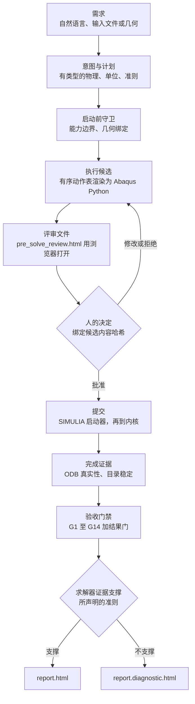
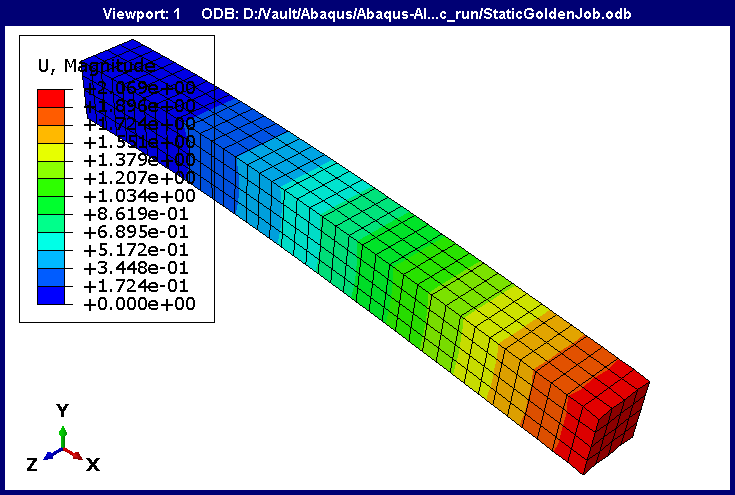
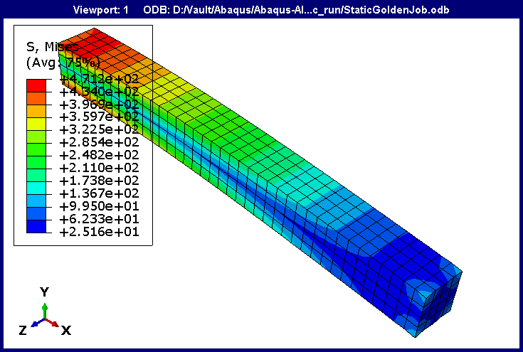

# Abaqus AI Agent

位于一条已陈述的分析需求与 Abaqus 之间的工程代理。它把需求编译成一个人能逐项核对的模型，只有这个人批准之后才提交求解，并且只有求解器自己写下的证据能支撑事先声明的准则时，才写出正式报告。

[English](README.md)

[](https://github.com/chenlei-gh/Abaqus-AI-Agent/actions/workflows/ci.yml)
[](https://www.python.org/)
[](LICENSE)

## 三件并不相同的事

多数自动化把三种不同的陈述压成一个成功信号。本包把它们分开，它产出的每一份文件都说明自己站在哪一种陈述上。

| 陈述 | 什么能证明它 | 什么不能 |
|---|---|---|
| 脚本跑过了 | 进程退出，并留下完成标记 | 只有一个返回码 |
| 作业做完了 | 通过真实性与完整性校验的 ODB，且工作目录已稳定 | 一个文件名正确的文件 |
| 答案可接受 | 全部验收门禁都对提交前声明的准则通过 | 一次绿色的运行、一张好看的云图、一个看起来合理的数值 |

正式报告是 `report.html`，只存在于第三种情况。否则交付物是 `report.diagnostic.html`。改文件名不会让它升级。

## 架构



脚本是从动作表渲染出来的。它不是模型的来源，也不是一个会与计划脱节、可被人手改的产物。

| `src/abaqus_ai_agent/` 下的包 | 职责 |
|---|---|
| `contracts/` | 动作、条件、审批、产物、准则的有类型记录 |
| `reasoning/` | 需求解析、材料与网格推断、合理性检查 |
| `grounding/` | 把命名区域解析成真实几何选择，并在策略层面拒绝发明区域 |
| `actions/` | 把计划变成确定性的建模脚本 |
| `execution/` | 启动器解析、提交、完成证据、审批服务 |
| `evidence/`、`results/` | 读取求解器实际产出了什么，以及它没有产出什么 |
| `acceptance.py` | 规范门序列与判定 |
| `reporting/` | 评审文件、正式报告、诊断报告 |

## 验收门禁

十七道门按固定顺序执行，因为前面一道已经失败时，后面一道的结论没有意义。顺序只在 `CANONICAL_GATE_ORDER` 里声明一次，并由判定器强制执行，而不是靠报告生成器自觉遵守。

```mermaid
flowchart LR
    subgraph P["来源与完整性"]
        direction TB
        p1["G1 执行"] --> p2["G2 ODB"] --> p3["G3 证据充分性"]
    end
    subgraph M["力学正确性"]
        direction TB
        m1["G4 数值验证"] --> m2["G5 工程检查"] --> m3["G6 网格质量"] --> m4["G7 收敛"]
    end
    subgraph X["过程专项"]
        direction TB
        x1["G8 疲劳"] --> x2["G9 接触"] --> x3["G10 分析过程"] --> x4["G11 热平衡"] --> x5["G11b 稳定化"] --> x6["G11c 动态能量"]
    end
    subgraph C["合约收口"]
        direction TB
        c1["G12 准则"] --> c2["G13 连接器运动学"] --> c3["G14 柔性多体"] --> c4["结果门"]
    end
    p3 --> m1
    m4 --> x1
    x6 --> c1
```



对某次分析不适用的门记为跳过，而不是记为通过。复合结果门负责收口其余各门开启的合约：一个作业可以收敛良好、网格良好，却仍然没有回答被提出的那个问题。

## 安装

两套解释器分开。本包装进普通 CPython 虚拟环境。Abaqus 保留自己的 Python，只能通过 SIMULIA 启动器调用。不要把本包装进 Abaqus/CAE 自带的 Python。

本包没有发布到 PyPI。从这棵源码树安装，并用 `python -m pip` 调用 pip，这样装到的就是刚检查过的那个解释器。不支持 `python setup.py install`。

Windows，在仓库根目录：

```bat
py -3.12 -m venv .venv
.venv\Scripts\activate.bat
python -m pip install --upgrade pip
python -m pip install .
python -m abaqus_ai_agent --help
```

macOS 或 Linux：

```bash
python3 -m venv .venv
source .venv/bin/activate
python -m pip install --upgrade pip
python -m pip install .
python -m abaqus_ai_agent --help
```

装上的是 `abaqus-ai-agent` 0.2.2。`pyproject.toml` 声明 `requires-python >=3.9`；持续集成在 Ubuntu 与 Windows 上测试 3.10、3.11、3.12。唯一的运行依赖是 `Pillow>=9`。控制台脚本是 `abaqus-ai-agent` 和 `abaqus-agent`。

要改这个仓库，用可编辑方式装上测试额外依赖，再跑离线测试。这一步不需要装 Abaqus：

```bat
python -m pip install -e ".[test]"
python -m pytest tests -q -m unit
```

在 `cmd` 里，`".[test]"` 的引号不能省，方括号是通配符。可编辑安装跟踪 `src/` 下的改动。`pyproject.toml` 里的依赖或入口脚本变了，要再执行同一条安装命令。

### Abaqus：本包不安装它

真机求解需要一套已经装好、并且有许可证的 Abaqus。本仓库不配置许可证服务器、`custom_v6.env`，也不保证 token 空闲，并且不附带任何许可证。

Abaqus 安装程序创建命令目录：Windows 上是 `C:\SIMULIA\Commands`，Linux 上是 `/var/DassaultSystemes/SIMULIA/Commands`。2025 的快捷命令是 `abq2025`；`abaqus` 是不带版本号的入口。

启动器按这个顺序解析：显式路径，`PATH` 上的 `abaqus`，然后是 Windows 上的 `C:\SIMULIA\Commands\abaqus.BAT`。

```bat
where abaqus
abaqus information=release
abaqus-ai-agent inspect --json
```

打出版本字符串，只说明启动器能用，不说明许可证 token 有空闲。`inspect` 找不到启动器，表示这台机器离线，不是本包装失败。

## 试一次

这一步路由需求，然后停止。它不启动 Abaqus，也是持续集成跑的那条命令。

```bat
abaqus-ai-agent ask "Apply 1000N vertical load to the free end of a 100mm cantilever beam, material steel, fixed root, check deflection <= 2.5mm." --dry-run
```

成功的 dry run 退出码为 0：

```text
Inferred Physics:   linear_static (Confidence: 0.79)
Unit System:        MM_N_MPA
Target Solver:      abaqus_standard
Completeness Score: 5.0 / 5.0
[DRY-RUN] Intent and plan contracts verified successfully. No solver invoked.
Solver invoked:     NO
Report authorized:  NO
```

同一句话如果没有写明载荷作用位置，退出码为 2，并指出 `missing_load_application_region`。这个停止是预定的：位置无法绑定的载荷，下游任何环节都不许猜。

## 求解之前先评审

建模与提交作业走 `AbaqusAIAgent.solve_requirement`。默认不提交。候选会写入运行工作目录下的 `pre_solve_review.html`，并用默认浏览器打开，这份文件就是评审：几何、网格、边界、载荷、材料、准则，以及将要执行的那份脚本原文。没有另一套交互界面，也没有需要再确认的隐藏状态。

```bat
abaqus-ai-agent approve --workdir ./run_workdir --by "analyst name"
```

审批记录绑定候选的内容哈希。候选一改，审批即失效，运行退回评审状态。记录里的审批人是一个标签，不是身份证明；哈希证明的是看过哪份文件，不是谁看的。

## 证据

仓库里带两类证据，它们回答的是不同的问题。

交付级算例，`deliverables/qualifications/case_01/` —— 100 × 10 × 10 mm 钢悬臂梁，线性静力，通过门链，`acceptance_status: PASS`：

| 端部位移 | von Mises 应力 |
|---|---|
|  |  |

`case_01_manifest.json` 记录的峰值：位移 2.0686 mm，von Mises 471.214 MPa。

基准校核，`machine_validation/official_cantilever_benchmark_evidence.json` —— 带许可证的 Abaqus 2025 上跑的 C3D20R 悬臂梁，端部剪切，与梁理论闭式解对照：

| 量 | 有限元 | 参考值 | 偏差 |
|---|---|---|---|
| 端部挠度 | 6.3330 mm | 6.4000 mm | 1.05 % |
| 积分点应力 | 138.89 MPa | 138.56 MPa | 0.23 % |
| 节点表面应力 | 254.12 MPa | 240.00 MPa | — |

启动器耗时 16.29 s，内核总耗时 17.80 s，ODB 386,836 字节且验签通过。这鉴定的是这一个算例。它不鉴定每一种分析过程、单元公式或接触定义，仓库也不作此声称。

## 它不替你决定的事

- 它不安装 Abaqus，不附带许可证，不管理 token。
- 它不决定传力路径、支承条件或验收准则是不是正确的工程问题。
- 它不发明几何，也不允许把边界或载荷放在无法绑定的区域上。
- 它不把诊断报告升格为正式报告。
- 生成的报告不是分析人员的签字。

## 文档

规划、合约与审计线索只有一份文档：[需求与规划](docs/PROJECT_REQUIREMENTS_AND_PLAN.md)。相关记录：[求解前审批入口矩阵](docs/presolve-approval-entry-matrix.md)、[几何绑定](docs/geometry-grounding.md)、[能力边界](docs/ai-agent-capability-boundary.md)。

## 帮助

问题与缺陷：[GitHub issues](https://github.com/chenlei-gh/Abaqus-AI-Agent/issues)。

## 许可证

[Apache License 2.0](LICENSE)。
