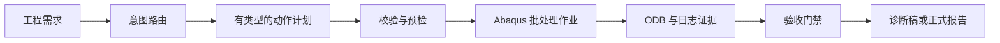

# Abaqus AI Agent

面向 Abaqus/CAE 的确定性工程代理。自然语言先编译成有类型的动作，执行前校验，只有求解证据和物理门禁一致时才允许正式交付。

[English](README.md)

[](https://github.com/chenlei-gh/Abaqus-AI-Agent/actions/workflows/ci.yml)
[](https://www.python.org/)
[](https://www.3ds.com/products-services/simulia/products/abaqus/)
[](LICENSE)

这是工程工具，不是认证求解器，也不能代替分析人员签字。求解器仍然是 Abaqus。本仓库不提供 Abaqus 许可证。

## 它做什么



1. 把需求路由成有类型的工程意图。几何、材料、载荷或约束缺失时，以 `NEEDS_CLARIFICATION` 停止。
2. 把受支持的动作编译成 Abaqus Python。未知动作类型会被拒绝。
3. 只有本机有 Abaqus 启动器和许可证时才真正求解。
4. 从 ODB 提取结果。区域表达式走白名单解析器，不使用 `eval()`。
5. 由求解状态、证据、物理判据和显式 `deliverable` 标志决定是否交付。
6. 报告只有一条生成路径。失败门禁不能被后续渲染改写成正式交付。

不配置 API Key 时，离线路由可用。TypeSafe System One（JEV）是可选的意图提供者。

## JEV 是什么，不是什么

JEV 回答结构化工程问题：物理域、单位制、求解器族、约束是否充分、有没有定量验收标准，以及完备性评分。默认端点是 `https://api.typesafe.ai/v1/systemone`，默认模型别名是 `jev-latest`。配置 `TYPESAFE_API_KEY` 即可；URL 可选。自定义 HTTPS 主机必须显式授权。

JEV **不会**：

- 批准代码、Pull Request 或发布；
- 授权生产报告；
- 代替 Abaqus、验收门禁或工程师；
- 从 `abaqus-ai-agent ask` 收到完整项目上下文。该命令目前只传 prompt。

`ROUTED` 或 `executable=true` 只表示意图路由认为结构够继续，不是物理批准。低置信度的验收标准仍必须经过确定性门禁。没有 Key 时回退到离线规则。草稿意图不可执行。

## 验收是四项检查，不是一个退出码

进程退出码为 0 不等于工程合格。

| 检查 | 问题 | 失败后果 |
| :--- | :--- | :--- |
| 求解状态 | Abaqus 作业是否真的完成？ | 不能正式交付 |
| 证据 | 清单、哈希、路径和 `run_id` 是否仍然一致？ | 阻断或标为无效 |
| 物理门禁 | 应力、反力平衡、位移、网格、接触、热平衡是否通过？ | 失败关闭 |
| 交付标志 | `deliverable` 是否显式为真？ | 缺标志不是通过 |

`ResultValidity` 的相等是严格字符串相等。自反、对称、传递是这个类型的数学性质，不是第五个验收维度。

证据清单上的 SHA-256 用来发现意外修改、损坏，以及摘要没有同步重算。它是完整性摘要，不是 HMAC，也不是数字签名。能改文件的人也能重算摘要。不要把它写成不可伪造或不可抵赖。

## 当前契约边界

下面是当前代码事实，不是路线图承诺。

**模型声明必须和 deck 一致。** 调用方传入 `inp_text` 时，声明的单元类型或塑性与 `*ELEMENT` / `*PLASTIC` 矛盾，会强制 `is_deliverable=False`。`AnalysisRunner` 会把 deck 契约警告写进 run。警告本身不会把合法的弹性模型或 `C3D4` 模型判失败。

**弹性应力超过屈服不是塑性。** 调用方传入 `elastic_validity`，且 deck 为纯弹性、屈服强度和峰值应力都是有限数、峰值超过屈服时，验收返回 `RESULT_INVALID`，`deliverable=False`。结果不得写成塑性变形。

**主路径现在会自己读取已求解的 deck。** `AnalysisRunner` 在 `<workdir>/<job>.inp` 存在时读取它，记录契约警告，并在屈服强度和提取应力都是有限数时组装 `elastic_validity`。`solve_requirement()` 会把这份 deck 文本传给 `build_and_render()`。声明的单元类型或塑性与 `*ELEMENT` / `*PLASTIC` 矛盾，仍然强制 `is_deliverable=False`。报告同时保留全场峰值和 99.5% 分位，分位数不能掩盖峰值。`C3D4` 警告本身不会把合法模型判失败。

**正式报告是 HTML。** `abaqus-ai-agent report` 默认输出 HTML，并拒绝把 Markdown 写成 `report.html`。门禁失败不会创建 `report.html`。代理可以写带非正式横幅的 `report.diagnostic.html`。`solve_user_inp(generate_report=True)` 仍然不会编造正式交付：没有代理验收结论和运行记录时，不写 `report.html`，也不写 `report.md`。管线外的手写文件仍然不受保护。

**Tie 脚本使用合法枚举。** 生成的 `Tie` 使用 `positionToleranceMethod=COMPUTED`，先尝试 `main`/`secondary`，类型不匹配时回退 `master`/`slave`。`COMPUTED_TOLERANCE` 不是 Abaqus 2025 的合法值，生成器不会写出它。

**判据计算失败关闭。** 布尔值、NaN、无穷，以及转换后的非有限数会被拒绝。负限值按正确方向放宽。严格零和 `|limit| < 1e-30` 不应用相对容差。`tolerance < 1e6` 只过滤异常输入；溢出靠计算后的有限性检查拦住。这个上界不是已批准的工程容差。

**ODB 区域失败关闭。** 只解析 `odb` 下的白名单属性和下标。函数调用、私有名称和解析失败会抛异常，不会把原始字符串传给 Abaqus。

**能力标签不是本次证书。** `resolve_capability()` 返回的 `qualification_level` 是 `WORKFLOW`。它只说明这条物理工作流已实现，不表示当前项目、当前 run 或本机已经通过机器验证。历史证据包里的 `QUALIFIED` 不能被复制到新作业上。

**自愈默认不改题。** 求解失败时可以诊断，并写出建议的边界、阻尼或步长修改。没有 `confirm_model_change=True` 时，不会添加 `ENCASTRE`、不会重跑，也不会用愈合 run 替换原失败 run。机构模型和许可证失败仍然拒绝自动改题。确认后的重跑必须在报告里写明改了什么。

## 验证分层

不要把下面几层合成一句“已认证”。

| 层次 | 能说明什么 | 不能说明什么 |
| :--- | :--- | :--- |
| 单元与契约测试 | 门禁、动作和报告阻断的 Python 行为 | 真实 Abaqus 求解 |
| GitHub Actions | 该提交实际跑过的 CI 矩阵 | 在进入默认分支且 CI 变绿之前，不能代表本 README 所在分支 |
| Golden 证据审计 | 既有证据包哈希仍然一致 | 一次新的物理求解 |
| Abaqus 2025 真机 | 有许可证的主机上，一次有记录的作业、ODB 和日志 | 全部工业物理能力 |

MS13L 工具缺陷分支上的本地回归是 **1373 passed**（`python -m pytest -q --tb=line`）。这是本地数字，不是 CI 徽章。`main` 的 CI 必须以该提交对应的 workflow 为准。Golden 审计不是真机求解。一次悬臂梁或拉手装配求解，不能证明接触、塑性、热机耦合、疲劳和导入装配都已具备生产资格。工作流能力标签同样不能代替这些验证。

静态悬臂梁生产脚本是集成探针，不是通用生产证书。引用前先看它的 `require_production` 设置，以及证据有没有被保留。

## 快速开始

Python 3.10、3.11 或 3.12。只有真实求解才需要 Abaqus 2025。

```bash
git clone https://github.com/chenlei-gh/Abaqus-AI-Agent.git
cd Abaqus-AI-Agent
python -m pip install -e ".[test]"
python -m pytest -q --tb=line
```

意图路由不会启动求解器，也不会授权报告：

```bash
abaqus-ai-agent ask "在 100 mm 钢悬臂梁自由端面施加 1000 N 向下载荷，根部面固定" --dry-run
```

不完整需求应返回退出码 2，并给出结构化缺失项。`ask` 不会转发项目上下文文件。要传入几何、材料和载荷证据，请在 Python 中调用 `JevIntentRouter.route(prompt, context=...)`。

可选的在线意图提供者：

```bash
# live 模式需要 TYPESAFE_API_KEY。
# TYPESAFE_API_URL 可选；默认使用官方 System One 端点。
abaqus-ai-agent ask "..." --mode live
```

## 仓库结构

```text
src/abaqus_ai_agent/
  actions/        有类型的 Abaqus 脚本动作和分发器
  contracts/      意图、证据、指标、单位
  diagnostics/    求解日志和 inp 契约诊断
  execution/      批处理、ODB 提取、沙箱
  reporting/      单一报告管线
  typesafe_intent.py
  acceptance.py
tests/            契约与回归测试
tools/            真机探针和影子评测；不是生产 API
machine_validation/  已审计证据包；测试时不要改写
```

`SUPPORTED_ACTION_TYPES` 中有 65 种受支持动作。脚本分发器与该集合对齐。不要再维护第二份注册表。

## 范围与许可证

Apache-2.0。见 [LICENSE](LICENSE)。

商业求解器许可、材料卡和工程签字属于部署方。问题反馈：<https://github.com/chenlei-gh/Abaqus-AI-Agent/issues>。

本 README 不声称 Dassault 认证，不声称密码学防伪，不把 JEV 输出当成批准，也不把未运行的 Abaqus 案例标成已验证。
