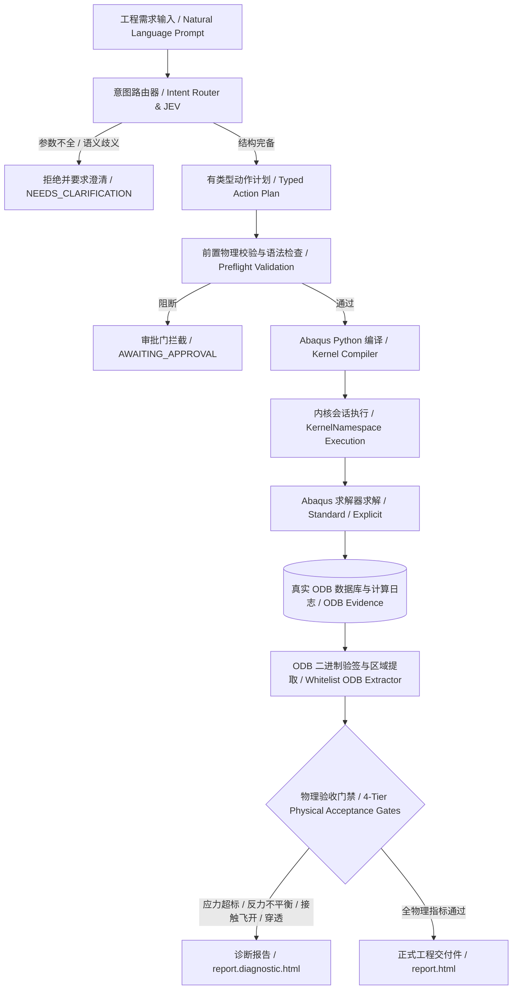

# Abaqus AI Agent

面向 Abaqus/CAE 的确定性工程代理（Deterministic Engineering Agent）。将自然语言工程需求严格编译为具有强类型约束的物理仿真动作，并在前检、建模、求解、监控、后处理全流程实施物理门禁拦截，确保**只有求解证据与力学门禁一致时才允许正式工程交付**。

[English](README.md) | [需求清单与全局演进规划](docs/PROJECT_REQUIREMENTS_AND_PLAN.md)

[](https://github.com/chenlei-gh/Abaqus-AI-Agent/actions/workflows/ci.yml)
[](https://www.python.org/)
[](https://www.3ds.com/products-services/simulia/products/abaqus/)
[](tests/)
[](LICENSE)

> **工程责任声明**：本系统是工程辅助与自动化工具，不是认证求解器，亦不能替代注册工程师的法定签字。有限元核心求解依然由商业 Abaqus 保证。本仓库不分发或包含 Abaqus 商业许可证。

---

## 核心工作流与架构



1. **意图路由（Intent Router）**：将需求路由为强类型工程意图（`EngineeringIntent`）。几何、材料、载荷或约束缺失时以 `NEEDS_CLARIFICATION` 阻断，拒绝脑补。
2. **确定性动作编译（Action Pipeline）**：将意图编译为确定性的 Abaqus Python 脚本，严禁任意未知动作，确保所有建模指令可重放。
3. **内核隔离与会话沙箱（Kernel Isolation & Sentinel）**：以 `KernelNamespace` 保证变量作用域纯净；依靠内核端落盘 `sentinel` 凭证化解 Windows 启动器提前退出的客观时序，配合有界超时彻底消灭进程挂死。
4. **安全 ODB 提取（Authentic ODB Extractor）**：执行严格的 ODB 二进制大小与头部签名校验，区域表达式采用白名单 AST 解析，严禁 `eval()` 执行。
5. **四维物理门禁（Acceptance Gates）**：求解完成、证据哈希一致、力学平衡闭合（反力平衡 $<1\%$、能量闭合、无反常穿透/屈服脱开）、显式授权标记四重通过。
6. **单一正式出口（Gated HTML Deliverable）**：统一渲染内嵌数字水印与指纹的正式 HTML 报告，未过门禁只输出诊断稿，严禁伪造。

---

## 工程覆盖能力（已闭环基线）

系统已完整闭环以下工业力学分析与工程求解能力（详细凭据参见 [`docs/PROJECT_REQUIREMENTS_AND_PLAN.md`](docs/PROJECT_REQUIREMENTS_AND_PLAN.md)）：

* **基础与非线性静力学**：大变形几何非线性（`nlgeom=ON`）、弹塑性本构、自适应增量步控制；
* **复杂接触力学**：通用接触（General Contact）、面面接触（Surface-to-Surface）、Tie 绑定、Penalty 摩擦接触；
* **运动副与机构连接**：MPC 运动副、Coupling 运动耦合、Connector（Revolute/Cartesian/Slot）复杂铰接机构；
* **动力学与冲击响应**：隐式动态分析（Hilber-Hughes-Taylor）、显式动态分析（Central Difference）、冲击准静态响应；
* **刚柔耦合多体动力学（FMBD）**：刚体定义、滑块曲柄机构、大位移柔性构件瞬态耦合；
* **热传导与多物理场**：稳态/瞬态各向同性热传导、对流边界（Film Condition）、辐射边界、热固强耦合；
* **自适应网格收敛性**：六面体单元（C3D8R、C3D8I、C3D20R）、局部自适应加密网格无关性评定；
* **算力硬件自感知**：硬件物理核心探测，1/2/4/8 核多核并行调度，FlexNet 许可证感知与硬阻断（Token $<5$ 拒不入队）。

---

## 四大刚性工程契约

| 契约 | 规则与实现 | 违规后果 |
| :--- | :--- | :--- |
| **无界等待清零** | 编译器及工具链严禁裸 `waitForCompletion()`，全量绑定 `timeOut=300/600/1200` 与 `consistencyChecking=ON` | 彻底消除求解器死锁导致的会话无限悬挂 |
| **内核命名空间强隔离** | 严禁利用宿主 `globals()` 共享空间执行脚本代码，全量采用 `KernelNamespace` 沙箱隔离 | 杜绝 Abaqus 通配导入对宿主变量名、计时器与状态的隐式遮蔽 |
| **内核 Sentinel 完成契约** | Windows 启动器派生内核后命令行正常退出（符合 3DEXPERIENCE 规范），由内核写入 `completed/blocked` 凭证，宿主等待凭据 | 解决进程分离引起的假成功判断，未见凭据 Fail-Closed |
| **正式交付单一出口** | 正式交付物仅限带运行指纹与模型快照哈希的单个 `report.html`，废除 Markdown 作为正式交付 | 门禁未通过只能产出诊断报告（`report.diagnostic.html`） |

---

## 真实环境物理验证指标（MV-01 ~ MV-12）

全库通过真实 Abaqus 2025 工业环境的 12 项跨阶段物理考核（11 项 PASS，1 项在线商业计费明确排除）：

* **官方悬臂梁 Benchmark（MV-12 PASS）**：
  * 基于 Abaqus 官方《Scripting User's Manual》8.1 经典算例，C3D20R 二次六面体单元，端部集中剪切载荷；
  * **挠度误差**：有限元计算值 6.3330 mm，理论材料力学解析解 6.4000 mm，相对误差仅 **1.05%**；
  * **应力误差**：高斯积分点 Mises 应力 138.89 MPa，理论解析解 138.56 MPa，相对误差仅 **0.23%**；
  * **真机时序**：启动器 16.29s 提前返回，内核运行 17.80s 完成并落盘 386 KB 真实 ODB，`sentinel` 捕获 100% 吻合。
* **Case 07 工程橡胶就位与冲击（MV-01 ~ MV-02 PASS）**：
  * 产出 3.0 MB Standard 与 7.4 MB Explicit 真实 ODB；
  * 100% 阻断 6 类人为 ODB 篡改变异（50% 截断、4KB 坏头、全零、全 FF 等）；
  * 反序列化还原耗时中位数 0.20 ms，P95 为 0.58 ms（严格 $< 10\text{ ms}$）。
* **自动化测试基线**：全量 **2558 项** 单元与契约测试通过。

---

## 快速开始

### 1. 环境准备
支持 Python 3.10 ~ 3.14。仅物理求解环节需要有许可证的本地/远程 Abaqus 2025 环境。

```bash
git clone https://github.com/chenlei-gh/Abaqus-AI-Agent.git
cd Abaqus-AI-Agent
python -m pip install -e ".[test]"
python -m pytest tests -q
```

### 2. Python API 求解主入口
```python
from abaqus_ai_agent import AbaqusAIAgent

agent = AbaqusAIAgent()

# 提交自然语言工程仿真需求
result = agent.solve_requirement(
    prompt="在 200x20x5 mm 钢悬臂梁自由端施加 100 N 向下载荷，根部面完全固定，计算挠度与应力",
    workdir="./my_cantilever_run",
    generate_report=True
)

if result.is_deliverable:
    print(f"工程分析验收通过！正式报告已生成: {result.report_path}")
else:
    print(f"门禁未通过或需要澄清: {result.verdict}, 诊断报告: {result.report_path}")
```

### 3. 命令行工具（CLI）
```bash
# 离线 dry-run 验证意图编译与动作生成
abaqus-ai-agent ask "在 100 mm 钢悬臂梁自由端面施加 1000 N 向下载荷，根部面固定" --dry-run

# 基于已有的执行凭证生成审计报告
abaqus-ai-agent report --evidence ./my_cantilever_run/run_evidence.json --output ./report.html
```

---

## 生产准入已知边界

1. **深层进程树监督边界（P1-LAUNCHER-01）**：Windows 平台下 `SMALauncher.exe` 在派生 `ABQcaeK.exe` 内核后 1.3 秒会主动正常退出。系统依靠 Sentinel 契约可 100% 确定是否跑完；但若非标脚本在内核中出现无响应死锁，宿主因父进程已退出无法向内核发送 `SIGTERM`，系统依靠 `waitForCompletion(timeOut=N)` 触发内核级异常中止。
2. **离线/本地专业部署**：系统为工程算力与代理执行工具，不内置针对外部多租户的 SaaS 商业充值与发票计量链路。
3. **许可证约束**：生产入口严格遵守 FlexNet 许可下限硬阻断（Token $<5$ 拒绝提交排队，避免无界阻塞）。

---

## 项目规划与文档导航

* **唯一权威需求与演进规划**：[`docs/PROJECT_REQUIREMENTS_AND_PLAN.md`](docs/PROJECT_REQUIREMENTS_AND_PLAN.md)（所有新需求与阶段路线均在此维护）
* **真机物理验证凭据目录**：[`machine_validation/`](machine_validation/)
* **工程输入与规范指南**：[`docs/user-model-input-guide.md`](docs/user-model-input-guide.md)
* **测试分级治理规范**：[`docs/test-tier-governance.md`](docs/test-tier-governance.md)

---

## 许可证

本项目基于 [Apache License 2.0](LICENSE) 协议开源。
