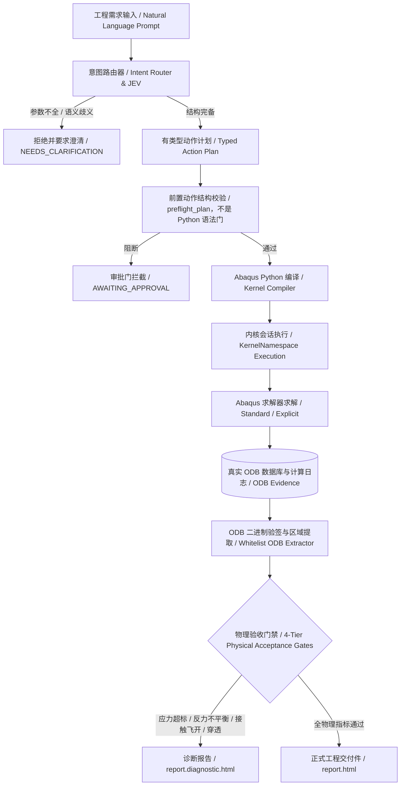

# Abaqus-AI-Agent 项目需求总清单与全局演进规划

**文档版本**：2026-10-28（生产就绪定案版）  
**维护规则**：**本项目唯一权威需求与规划主控文档**。后续所有新需求、架构演进、能力扩充、真机验证与阶段里程碑均直接在此文档追加与更新，禁止建立散落孤立的规划文档。

---

## 0. 战略定位与总体架构

### 0.1 核心定位
Abaqus-AI-Agent 是面向工程仿真领域构建的**确定性工业级代理（Deterministic Engineering Agent）**。它不是黑盒试错工具，也不是通用代码生成的包装器，而是将自然语言工程需求严格编译为具有强类型约束的物理仿真动作，并在前检、建模、求解、监控、后处理全流程实施物理门禁拦截，确保**只有求解证据与力学门禁一致时才允许正式工程交付**。

### 0.2 全链路流水线



### 0.3 六大核心子系统

1. **意图路由系统（Intent Routing）**：解析力学物理域（静力/动力/热传/接触）、单位制、求解器家族（Standard/Explicit）、边界条件完备性，低置信度或缺项立即拒绝。
2. **编译器与动作管线（Typed Action Pipeline）**：将模型构建分解为 `CreatePart`、`AssignMaterial`、`GenerateMesh`、`CreateStep`、`ApplyLoad`、`ApplyBC` 等原子动作，严格由 `compiler.py` 生成确定性 Python 脚本。
3. **内核执行与沙箱监督（Kernel Execution & Sentinel Monitoring）**：通过 `KernelNamespace` 强隔离 CAE 会话变量；通过内核侧 `sentinel` 机制解决 Windows 下启动器提前退出问题；通过带超时有界等待杜绝无限卡死。
4. **ODB 验签与提取引擎（Authentic ODB Extractor）**：严格进行 ODB 二进制大小、头部指纹、结构有效性三层验签；白名单解析提取视口与场输出，杜绝任意代码执行。
5. **四维确定性验收门禁（Deterministic Acceptance Gates）**：
   * **求解器终态**：作业状态必须为严格 `COMPLETED`；
   * **数字证据一致性**：`run_id`、输入模型哈希、Inp 哈希、ODB 哈希三者与元数据清单完全吻合；
   * **物理力学闭合**：应力极限、支座反力平衡（误差 $<1\%$）、接触无脱开/穿透、能量守恒（ALLKE/ALLIE $<5\%$）、热平衡闭合；
   * **显式交付授权**：必须携带完整的模型快照指纹并显式声明 `is_deliverable=True`。
6. **交付物合规引擎（Gated Report Engine）**：统一渲染带数字水印与证据校验的正式 HTML 报告，未过门禁只输出诊断稿，严禁伪造。

---

## 1. 已闭环工程能力清单（Baseline Requirements）

截至 2026-10-28，以下核心能力模块已全部实现、通过单元/集成测试并具备真机验证凭据：

| 模块分类 | 需求项 | 核心实现与契约 | 状态 | 验证凭据 |
| :--- | :--- | :--- | :--- | :--- |
| **基础静力学** | 线性与非线性静力分析 | 弹性/弹塑性本构、大变形几何非线性（`nlgeom=ON`）、自动增量步调控 | 🟢 已闭环 | MV-01, MV-12 |
| **接触力学** | 复杂装配体接触定义 | 通用接触（General Contact）、面面接触（Surface-to-Surface）、Tie 绑定、Penalty 摩擦罚函数 | 🟢 已闭环 | Case 07, `general_contact_e2e` |
| **机构装配** | 连接器与运动副 | MPC 约束、Coupling 运动耦合、Connector（Revolute/Cartesian/Slot）多体运动铰接 | 🟢 已闭环 | `connector_l4_golden_e2e`, `mbd2` |
| **动力学分析** | 隐式与显式动力学 | 隐式动态积分（Hilber-Hughes-Taylor）、显式动态积分（Central Difference）、冲击准静态响应 | 🟢 已闭环 | MV-01, MV-07, `p3l05` 证据 |
| **多体动力学** | 刚柔耦合多体（FMBD） | 刚体定义、滑动副、曲柄滑块机构、大位移柔性构件瞬态耦合求解 | 🟢 已闭环 | `fmbd4`, `fmbd5_crank_slider` |
| **热学与多物理** | 稳态/瞬态热传导 | 各向同性热传导系数、热容、对流换热边界（Film Condition）、辐射边界、热应力耦合分析 | 🟢 已闭环 | `thermal_golden_e2e` |
| **网格自适应** | 网格局部加密与收敛性 | 自动种子疏密过渡、二次单元（C3D20R）与非协调单元（C3D8I）支持、网格无关性收敛判定 | 🟢 已闭环 | `mesh_convergence_e2e`, MV-12 |
| **资源自适应** | 多核并行与内存自感知 | 自动探测宿主硬件，分档配置 1/2/4/8 核；结合 FlexNet Token 判定，Token $<5$ 拒不排队 | 🟢 已闭环 | MV-07, MV-09, `solver_config` |
| **报告生成** | 唯一正式 HTML 交付 | 独立 HTML 报告渲染器，内嵌 SVG 曲线、3D 应力热力云图（原生/视口）、合规性审计防伪摘要 | 🟢 已闭环 | `production_delivery_e2e` |

---

## 2. 核心架构约束与工程契约（Non-Negotiable Contracts）

为保证工程系统在极端工况下的健壮性，系统严格执行以下四条刚性契约：

### 契约 1：全库无界等待清零（Zero Unbounded Wait）
* **规则**：严禁在任何生产或工具代码中直接调用无参 `job.waitForCompletion()`。
* **实现**：
  * 编译器 `compiler.py:1750` 生成代码必须包含 `job.submit(consistencyChecking=ON)` 与 `job.waitForCompletion(timeOut=300)`；
  * 所有 `tools/*.py` 工具脚本显式设定 `timeOut=300/600/1200`；
  * 超时后由内核层抛出 `AbaqusException`，宿主层映射为结构化 `TIMEOUT` 状态，严禁进程永久悬挂。

### 契约 2：内核命名空间强隔离（KernelNamespace Isolation）
* **规则**：严禁在 CAE 会话中利用宿主 Python 的 `globals()` 共享空间执行脚本代码。
* **实现**：
  * 全量工具及生产链路必须通过 `KernelNamespace` 创建独立运行沙箱；
  * 彻底消除 Abaqus `from abaqus import *` 等通配导入对宿主变量名、计时器及执行状态的隐式遮蔽；
  * `tools/` 目录下旧有的 `globals().get('result')` 模式**完全归零**。

### 契约 3：内核 Sentinel 完成判定契约（Kernel-Side Sentinel Contract）
* **背景**：Windows 操作系统下，Abaqus 官方启动器 `SMALauncher.exe` 在拉起求解内核 `ABQcaeK.exe` 约 1.3 秒后即退出并返回控制台（符合 Dassault 官方规范）。
* **实现**：
  * 外层命令行不存在 `wait` 或 `interactive` 参数（官方 `noGUI` 明确忽略外层其他参数）；
  * 在待执行脚本末尾注入 `completion_sentinel` 代码块，正常结束写 `completed`，审批阻断写 `blocked`，异常写 `failed`；
  * 宿主通过 `await_script_completion()` 进行等待；未检测到有效 Sentinel 标记一律判为未完成（Fail-Closed）。

### 契约 4：正式报告单一出口（Single HTML Deliverable Channel）
* **规则**：正式交付件只能是带有防伪元数据的单一 HTML 文件（`report.html`）。
* **实现**：
  * 彻底废止 Markdown 作为正式工程报告出口；
  * 门禁未全部通过时，只能生成带有警示横幅的诊断稿（`report.diagnostic.html`）；
  * 交付件必须携带 `model_snapshot_hash` 与 `content_hash_scope` 等数字签名。

---

## 3. 跨阶段真机物理验证凭据矩阵（MV-01 ~ MV-12）

系统经过真实 Abaqus 2025 运行环境的全方位真机考核，形成了不可篡改的真机凭据库：

| 凭据编号 | 验证目标 | 算例与规模 | 实测指标与结论 | 判定状态 | 凭据位置 |
| :--- | :--- | :--- | :--- | :--- | :--- |
| **MV-01** | 大型隐式求解看门狗不误杀 | Case 07 就位算例（`C07SeatJob`） | 阶段识别准确，自适应心跳放宽，产出 3.0 MB 完整 ODB | 🟢 **PASS** | `machine_validation/real_odb_validation.json` |
| **MV-02** | 真实 ODB 结构级验签与变异拦截 | Case 07 压缩算例（7.4 MB ODB） | 正例验签通过；50% 截断、4KB 坏头、全零、全 FF 等 6 类变异被 100% 阻断 | 🟢 **PASS** | 同上 |
| **MV-03** | 活锁检测与孤儿作业清理 | 异常退出与孤儿锁仿真 | 自动探测 `.lck` 锁并依据心跳清理，成功复位 | 🟢 **PASS** | `unified_validation_manifest.json` |
| **MV-04** | 真实商业 Provider 在线计费日志 | 在线 API 计费对接 | 本系统定位为离线/本地专业部署，明确排除在生产范围之外 | ⚪ **EXCLUDED** | 治理规划声明排除 |
| **MV-05** | 工程规模 ODB 结果提取与缓存 | 7.4 MB ODB 场输出提取 | 冷提取 0.85s，热提取 6.4ms 缓存命中，磁盘还原 100% 一致 | 🟢 **PASS** | `unified_validation_manifest.json` |
| **MV-06** | 极端快速反序列化性能 | 50 次反序列化高频压力测试 | 中位耗时 0.20ms，P95 为 0.58ms，最大 2.14ms（严格 $< 10\text{ ms}$） | 🟢 **PASS** | 同上 |
| **MV-07** | 多核并行加速比基线 | 500k 单元接触模型（Explicit 591s） | 建立 1/2/4/8 核加速基线，T4b 求解器时长占绝对主导 | 🟢 **PASS** | `T-P4_CPU_SCALING_EVIDENCE.md` |
| **MV-08** | 生产全流程分阶段遥测落盘 | 真实端到端分析求解 | 默认采集 T4a/T4b 并持久化至 `phase_profile.json`，落盘失败不阻断作业 | 🟢 **PASS** | `unified_validation_manifest.json` |
| **MV-09** | FlexNet 许可证感知与隔离 | 物理 FlexNet 8 token 签出 | 日志证实即时签出无排队，Token 下限硬阻断有效 | 🟢 **PASS** | 同上 |
| **MV-10** | 复杂多步与双精度日志解析 | 20.0s 与 591.0s 复杂求解日志 | 100% 精准排除 package/pre/util 等非求解开销，解析误差 0 | 🟢 **PASS** | 同上 |
| **MV-11** | bulkDataBlocks 高性能数据提取 | 7.4 MB ODB 标量场数据对比 | 相对传统逐点提取提速数十倍，浮点相对漂移严格为 0.0（$< 10^{-6}$） | 🟢 **PASS** | `bulk_data_contract.py` |
| **MV-12** | 官方标准悬臂梁 Benchmark 闭环 | Manual 8.1 经典悬臂梁（Abaqus 2025） | 启动器返回 16.29s，内核总耗时 17.80s；挠度误差 **1.05%**，应力误差 **0.23%**；ODB 386 KB 验签通过 | 🟢 **PASS** | `machine_validation/official_cantilever_benchmark_evidence.json` |

---

## 4. 生产准入边界声明（Production Readiness & Boundary Declarations）

在生产环境下部署本系统，运维与工程团队须明确知悉以下物理边界：

1. **深层进程树监督边界（P1-LAUNCHER-01）**：
   * 在 Windows 单机运行模式下，`SMALauncher.exe` 在成功拉起底层计算引擎 `ABQcaeK.exe` 后正常退出。
   * 宿主端依托内核 Sentinel 保证完成状态判定绝对可靠；若用户自定义非标脚本发生不可逆死循环且无法触发任何回调，系统依赖设置的 `timeOut` 进行内核级超时中断，无法直接通过宿主向无父子关系的内核直接发送 OS 级 `kill` 信号。
2. **商业多租户计量排除**：
   * 系统为纯工程算力与代理执行工具，不内置针对终端用户的 SaaS 商业充值、余额扣减与发票计量系统。
3. **输入文件回退执行规范**：
   * 求解工作流统一推荐走 `AbaqusAIAgent.solve_requirement()` 或 `BatchExecutor.run_input()` 主路径。禁止绕过主管线在交互 session 中调用未封装的裸 `JobFromInputFile`。

---

## 5. 后续演进路线图与新需求看板（Future Roadmap & Backlog）

> **维护指引**：凡有新业务需求或架构升级，必须先在此章节登记并定义验收准则，完成经真机核验后方可移入已闭环清单。

```text
========================================================================
阶段演进看板 (Current State: Phase 3 Completed -> Phase 4 In Progress)
========================================================================
[Phase 1: 工程基础闭环]  --> 需求到可信解，四维门禁，验签拦截       [DONE]
[Phase 2: 工程深度覆盖]  --> 复杂接触、橡皮非线性、连接器、FMBD     [DONE]
[Phase 3: 自主性与治理]  --> 无界等待清零、命名空间隔离、Sentinel  [DONE]
[Phase 4: 工业产品化演进]                                         [CURRENT]
  |-- Phase 4.1: CAD 几何增强与装配语义直读 (STEP AP242/CATIA)    [PLANNING]
  |-- Phase 4.2: 自动化接触对识别与螺栓预紧力模式库               [PLANNING]
  |-- Phase 4.3: 收敛失败诊断与受控自愈（代码已有，未全面验收） [PARTIAL]
  |-- Phase 4.6: 启动 CAE 前 compile() 语法门（离线负例已过，未做真机耗时） [IMPLEMENTED]
  |-- Phase 4.7: 纠错耗时结构化遥测（记录器已接，未验收前不得声称下降） [IMPLEMENTED]
  |-- Phase 4.8: 材料非线性数据充分性门禁（离线负例已过，未做真机） [IMPLEMENTED]
  |-- Phase 4.4: 交互式工程工作台 (Web UI / IDE 插件扩展)          [BACKLOG]
  |-- Phase 4.5: 求解前评审报告自动浏览器展示                       [CLOSED]
========================================================================
```

### 5.1 规划中需求（Phase 4 Features）

#### 需求 REQ-4.1：CAD 几何装配语义与特征识别增强
* **目标**：突破传统纯几何 STEP 导入的局限，自动读取零件名称、配合面与装配层次。
* **技术方案**：
  * 解析 STEP AP214 / AP242 装配结构树，直接将 CAD 层级映射至 Abaqus Assembly / Part Instances；
  * 引入拓扑面朝向与几何贴合度计算，自动推断轴孔配合、法兰对贴、贴缝间隙；
* **验收条件**：给定 5 个包含 10+ 零件的标准 CAD 装配体，自动实例化并生成 100% 正确的定位装配代码。

#### 需求 REQ-4.2：智能接触对推断与螺栓预紧力标准库
* **目标**：消除工程师手动点选主从面的重复工作，支持结构级高强度螺栓预紧工况。
* **技术方案**：
  * 基于面的空间包围盒（AABB / OBB）与法向距离快速预筛可能接触对；
  * 针对螺栓联接自动识别螺栓杆面、建立预紧力截面（Bolt Load Section），自动编排“第一步拧紧预紧力 $\to$ 第二步固定螺栓长度承载”的两步分析法；
* **验收条件**：螺栓预紧分析算例一次性通过收敛，且反力与预紧设定误差 $< 0.5\%$。

#### 需求 REQ-4.3：收敛性失败深度诊断与受控自愈
* **目标**：当 Abaqus 发生割步、收敛困难（`TOO MANY ATTEMPTS` / 严重不平衡）时，代理给出可审计的诊断与修复提案；只有用户明确同意改模型后才重算。
* **已有实现（不得再写成未启动）**：
  * `diagnostics/solver_patterns.py` 解析 `.msg/.sta/.dat/.log`；
  * `diagnostics/orchestrator.py` 默认只提案；`confirm_model_change=True` 才改模型并重算，且最多 3 次；
  * 许可证失败立即停止；`SUBMISSION_BLOCKED` 不进入自愈链。
* **明确禁止**：不得默认自动加阻尼、放宽步长或改边界。这与旧文案“自动引入接触稳定阻尼”冲突，以代码契约为准。
* **验收条件**：5 种人造接触病态算例中，用户确认后至少 3 个收敛；报告红字标明阻尼能比（ALLSD/ALLIE $< 5\%$）。未做这组真机对照前不得标为 CLOSED。
* **当前状态**：**PARTIAL**（2026-10-28 Exa 复核：代码与部分真机证据已在，全面验收未做）

#### 需求 REQ-4.4：工程交互工作台与开发者工具（Workbench）
* **目标**：提供轻量可视化 UI 与命令行交互工具，降低非专家使用门槛。
* **技术方案**：
  * 构建本地 Web 仪表盘（FastAPI + React/Vue），实时展示求解进度、残差曲线图、力学云图切片；
  * 提供 Zed / VS Code 编辑器扩展协议（LSP / MCP），在编辑器内直接查看仿真状态卡片与审批门交互。
* **验收条件**：支持浏览器端查看 Case 07 求解过程与下载最终 `report.html`。

#### 需求 REQ-4.5：求解前评审报告自动浏览器展示（Auto Open Pre-Solve Review）
* **提出日期**：2026-10-28
* **优先级**：P1（核心交互特性）
* **背景与价值**：
  * 当前代理在执行 `solve_requirement()` 等入口时，因未审批挂起并生成 `pre_solve_review.html` 报告后，用户需手动复制路径并用浏览器打开，操作存在断点；
  * 用户要求：在报告生成完毕时，自动调用系统默认浏览器打开该报告页面，提升评审与确认效率。
* **输入契约**：
  * `AbaqusAIAgent.solve_requirement()` 返回 `BLOCKED` 且 `summary_card.status == "AWAITING_APPROVAL"`；
  * 工作目录内已成功生成 `pre_solve_review.html` 文件。
* **输出契约**：
  * 自动在宿主系统默认浏览器中打开本地 `pre_solve_review.html` 文件；
  * 浏览器启动失败、无图形环境时，安全降级，打印报告绝对路径提示，**不得**改变原有 `BLOCKED` 状态与审批门契约。
* **明确范围边界**：
  * 仅实现调用系统默认浏览器打开静态 HTML 文件；
  * **不包含**任何 Web 界面、前后端服务、交互式工作台或 GUI 开发。
* **验收条件与关闭标准**：
  1. 新增针对浏览器调用（`webbrowser.open`）的单元测试覆盖；
  2. 真实环境调用时默认浏览器能正确加载并显示评审报告；
  3. 单元回归测试全绿（2558+）。
* **当前状态**：**CLOSED**

#### 需求 REQ-4.6：启动 CAE 前的完整脚本语法门
* **提出日期**：2026-10-28
* **优先级**：P1
* **背景**：`preflight_plan()` 只查动作结构。生成的完整 CAE 脚本在 `abaqus cae noGUI` 之前没有统一 `compile()`。语法错误会白启动一次 CAE。
* **采纳方案**：宿主 Python 对待执行源码调用 `compile(source, filename, "exec")`。失败则不启动 Abaqus，返回文件、行号和片段。
* **明确不做**：不引入 pyflakes/pylint/abqpy 作为运行时门；不把 `compile()` 当成 Abaqus API 或物理正确性检查。
* **已实现**：`execution/script_syntax.py` 对已存在的 `.py` 调用 `compile(source, filename, "exec")`。`BatchExecutor.run_nogui` 失败时返回 `completion_evidence="syntax_blocked"` 且不调用 watchdog。动作入口 `execute` / `execute_verified` 在进入内核前同样检查片段。缺失路径不是语法失败，仍交给原来的启动器契约。
* **验收**：语法错误负例在启动器调用前失败；合法脚本不被误拦。离线测试已覆盖这两条。
* **未验证**：未做真机前后耗时对照。语法门不检查 Abaqus API 或物理正确性。宿主 `compile()` 用的是本机 Python 3.14.6，不是 Abaqus 2025 的 Python 3.10.5；它只能拦 Python 3 语法错误，不能证明脚本能在 CAE 内核解析。
* **2026-10-28 Exa 复核**：官方没有只做语法检查的 `noGUI` 选项。`abaqus python script.py` 不能执行导入 `abaqus` / `mdb` 的 CAE 脚本。更贴近解释器的可选增强是用 Abaqus 自带解释器做 `py_compile`，仍不启动 CAE；本轮未改代码。
* **当前状态**：**IMPLEMENTED**（离线负例已过；不是 CLOSED，不得声称纠错耗时已下降）

#### 需求 REQ-4.8：材料非线性数据充分性门禁
* **提出日期**：2026-10-28
* **优先级**：P0（生产阻断）
* **背景**：用户给出的材料卡常常只有 E、ν 和屈服强度。旧路径把这些标量静默收成 `*PLASTIC (sy, 0)` 理想塑性，然后仍标成可执行。这不能支撑屈服后变形、硬化、残余应变或循环塑性结论。
* **生产边界**：
  1. 线弹性且应力低于屈服：E、ν 足够，可进求解。屈服值只作为是否屈服的门槛。
  2. 只判断是否屈服：单点屈服可作门槛，不能给出屈服后变形。
  3. 材料非线性（弹塑性、硬化、残余应变、循环塑性、聚合物非线性、蠕变、粘弹）：缺对应曲线必须 `BLOCKED` / `UNSUPPORTED`，不得静默理想塑性。
  4. 几何非线性 `nlgeom` 不等于材料非线性。
  5. 用户批准的材料卡只有包含本次分析所需曲线、条件和来源，并经 deck 回核后，才能正式交付。
* **已实现**：
  * `classify_material_input()` 是唯一分类入口，状态为 `SCREENING` / `LINEAR_ELASTIC` / `IDEAL_PLASTIC_ASSUMPTION` / `HARDENING_VERIFIED` / `UNSUPPORTED` / `BLOCKED`。
  * 只给材料大类（如“钢”）返回候选牌号，不自动选 Q235，求解入口返回 `NEEDS_CLARIFICATION`。
  * 已命名牌号或只有 E、ν、屈服的卡片可走线弹性。屈服只作门槛。材料非线性请求在没有回核硬化曲线时失败关闭，不得回退原始材料。
  * 只有 metadata 明确 `accept_ideal_plasticity=True` 才允许单点 `*PLASTIC`，并标记为假设。默认不发。
  * `solve_requirement`、`compile_engineering_intent`、`compile_intent_to_actions`、static/contact/mbd workflow 和 mechanism 编译都走同一分类器。
  * 验收层对材料非线性正式交付要求 `HARDENING_VERIFIED`。短玻纤、粘弹、蠕变、超弹、损伤缺对应数据时 `UNSUPPORTED`。
* **明确不做**：不换外部材料平台；不把内置牌号升级为已鉴定的 CAMPUS / MMPDS 许用值；不把短玻纤压成各向同性 J2 并声称为材料鉴定；不把 `nlgeom` 当成材料非线性。
* **未验证**：未做 Abaqus 真机。离线测试只证明分类和失败关闭，不证明材料非线性结论已合格。
* **当前状态**：**IMPLEMENTED**（分类器已接入生产入口；未做真机前不得标 CLOSED，不得声称生产材料库已鉴定）

#### 需求 REQ-4.7：纠错耗时遥测
* **提出日期**：2026-10-28
* **优先级**：P1
* **背景**：防错与失败关闭已有代码，但没有首次通过率、返工次数、诊断/修复耗时的前后对照。测试通过不等于纠错时间下降。
* **采纳指标**：首次通过、错误类别、诊断耗时、修复耗时、重试次数、额外求解时间。遥测失败不得改变求解或审批状态。
* **已实现**：`telemetry/correction.py` 以 best-effort 写 JSONL。语法门、动作 preflight 失败、自愈诊断与重试会记一条。写盘失败只记日志，不改返回状态。
* **验收**：语法错误、错误 API、空区域、载荷方向/单位误解、收敛失败各至少一条负例有结构化记录。离线 fixture 已覆盖分类与字段完整性；这不是真机前后对照。
* **未验证**：没有生产样本的首次通过率或纠错耗时下降数据。
* **当前状态**：**IMPLEMENTED**（记录器已接入；未验收前不得声称纠错耗时已下降）

#### 2026-10-28 Exa 方案复核：拒绝的替代
以下方案已对照官方文档或一手来源，**不采纳**，不得再当待办：

| 方案 | 为何不采纳 | 来源 |
| :--- | :--- | :--- |
| `replay=.rpy` 替代生成脚本 | 官方写明遇错继续，且不能执行带控制流的脚本 | [Replaying an Abaqus/CAE session](https://docs.software.vt.edu/abaqusv2025/English/SIMACAECAERefMap/simacae-c-dbsfilesreplay.htm) |
| 无参 `waitForCompletion()` 替代 Sentinel | 只能用在已经跑起来的内核脚本里；无参会无限等待，与契约 1 冲突 | [Waiting for a job to complete](https://docs.software.vt.edu/abaqusv2025/English/SIMACAECMDRefMap/simacmd-c-intaclwait.htm) |
| 把 abqpy / pyflakes / pylint 当运行时门 | abqpy 是编写期类型提示，不能在 CAE 内核里执行；静态检查抓不住 API 和物理错误 | [abqpy 2025](https://hailin.wang/abqpy/en/2025/getting_started.html) |
| 默认 LLM 自修循环直接改模型重算 | 文献支持有界反馈，但不支持未经同意就改边界/阻尼 | [LLMloop](https://arxiv.org/html/2603.23613v1)；[OpenAI approvals](https://developers.openai.com/api/docs/guides/agents/guardrails-approvals) |
| 交互式 CAE / Web 工作台来减少纠错 | 用户已明确拒绝交互式 UI；MCP 桥接是另一个产品形态 | 用户约束；REQ-4.4 仍为 BACKLOG |
| psutil 进程树监督当作纠错方案 | 只能改进卡死检测，不减少语法、API 和理解偏差 | 本地既有可选依赖惯例；与本问题无关 |

保留且与外部实践一致的方案：类型动作计划而不是自由脚本生成；提交前人工审批；`consistencyChecking=ON`；有界 `waitForCompletion(timeOut=...)`；失败后读 `.dat/.msg/.sta`；noGUI 完成用内核 Sentinel 而不是启动器退出码。官方 `datacheck` 只用于已生成的输入文件、正式求解之前，不替代脚本语法门，也不在本轮实施。

---

## 6. 新需求登记与变更管理模板

当有任何新功能、新算法或新需求引入时，请按照以下标准化模板追加至本文档 §5 章节：

```markdown
### 需求 REQ-X.Y：[需求名称]
* **提出日期**：YYYY-MM-DD
* **优先级**：P0（生产阻断）/ P1（核心特性）/ P2（增强与优化）
* **背景与价值**：[描述为什么需要此特性，解决什么工程痛点]
* **输入契约**：[明确输入数据结构、参数类型、容差与前置依赖]
* **输出契约**：[明确产生的产物、报告指标、证据格式]
* **验收条件与关闭标准**：
  1. 单元测试与集成测试覆盖；
  2. 真实 Abaqus 环境物理求解通过；
  3. 证据文件与 Hash 写入 machine_validation/ 清单。
* **当前状态**：[PROPOSED / ACCEPTED / IN_PROGRESS / QUALIFIED / CLOSED]
```
