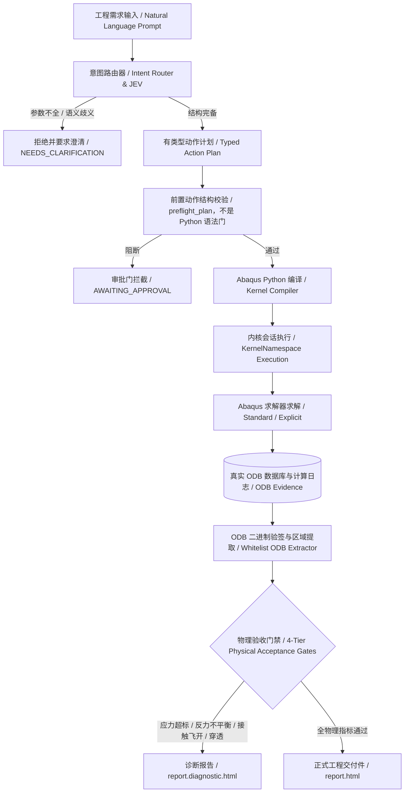

# Abaqus-AI-Agent 项目需求总清单与全局演进规划

**文档版本**：2026-10-28（生产就绪定案版）  
**维护规则**：**本项目唯一权威需求与规划主控文档**。后续所有新需求、架构演进、能力扩充、真机验证与阶段里程碑均直接在此文档追加与更新，禁止建立散落孤立的规划文档。

---

## 0. 战略定位与总体架构

### 0.1 核心定位
Abaqus-AI-Agent 是面向工程仿真领域构建的**确定性工业级代理（Deterministic Engineering Agent）**。它不是黑盒试错工具，也不是通用代码生成的包装器，而是将自然语言工程需求严格编译为具有强类型约束的物理仿真动作，并在前检、建模、求解、监控、后处理全流程实施物理门禁拦截，确保**只有求解证据与力学门禁一致时才允许正式工程交付**。

### 0.2 全链路流水线



### 0.3 六大核心子系统

1. **意图路由系统（Intent Routing）**：解析力学物理域（静力/动力/热传/接触）、单位制、求解器家族（Standard/Explicit）、边界条件完备性，低置信度或缺项立即拒绝。
2. **编译器与动作管线（Typed Action Pipeline）**：将模型构建分解为 `CreatePart`、`AssignMaterial`、`GenerateMesh`、`CreateStep`、`ApplyLoad`、`ApplyBC` 等原子动作，严格由 `compiler.py` 生成确定性 Python 脚本。
3. **内核执行与沙箱监督（Kernel Execution & Sentinel Monitoring）**：通过 `KernelNamespace` 强隔离 CAE 会话变量；通过内核侧 `sentinel` 机制解决 Windows 下启动器提前退出问题；通过带超时有界等待杜绝无限卡死。
4. **ODB 验签与提取引擎（Authentic ODB Extractor）**：严格进行 ODB 二进制大小、头部指纹、结构有效性三层验签；白名单解析提取视口与场输出，杜绝任意代码执行。
5. **四维确定性验收门禁（Deterministic Acceptance Gates）**：
   * **求解器终态**：作业状态必须为严格 `COMPLETED`；
   * **数字证据一致性**：`run_id`、输入模型哈希、Inp 哈希、ODB 哈希三者与元数据清单完全吻合；
   * **物理力学闭合**：应力极限、支座反力平衡（误差 $<1\%$）、接触无脱开/穿透、能量守恒（ALLKE/ALLIE $<5\%$）、热平衡闭合；
   * **显式交付授权**：必须携带完整的模型快照指纹并显式声明 `is_deliverable=True`。
6. **交付物合规引擎（Gated Report Engine）**：统一渲染带数字水印与证据校验的正式 HTML 报告，未过门禁只输出诊断稿，严禁伪造。

---

## 1. 已闭环工程能力清单（Baseline Requirements）

截至 2026-10-28，以下核心能力模块已全部实现、通过单元/集成测试并具备真机验证凭据：

| 模块分类 | 需求项 | 核心实现与契约 | 状态 | 验证凭据 |
| :--- | :--- | :--- | :--- | :--- |
| **基础静力学** | 线性与非线性静力分析 | 弹性/弹塑性本构、大变形几何非线性（`nlgeom=ON`）、自动增量步调控 | 🟢 已闭环 | MV-01, MV-12 |
| **接触力学** | 复杂装配体接触定义 | 通用接触（General Contact）、面面接触（Surface-to-Surface）、Tie 绑定、Penalty 摩擦罚函数 | 🟢 已闭环 | Case 07, `general_contact_e2e` |
| **机构装配** | 连接器与运动副 | MPC 约束、Coupling 运动耦合、Connector（Revolute/Cartesian/Slot）多体运动铰接 | 🟢 已闭环 | `connector_l4_golden_e2e`, `mbd2` |
| **动力学分析** | 隐式与显式动力学 | 隐式动态积分（Hilber-Hughes-Taylor）、显式动态积分（Central Difference）、冲击准静态响应 | 🟢 已闭环 | MV-01, MV-07, `p3l05` 证据 |
| **多体动力学** | 刚柔耦合多体（FMBD） | 刚体定义、滑动副、曲柄滑块机构、大位移柔性构件瞬态耦合求解 | 🟢 已闭环 | `fmbd4`, `fmbd5_crank_slider` |
| **热学与多物理** | 稳态/瞬态热传导 | 各向同性热传导系数、热容、对流换热边界（Film Condition）、辐射边界、热应力耦合分析 | 🟢 已闭环 | `thermal_golden_e2e` |
| **网格自适应** | 网格局部加密与收敛性 | 自动种子疏密过渡、二次单元（C3D20R）与非协调单元（C3D8I）支持、网格无关性收敛判定 | 🟢 已闭环 | `mesh_convergence_e2e`, MV-12 |
| **资源自适应** | 多核并行与内存自感知 | 自动探测宿主硬件，分档配置 1/2/4/8 核；结合 FlexNet Token 判定，Token $<5$ 拒不排队 | 🟢 已闭环 | MV-07, MV-09, `solver_config` |
| **报告生成** | 唯一正式 HTML 交付 | 独立 HTML 报告渲染器，内嵌 SVG 曲线、3D 应力热力云图（原生/视口）、合规性审计防伪摘要 | 🟢 已闭环 | `production_delivery_e2e` |

---

## 2. 核心架构约束与工程契约（Non-Negotiable Contracts）

为保证工程系统在极端工况下的健壮性，系统严格执行以下四条刚性契约：

### 契约 1：全库无界等待清零（Zero Unbounded Wait）
* **规则**：严禁在任何生产或工具代码中直接调用无参 `job.waitForCompletion()`。
* **实现**：
  * 编译器 `compiler.py:1750` 生成代码必须包含 `job.submit(consistencyChecking=ON)` 与 `job.waitForCompletion(timeOut=300)`；
  * 所有 `tools/*.py` 工具脚本显式设定 `timeOut=300/600/1200`；
  * 超时后由内核层抛出 `AbaqusException`，宿主层映射为结构化 `TIMEOUT` 状态，严禁进程永久悬挂。

### 契约 2：内核命名空间强隔离（KernelNamespace Isolation）
* **规则**：严禁在 CAE 会话中利用宿主 Python 的 `globals()` 共享空间执行脚本代码。
* **实现**：
  * 全量工具及生产链路必须通过 `KernelNamespace` 创建独立运行沙箱；
  * 彻底消除 Abaqus `from abaqus import *` 等通配导入对宿主变量名、计时器及执行状态的隐式遮蔽；
  * `tools/` 目录下旧有的 `globals().get('result')` 模式**完全归零**。

### 契约 3：内核 Sentinel 完成判定契约（Kernel-Side Sentinel Contract）
* **背景**：Windows 操作系统下，Abaqus 官方启动器 `SMALauncher.exe` 在拉起求解内核 `ABQcaeK.exe` 约 1.3 秒后即退出并返回控制台（符合 Dassault 官方规范）。
* **实现**：
  * 外层命令行不存在 `wait` 或 `interactive` 参数（官方 `noGUI` 明确忽略外层其他参数）；
  * 在待执行脚本末尾注入 `completion_sentinel` 代码块，正常结束写 `completed`，审批阻断写 `blocked`，异常写 `failed`；
  * 宿主通过 `await_script_completion()` 进行等待；未检测到有效 Sentinel 标记一律判为未完成（Fail-Closed）。

### 契约 4：正式报告单一出口（Single HTML Deliverable Channel）
* **规则**：正式交付件只能是带有防伪元数据的单一 HTML 文件（`report.html`）。
* **实现**：
  * 彻底废止 Markdown 作为正式工程报告出口；
  * 门禁未全部通过时，只能生成带有警示横幅的诊断稿（`report.diagnostic.html`）；
  * 交付件必须携带 `model_snapshot_hash` 与 `content_hash_scope` 等数字签名。

---

## 3. 跨阶段真机物理验证凭据矩阵（MV-01 ~ MV-12）

系统经过真实 Abaqus 2025 运行环境的全方位真机考核，形成了不可篡改的真机凭据库：

| 凭据编号 | 验证目标 | 算例与规模 | 实测指标与结论 | 判定状态 | 凭据位置 |
| :--- | :--- | :--- | :--- | :--- | :--- |
| **MV-01** | 大型隐式求解看门狗不误杀 | Case 07 就位算例（`C07SeatJob`） | 阶段识别准确，自适应心跳放宽，产出 3.0 MB 完整 ODB | 🟢 **PASS** | `machine_validation/real_odb_validation.json` |
| **MV-02** | 真实 ODB 结构级验签与变异拦截 | Case 07 压缩算例（7.4 MB ODB） | 正例验签通过；50% 截断、4KB 坏头、全零、全 FF 等 6 类变异被 100% 阻断 | 🟢 **PASS** | 同上 |
| **MV-03** | 活锁检测与孤儿作业清理 | 异常退出与孤儿锁仿真 | 自动探测 `.lck` 锁并依据心跳清理，成功复位 | 🟢 **PASS** | `unified_validation_manifest.json` |
| **MV-04** | 真实商业 Provider 在线计费日志 | 在线 API 计费对接 | 本系统定位为离线/本地专业部署，明确排除在生产范围之外 | ⚪ **EXCLUDED** | 治理规划声明排除 |
| **MV-05** | 工程规模 ODB 结果提取与缓存 | 7.4 MB ODB 场输出提取 | 冷提取 0.85s，热提取 6.4ms 缓存命中，磁盘还原 100% 一致 | 🟢 **PASS** | `unified_validation_manifest.json` |
| **MV-06** | 极端快速反序列化性能 | 50 次反序列化高频压力测试 | 中位耗时 0.20ms，P95 为 0.58ms，最大 2.14ms（严格 $< 10\text{ ms}$） | 🟢 **PASS** | 同上 |
| **MV-07** | 多核并行加速比基线 | 500k 单元接触模型（Explicit 591s） | 建立 1/2/4/8 核加速基线，T4b 求解器时长占绝对主导 | 🟢 **PASS** | `T-P4_CPU_SCALING_EVIDENCE.md` |
| **MV-08** | 生产全流程分阶段遥测落盘 | 真实端到端分析求解 | 默认采集 T4a/T4b 并持久化至 `phase_profile.json`，落盘失败不阻断作业 | 🟢 **PASS** | `unified_validation_manifest.json` |
| **MV-09** | FlexNet 许可证感知与隔离 | 物理 FlexNet 8 token 签出 | 日志证实即时签出无排队，Token 下限硬阻断有效 | 🟢 **PASS** | 同上 |
| **MV-10** | 复杂多步与双精度日志解析 | 20.0s 与 591.0s 复杂求解日志 | 100% 精准排除 package/pre/util 等非求解开销，解析误差 0 | 🟢 **PASS** | 同上 |
| **MV-11** | bulkDataBlocks 高性能数据提取 | 7.4 MB ODB 标量场数据对比 | 相对传统逐点提取提速数十倍，浮点相对漂移严格为 0.0（$< 10^{-6}$） | 🟢 **PASS** | `bulk_data_contract.py` |
| **MV-12** | 官方标准悬臂梁 Benchmark 闭环 | Manual 8.1 经典悬臂梁（Abaqus 2025） | 启动器返回 16.29s，内核总耗时 17.80s；挠度误差 **1.05%**，应力误差 **0.23%**；ODB 386 KB 验签通过 | 🟢 **PASS** | `machine_validation/official_cantilever_benchmark_evidence.json` |

---

## 4. 生产准入边界声明（Production Readiness & Boundary Declarations）

在生产环境下部署本系统，运维与工程团队须明确知悉以下物理边界：

1. **深层进程树监督边界（P1-LAUNCHER-01）**：
   * 在 Windows 单机运行模式下，`SMALauncher.exe` 在成功拉起底层计算引擎 `ABQcaeK.exe` 后正常退出。
   * 宿主端依托内核 Sentinel 保证完成状态判定绝对可靠；若用户自定义非标脚本发生不可逆死循环且无法触发任何回调，系统依赖设置的 `timeOut` 进行内核级超时中断，无法直接通过宿主向无父子关系的内核直接发送 OS 级 `kill` 信号。
2. **商业多租户计量排除**：
   * 系统为纯工程算力与代理执行工具，不内置针对终端用户的 SaaS 商业充值、余额扣减与发票计量系统。
3. **输入文件回退执行规范**：
   * 求解工作流统一推荐走 `AbaqusAIAgent.solve_requirement()` 或 `BatchExecutor.run_input()` 主路径。禁止绕过主管线在交互 session 中调用未封装的裸 `JobFromInputFile`。

---

## 5. 后续演进路线图与新需求看板（Future Roadmap & Backlog）

> **维护指引**：凡有新业务需求或架构升级，必须先在此章节登记并定义验收准则，完成经真机核验后方可移入已闭环清单。

```text
========================================================================
阶段演进看板 (Current State: Phase 3 Completed -> Phase 4 In Progress)
========================================================================
[Phase 1: 工程基础闭环]  --> 需求到可信解，四维门禁，验签拦截       [DONE]
[Phase 2: 工程深度覆盖]  --> 复杂接触、橡皮非线性、连接器、FMBD     [DONE]
[Phase 3: 自主性与治理]  --> 无界等待清零、命名空间隔离、Sentinel  [DONE]
[Phase 4: 工业产品化演进]                                         [CURRENT]
  |-- Phase 4.1: CAD 几何增强与装配语义直读 (STEP AP242/CATIA)    [PLANNING]
  |-- Phase 4.2: 自动化接触对识别与螺栓预紧力模式库               [PLANNING]
  |-- Phase 4.3: 收敛失败诊断与受控自愈（代码已有，未全面验收） [PARTIAL]
  |-- Phase 4.6: 启动 CAE 前 compile() 语法门（离线负例已过，未做真机耗时） [IMPLEMENTED]
  |-- Phase 4.7: 纠错耗时结构化遥测（记录器已接，未验收前不得声称下降） [IMPLEMENTED]
  |-- Phase 4.8: 材料非线性数据充分性门禁（deck 门禁有真机证据，非线性结论未鉴定） [IMPLEMENTED]
  |-- Phase 4.9: S2–S6 已接入网格链；生产默认未切换，真机边覆盖未验证，不是 CLOSED [IMPLEMENTED]
  |-- Phase 4.10: 接触诊断只读已有 ODB；缺期望或字段冲突不算通过 [IMPLEMENTED]
  |-- Phase 4.11: 解的网格收敛默认关闭；质量通过不是收敛 [IMPLEMENTED]
  |-- Phase 4.12: 几何定位校验放进 CAE 脚本，绑定前拒绝 [IMPLEMENTED]
  |-- Phase 4.13: 修复只提案；确认也不自动加边界/阻尼/网格 [IMPLEMENTED]
  |-- Phase 4.14: 敏感性默认关闭；只接受显式局部筛选 [IMPLEMENTED]
  |-- Phase 4.4: 交互式工程工作台 (Web UI / IDE 插件扩展)          [BACKLOG]
  |-- Phase 4.5: 求解前评审报告自动浏览器展示                       [CLOSED]
========================================================================
```

### 5.1 规划中需求（Phase 4 Features）

#### 需求 REQ-4.1：CAD 几何装配语义与特征识别增强
* **目标**：突破传统纯几何 STEP 导入的局限，自动读取零件名称、配合面与装配层次。
* **技术方案**：
  * 解析 STEP AP214 / AP242 装配结构树，直接将 CAD 层级映射至 Abaqus Assembly / Part Instances；
  * 引入拓扑面朝向与几何贴合度计算，自动推断轴孔配合、法兰对贴、贴缝间隙；
* **验收条件**：给定 5 个包含 10+ 零件的标准 CAD 装配体，自动实例化并生成 100% 正确的定位装配代码。

#### 需求 REQ-4.2：智能接触对推断与螺栓预紧力标准库
* **目标**：消除工程师手动点选主从面的重复工作，支持结构级高强度螺栓预紧工况。
* **技术方案**：
  * 基于面的空间包围盒（AABB / OBB）与法向距离快速预筛可能接触对；
  * 针对螺栓联接自动识别螺栓杆面、建立预紧力截面（Bolt Load Section），自动编排“第一步拧紧预紧力 $\to$ 第二步固定螺栓长度承载”的两步分析法；
* **验收条件**：螺栓预紧分析算例一次性通过收敛，且反力与预紧设定误差 $< 0.5\%$。

#### 需求 REQ-4.3：收敛性失败深度诊断与受控自愈
* **目标**：当 Abaqus 发生割步、收敛困难（`TOO MANY ATTEMPTS` / 严重不平衡）时，代理给出可审计的诊断与修复提案；只有用户明确同意改模型后才重算。
* **已有实现（不得再写成未启动）**：
  * `diagnostics/solver_patterns.py` 解析 `.msg/.sta/.dat/.log`；
  * `diagnostics/orchestrator.py` 默认只提案；`confirm_model_change=True` 才改模型并重算，且最多 3 次；
  * 许可证失败立即停止；`SUBMISSION_BLOCKED` 不进入自愈链。
* **明确禁止**：不得默认自动加阻尼、放宽步长或改边界。这与旧文案“自动引入接触稳定阻尼”冲突，以代码契约为准。
* **验收条件**：5 种人造接触病态算例中，用户确认后至少 3 个收敛；报告红字标明阻尼能比（ALLSD/ALLIE $< 5\%$）。未做这组真机对照前不得标为 CLOSED。
* **当前状态**：**PARTIAL**（2026-10-28 Exa 复核：代码与部分真机证据已在，全面验收未做）

#### 需求 REQ-4.4：工程交互工作台与开发者工具（Workbench）
* **目标**：提供轻量可视化 UI 与命令行交互工具，降低非专家使用门槛。
* **技术方案**：
  * 构建本地 Web 仪表盘（FastAPI + React/Vue），实时展示求解进度、残差曲线图、力学云图切片；
  * 提供 Zed / VS Code 编辑器扩展协议（LSP / MCP），在编辑器内直接查看仿真状态卡片与审批门交互。
* **验收条件**：支持浏览器端查看 Case 07 求解过程与下载最终 `report.html`。

#### 需求 REQ-4.5：求解前评审报告自动浏览器展示（Auto Open Pre-Solve Review）
* **提出日期**：2026-10-28
* **优先级**：P1（核心交互特性）
* **背景与价值**：
  * 当前代理在执行 `solve_requirement()` 等入口时，因未审批挂起并生成 `pre_solve_review.html` 报告后，用户需手动复制路径并用浏览器打开，操作存在断点；
  * 用户要求：在报告生成完毕时，自动调用系统默认浏览器打开该报告页面，提升评审与确认效率。
* **输入契约**：
  * `AbaqusAIAgent.solve_requirement()` 返回 `BLOCKED` 且 `summary_card.status == "AWAITING_APPROVAL"`；
  * 工作目录内已成功生成 `pre_solve_review.html` 文件。
* **输出契约**：
  * 自动在宿主系统默认浏览器中打开本地 `pre_solve_review.html` 文件；
  * 浏览器启动失败、无图形环境时，安全降级，打印报告绝对路径提示，**不得**改变原有 `BLOCKED` 状态与审批门契约。
* **明确范围边界**：
  * 仅实现调用系统默认浏览器打开静态 HTML 文件；
  * **不包含**任何 Web 界面、前后端服务、交互式工作台或 GUI 开发。
* **验收条件与关闭标准**：
  1. 新增针对浏览器调用（`webbrowser.open`）的单元测试覆盖；
  2. 真实环境调用时默认浏览器能正确加载并显示评审报告；
  3. 单元回归测试全绿（2558+）。
* **当前状态**：**CLOSED**

#### 需求 REQ-4.6：启动 CAE 前的完整脚本语法门
* **提出日期**：2026-10-28
* **优先级**：P1
* **背景**：`preflight_plan()` 只查动作结构。生成的完整 CAE 脚本在 `abaqus cae noGUI` 之前没有统一 `compile()`。语法错误会白启动一次 CAE。
* **采纳方案**：宿主 Python 对待执行源码调用 `compile(source, filename, "exec")`。失败则不启动 Abaqus，返回文件、行号和片段。
* **明确不做**：不引入 pyflakes/pylint/abqpy 作为运行时门；不把 `compile()` 当成 Abaqus API 或物理正确性检查。
* **已实现**：`execution/script_syntax.py` 对已存在的 `.py` 调用 `compile(source, filename, "exec")`。`BatchExecutor.run_nogui` 失败时返回 `completion_evidence="syntax_blocked"` 且不调用 watchdog。动作入口 `execute` / `execute_verified` 在进入内核前同样检查片段。缺失路径不是语法失败，仍交给原来的启动器契约。
* **验收**：语法错误负例在启动器调用前失败；合法脚本不被误拦。离线测试已覆盖这两条。
* **未验证**：未做真机前后耗时对照。语法门不检查 Abaqus API 或物理正确性。宿主 `compile()` 用的是本机 Python 3.14.6，不是 Abaqus 2025 的 Python 3.10.5；它只能拦 Python 3 语法错误，不能证明脚本能在 CAE 内核解析。
* **2026-10-28 Exa 复核**：官方没有只做语法检查的 `noGUI` 选项。`abaqus python script.py` 不能执行导入 `abaqus` / `mdb` 的 CAE 脚本。更贴近解释器的可选增强是用 Abaqus 自带解释器做 `py_compile`，仍不启动 CAE；本轮未改代码。
* **当前状态**：**IMPLEMENTED**（离线负例已过；不是 CLOSED，不得声称纠错耗时已下降）

#### 需求 REQ-4.8：材料非线性数据充分性门禁
* **提出日期**：2026-10-28
* **优先级**：P0（生产阻断）
* **背景**：用户给出的材料卡常常只有 E、ν 和屈服强度。旧路径把这些标量静默收成 `*PLASTIC (sy, 0)` 理想塑性，然后仍标成可执行。这不能支撑屈服后变形、硬化、残余应变或循环塑性结论。
* **生产边界**：
  1. 线弹性且应力低于屈服：E、ν 足够，可进求解。屈服值只作为是否屈服的门槛。
  2. 只判断是否屈服：单点屈服可作门槛，不能给出屈服后变形。
  3. 材料非线性（弹塑性、硬化、残余应变、循环塑性、聚合物非线性、蠕变、粘弹）：缺对应曲线必须 `BLOCKED` / `UNSUPPORTED`，不得静默理想塑性。
  4. 几何非线性 `nlgeom` 不等于材料非线性。
  5. 用户批准的材料卡只有包含本次分析所需曲线、条件和来源，并经 deck 回核后，才能正式交付。
* **已实现**：
  * `classify_material_input()` 是唯一分类入口，状态为 `SCREENING` / `LINEAR_ELASTIC` / `IDEAL_PLASTIC_ASSUMPTION` / `HARDENING_VERIFIED` / `UNSUPPORTED` / `BLOCKED`。
  * 只给材料大类（如“钢”）返回候选牌号，不自动选 Q235，求解入口返回 `NEEDS_CLARIFICATION`。
  * 已命名牌号或只有 E、ν、屈服的卡片可走线弹性。屈服只作门槛。材料非线性请求在没有回核硬化曲线时失败关闭，不得回退原始材料。
  * 只有 metadata 明确 `accept_ideal_plasticity=True` 才允许单点 `*PLASTIC`，并标记为假设。默认不发。
  * `solve_requirement`、`compile_engineering_intent`、`compile_intent_to_actions`、static/contact/mbd workflow 和 mechanism 编译都走同一分类器。
  * 验收层对材料非线性正式交付要求 `HARDENING_VERIFIED`。短玻纤、粘弹、蠕变、超弹、损伤缺对应数据时 `UNSUPPORTED`。
* **明确不做**：不换外部材料平台；不把内置牌号升级为已鉴定的 CAMPUS / MMPDS 许用值；不把短玻纤压成各向同性 J2 并声称为材料鉴定；不把 `nlgeom` 当成材料非线性。
* **真机证据（2026-10-28，Abaqus/CAE 2025，`<ABAQUS_LAUNCHER>`）**：
  * 探针 `tools/req48_material_gate_probe.py` 走 `compile_engineering_intent()` 产出的脚本，`cae noGUI` 只 `writeInput`，不求解。四条路径全部通过，证据 `machine_validation/req48_material_gate_evidence.json`。
  * `Q235` + `linear_static` → `LINEAR_ELASTIC`；真机 deck 有 `*Elastic`，无 `*Plastic`。
  * 只给“钢”并请求塑性 → `SCREENING`，编译拒绝，未启动 CAE，未自动选 Q235。
  * 标量卡片加 `accept_ideal_plasticity=True` → `IDEAL_PLASTIC_ASSUMPTION`；真机 deck 为 `*Plastic` / `250.,0.`。
  * 用户硬化表 `(250, 0)`、`(300, 0.02)` → `HARDENING_VERIFIED`；真机 deck 两点都在，含塑性应变 `0.02`。
  * 三次写 deck 的宿主进程都是 `return_code=0`、`settled=true`、`completion_evidence=script_completed`。
* **这次没有证明的**：没有求解，没有 ODB，没有屈服后变形或残余应变结论。牌号库仍是筛选值，不是 MMPDS/CAMPUS 鉴定值。粘弹、蠕变、超弹、短玻纤、损伤未跑真机。
* **当前状态**：**IMPLEMENTED**（deck 门禁已有真机证据；不是 CLOSED，不得声称材料非线性结论或生产材料库已鉴定）

#### 需求 REQ-4.7：纠错耗时遥测
* **提出日期**：2026-10-28
* **优先级**：P1
* **背景**：防错与失败关闭已有代码，但没有首次通过率、返工次数、诊断/修复耗时的前后对照。测试通过不等于纠错时间下降。
* **采纳指标**：首次通过、错误类别、诊断耗时、修复耗时、重试次数、额外求解时间。遥测失败不得改变求解或审批状态。
* **已实现**：`telemetry/correction.py` 以 best-effort 写 JSONL。语法门、动作 preflight 失败、自愈诊断与重试会记一条。写盘失败只记日志，不改返回状态。
* **验收**：语法错误、错误 API、空区域、载荷方向/单位误解、收敛失败各至少一条负例有结构化记录。离线 fixture 已覆盖分类与字段完整性；这不是真机前后对照。
* **未验证**：没有生产样本的首次通过率或纠错耗时下降数据。
* **当前状态**：**IMPLEMENTED**（记录器已接入；未验收前不得声称纠错耗时已下降）

#### 2026-10-28 Exa 方案复核：拒绝的替代
以下方案已对照官方文档或一手来源，**不采纳**，不得再当待办：

| 方案 | 为何不采纳 | 来源 |
| :--- | :--- | :--- |
| `replay=.rpy` 替代生成脚本 | 官方写明遇错继续，且不能执行带控制流的脚本 | [Replaying an Abaqus/CAE session](https://docs.software.vt.edu/abaqusv2025/English/SIMACAECAERefMap/simacae-c-dbsfilesreplay.htm) |
| 无参 `waitForCompletion()` 替代 Sentinel | 只能用在已经跑起来的内核脚本里；无参会无限等待，与契约 1 冲突 | [Waiting for a job to complete](https://docs.software.vt.edu/abaqusv2025/English/SIMACAECMDRefMap/simacmd-c-intaclwait.htm) |
| 把 abqpy / pyflakes / pylint 当运行时门 | abqpy 是编写期类型提示，不能在 CAE 内核里执行；静态检查抓不住 API 和物理错误 | [abqpy 2025](https://hailin.wang/abqpy/en/2025/getting_started.html) |
| 默认 LLM 自修循环直接改模型重算 | 文献支持有界反馈，但不支持未经同意就改边界/阻尼 | [LLMloop](https://arxiv.org/html/2603.23613v1)；[OpenAI approvals](https://developers.openai.com/api/docs/guides/agents/guardrails-approvals) |
| 交互式 CAE / Web 工作台来减少纠错 | 用户已明确拒绝交互式 UI；MCP 桥接是另一个产品形态 | 用户约束；REQ-4.4 仍为 BACKLOG |
| psutil 进程树监督当作纠错方案 | 只能改进卡死检测，不减少语法、API 和理解偏差 | 本地既有可选依赖惯例；与本问题无关 |

保留且与外部实践一致的方案：类型动作计划而不是自由脚本生成；提交前人工审批；`consistencyChecking=ON`；有界 `waitForCompletion(timeOut=...)`；失败后读 `.dat/.msg/.sta`；noGUI 完成用内核 Sentinel 而不是启动器退出码。官方 `datacheck` 只用于已生成的输入文件、正式求解之前，不替代脚本语法门。同一 datacheck / 网格错误签名只允许一次重交，见 REQ-4.9。

#### 需求 REQ-4.9：一次合格剖分，失败即停
* **提出日期**：2026-10-28
* **优先级**：P0
* **背景**：M1FA 类型的坏网格会被反复提交，数小时后仍失败。最优解不是自动修几何，而是一次合格剖分、失败立即停止、只在求解通过后对关心区域做收敛。
* **采纳的官方接口**：
  * 四面体不传 `algorithm`。官方写明不传才使用默认四面体算法；`NON_DEFAULT` 是 6.4 之前的旧算法。
  * `setMeshControls(..., sizeGrowth=MODERATE)` 只用于默认四面体算法。
  * 先 `generateMesh(boundaryPreview=ON)`。边界预览失败或低于形状因子门槛，不生成内部网格。官方写明该选项只对四面体或 bottom-up 六面体/楔形有效。
  * `verifyMeshQuality(criterion=SHAPE_FACTOR, threshold=0.0001, elemShape=TET)`。`0.0001` 是 CAE 对四面体的默认形状因子下限，0 表示退化单元。形状因子只适用于三角形和四面体；三角形默认下限是 `0.01`。
  * 来源：[Part object](https://docs.software.vt.edu/abaqusv2025/English/SIMACAEKERRefMap/simaker-c-partedtpyc.htm)、[Verifying your mesh](https://docs.software.vt.edu/abaqusv2025/English/SIMACAECAERefMap/simacae-c-mgnconcpartitionverify.htm)、[Tetrahedral boundary mesh](https://docs.software.vt.edu/abaqusv2025/English/SIMACAECAERefMap/simacae-c-mgnconcmeshingfreepreview.htm)。
* **已实现**：
  * 剖分前只读 `geometryValidity` 与 `checkGeometry(detailed=ON, level=20)`。官方写明 `checkGeometry` 失败时更新存储的有效性状态，不保证抛异常；所以必须在调用后再读 `geometryValidity`。无效几何回 CAD，不打开 `allow_repair`，不打开虚拟拓扑。
  * 第一轮把短边、冗余实体和未受保护小面合并为一次综合虚拟拓扑清理，再生成网格。小面面积阈值仍是 `(0.2*seed)^2`；已有载荷、边界或接触 surface/set 的面排除。禁止换种子循环，禁止 `algorithm=NON_DEFAULT`。
  * 第一轮整件边界预览用 `elemShape=TRI`、门槛仍是 `0.0001`，不用三角形官方默认 `0.01`。预览失败抛 `tet_boundary_preview_rejected`，不转入局部修复。第一轮不合格时，第 2、3 轮用 `Face.getElements()` 定位当前失败单元的几何面；若失败单元只在面上、不在 `Cell.getElements()` 里，再用官方 `Face.getCells()` 回退到 CAD cell。对这些面的边执行 `seedEdgeBySize(size=part_size/2**(round-1), constraint=FINER)`，再 `getEdgeSeeds` 回读。半种子只在第 2 轮，且必须不大于已测主壁厚、不小于零件种子的 5%；任一不满足就在删网格前停止。然后只 `deleteMesh(regions=cells)` 删已定位 Cell，先 `generateMesh(regions=cells, boundaryPreview=ON)` 检查失败宿主面三角形，通过后才生成内部网格。预览失败调用 `deletePreviewMesh()`，不生成内部网格。不调整件 `deleteMesh()`，不改全局 `seedPart`。任一轮合格立即停止。网格指纹与上一轮相同则判为未重划。
  * 第 3 轮先把尚未纳入的面相邻 Cell 加入区域，再按当前失败宿主面细化局部边种子。尺寸除数只到 2、4，不再用 8、16 重复同一机制。单 Cell 无法扩大时只细化当前失败宿主面。第 4 轮不再缩小种子，改为 `seedEdgeByBias(biasMethod=DOUBLE, endEdges=failed host edges, minSize=上一轮局部尺寸, maxSize=零件种子, constraint=FINER)`，把节点移向边两端。第 5 轮是停止门：按最新失败单元重定位宿主，只检查这些面上已有的边界三角形；不删第 4 轮网格，不改种子，不设 `sizeGrowth=MAXIMUM`，不再生成内部网格。边界不过、找不到三角形、边界过了但内部仍失败，都停止。禁止第 6 轮，禁止第 5 轮后再半种子。找不到 CAD 宿主或宿主面、回读失败、方案与上一轮相同、指纹未变，或第 5 轮仍不合格时阻断。任意三维 orphan mesh 不承诺局部重划。
  * 每一轮都同时检查 `ANALYSIS_CHECKS` 与 `SHAPE_FACTOR`，并记录 `_abqai_rounds` 的质量、局部区域和执行状态。六面体不发 `SHAPE_FACTOR`。`ANALYSIS_CHECKS` 不能单独当门禁。非四面体路径只播种一次，不得在 `seed_part` 之后再调一次 `seedPart`。
  * 失败、缺失质量结果、失败单元或形状因子低于 0.0001，在审批门之前返回 `SUBMISSION_BLOCKED`。
  * 同一 datacheck / 网格错误签名只允许一次重交。
  * 实体重叠不得自动建接触，也不得用 `adjustMethod` / `adjustTolerance` 掩盖。
* **明确不做**：不调用 `repair()`；不手选 `ignoreEntity`；不合并细长面、台阶面或圆角；不把坏四面体直接粘成孤立网格。只在第一轮按统一面积阈值合并未受保护小面，CAD 实体仍可恢复。局部轮次不整件删网格、不改变全局种子、不做第 6 轮；不把通过质量门禁说成已收敛；不改 M1FA 项目外的手工脚本。
* **验收门槛**：零/负体积单元 0、`ANALYSIS_CHECKS.failedElements` 0、四面体 shape factor 不低于 0.0001。这只表示可以继续检查，不能声称一次得到最终高质量网格。
* **真机证据（2026-10-28，Abaqus/CAE 2025，`<ABAQUS_LAUNCHER>`）**：
  * 几何 `<RETIRED_RUN>/M1FA/M1FA_VENT_ASM_CTR_20261025.stp`，种子 2.5 mm，不修几何，不换种子，不提交求解。证据 `machine_validation/m1fa_mesh_continuation_evidence.json`，原始日志 `<RETIRED_RUN>/M1FA/working/REQ49_MESH/probe.log`。
  * STEP 有 6 个 body。门禁在 Body-1 失败后停止，总耗时 7.51 秒：导入 5.42 秒，边界预览 0.831 秒，内部网格 0.247 秒。
  * Body-1 几何有效，723 面，21765 个四面体。`ANALYSIS_CHECKS` 失败单元为 0，但 30 个单元低于形状因子 0.0001，最差 `1.607e-09`，状态 `BLOCKED`。警告单元 2044。
  * 旧基线来自 `diag_mesh.log` / `fixmesh.log` / `build.log`：6 体、C3D10、seed 2.5、97265 单元，43850 个坏单元，最差体积 `-1.093e+04`。一次剖分本来只要 19–24 秒；4.4 小时是坏网格被反复求解，不是一次剖分耗时。
* **对照结论**：速度从反复求解数小时降到 Body-1 约 8 秒即停止。质量没有提升到可提交；`ANALYSIS_CHECKS` 通过不能当合格网格。Body 2–6 未剖分，不得把这次结果说成 6 体网格已验证，也不得声称网格已收敛。
* **2026-10-28 短边复测**：同一 STEP、Body-1、种子 2.5 mm、阈值 0.5 mm，不修几何、不求解。`createVirtualTopology` 实际忽略 586 条边、520 个顶点，耗时 0.152 秒。单元 21765 降到 18494，形状因子失败单元 30 降到 6，警告单元 2044 降到 722，最差形状因子从 `1.607e-09` 升到 `4.090e-08`。门槛是 `0.0001`，仍差约 4 个数量级，状态 `BLOCKED`，总耗时 7.66 秒。证据 `machine_validation/m1fa_mesh_continuation_evidence.json`。来源：[Virtual Topology toolset](https://docs.software.vt.edu/abaqusv2025/English/SIMACAECAERefMap/simacae-c-vtoconceptswhatto.htm)。
* **验证**：离线门禁见 `tests/test_mesh_continuation_gate.py`、`tests/test_p1_4_self_healing.py`。短边复测没有重跑这两组测试。
* **2026-10-28 种子与特征线裁定**：2.5 mm 不是 M1FA 的计算种子，是 `IntentMeshSpec.global_size` 的代码默认值。官方没有“零件尺寸的百分之几”这种通用公式。CAE 对话框里的默认尺寸来自零件几何，脚本接口是 `getPartSeeds(attribute=DEFAULT_SIZE)`，返回“基于零件几何的建议全局尺寸”；没有原生几何时抛异常。它只是起点，不是合格证明。曲率由另外两个官方旋钮管：`deviationFactor` 是弦高偏差除以单元边长，默认随 `seedPart` 传入 0.1；`minSizeFactor` 默认 0.1，意思是高曲率处最小单元不得小于全局种子的 10%，用来挡住不关心的极小圆角和样条折点。来源：[Creating the mesh](https://docs.software.vt.edu/abaqusv2025/English/SIMACAEGSARefMap/simagsa-t-caebeammeshmodel.htm)、[curvature control](https://docs.software.vt.edu/abaqusv2025/English/SIMACAECAERefMap/simacae-c-mgnconcseedcurvature.htm)、[Part.getPartSeeds](http://abaqusdocs.eait.uq.edu.au/v6.11/books/ker/pt01ch30pyo02.html)。
  * 可忽略的特征线只有三类，而且必须同时满足：短于 `0.2*seed`；夹角落在 120°–240°，也就是偏离 180° 不超过默认 30°；不是载荷、边界或接触面的边界。冗余边是官方定义的第四类：面内部边、本可连续的平面或曲面分界、以及不引入新边的顶点。这四类由 `createVirtualTopology` 的阈值决定，不由人工点选决定。
  * 明确不能优化掉：尖角、台阶、细长面、圆角控制面、已用于边界条件或接触的面。官方写明超出 120°–240° 后网格会离开原表面。旧日志里 seed 1.8 有 150 个坏单元、seed 1.4 有 234 个，比 2.5 更差，所以不能用“再缩小种子”代替这套判定。M1FA Body-1 的 `DEFAULT_SIZE` 还没读过，2.5 mm 是否相对这个零件偏大仍是未验证项。
* **历史方案（已被通用二次清理替代）**：第一版用 `Edge.getCurvature()['evalAngle']` 和节点 `findAt`。官方 `getCurvature` 返回键是 `evaluationPoint/curvature/radius/tangent`，没有 `evalAngle`；交点处 `findAt` 也不保证稳定。现在改为 `Face.getElementFaces()` 定位承载失败单元的小面，再用 `getFacesByFaceAngle(60)` 加入浅夹角相邻面。找不到合格面或第二次仍失败就停，不求解。来源：[Virtual Topology](https://docs.software.vt.edu/abaqusv2025/English/SIMACAECAERefMap/simacae-c-vtoconceptswhatto.htm)、[angle method](https://docs.software.vt.edu/abaqusv2025/English/SIMACAECAERefMap/simacae-c-picbyangle.htm)、[Face](https://docs.software.vt.edu/abaqusv2025/English/SIMACAEKERRefMap/simaker-c-facepyc.htm)、[MeshFace](https://docs.software.vt.edu/abaqusv2025/English/SIMACAEKERRefMap/simaker-c-meshfacepyc.htm)。这条还没有 M1FA 真机证据，不能声称那 6 个失败单元已被消除。
* **2026-10-28 动态布种实施基线（S1–S6，不另建需求）**：全局基线与局部约束分开。没有用户尺寸时，只有读到并验证当前零件的 `getPartSeeds(attribute=DEFAULT_SIZE)` 才能形成基线，来源标为 `ABAQUS_DEFAULT_SIZE`。用户明确给出的正有限尺寸来源标为 `USER_SPECIFIED`。读不到、非正数或非有限数，状态是 `BLOCKED`，不生成带隐式尺寸的生产网格脚本。`DEFAULT_SIZE` 不是合格证明。
  * 禁止进入生产自动路径的固定兜底：`IntentMeshSpec.global_size = 2.5`、`agent.py` 的 `getattr(..., 2.5)`、`compile_engineering_intent` 字典缺 `global_size` 时取 2.5、`tet_mesh_script(seed_size=None)` 用 `0.2*2.5`、`meshability.py` 的 `max(characteristic_length * 0.05, 1.0)`、`mesh_inference.py` 在无几何时回退 2.5。历史 2.5 与 5% 规则只能留在隔离对照测试。
  * S1 只改尺寸来源和缺省状态。S2 才记录局部约束：孔、圆角、间隙没有分析意图就不生成强制局部种子；厚度层数只是实体单元的可配置工程起点，没有经过可网格化证明的分区就进 `unsupported` 并 `BLOCKED`。发出 `seedEdgeBySize` 不等于厚度分层已生成。
  * S3 脚本顺序必须是 `seedPart`、已定位的边种子、`generateMesh`。真机证据记录实际作用到的边，不只记录计划边。`step_assembly` 与 `two_blocks_contact` 现有的局部种子拒绝逻辑保留，直到各自路径独立验证。
  * S4 只记录网格生成、目标边覆盖、质量和由最小单元尺寸估算的 Explicit 稳定增量风险。不启动求解作业。估算风险不等于求解器报告的稳定增量。
  * S5 才能决定是否替换生产默认。S6 不进入第一版：Standard adaptive remeshing 只在官方支持的过程和单元上研究；Explicit 不调用这套重划分，ALE 也不当初始离散误差修复。来源：[adaptive remeshing](https://docs.software.vt.edu/abaqusv2025/English/SIMACAEANLRefMap/simaanl-c-adpover.htm)、[supported procedures](https://docs.software.vt.edu/abaqusv2025/English/SIMACAECAERefMap/simacae-c-mgnconcadaptivitysteps.htm)、[ALE](https://docs.software.vt.edu/abaqusv2025/English/SIMACAEANLRefMap/simaanl-c-aleover.htm)。
  * 曲率仍交给 `deviationFactor=0.1`、`minSizeFactor=0.1`。圆弧弦高公式只能用于已可靠识别的圆弧，且只是候选边尺寸。第一版不实现连续体尺寸场，也不把 M1FA 当分区算法验收件。
* **2026-10-28 综合网格系统收口**：生产网格只保留一条链，不另建算法。顺序是：已验证尺寸 → `seedPart(deviationFactor=0.1, minSizeFactor=0.1)` → 已定位边种子 → 一次 `createVirtualTopology(mergeShortEdges, ignoreRedundantEntities, cornerAngleTolerance=30)` → 一次四面体剖分 → 原生 `verifyMeshQuality` → 至多一次小面二次改进 → 失败即停。这不是 S2 局部约束，也不是 S3 真机边覆盖证据。来源：[Virtual Topology](https://docs.software.vt.edu/abaqusv2025/English/SIMACAECAERefMap/simacae-c-vtoconceptswhatto.htm)、[curvature control](https://docs.software.vt.edu/abaqusv2025/English/SIMACAECAERefMap/simacae-c-mgnconcseedcurvature.htm)。
  * 已删除生产零调用、且与这条链冲突或重复的模块：`mesh_audit.py`（只审四边形/六面体手写 Jacobian，不审 C3D10M）、`mesh_gate.py`（唯一生产消费者是 `mesh_audit.py`）、`geometry/meshability.py`（`max(characteristic_length * 0.05, 1.0)` 预网格启发式）、`planning/mesh_strategy.py`（`global_size * refinement_factor` 与 `max(..., global_size * 0.05)` 平行规划器）、`docs/geometry-mesh-strategy.md`、`tools/ga14_real_machine_qualification.py`（0.25D / 0.5R 离线演练，不是生产证据）。同步删除只服务这些模块的测试。
  * 保留：`contracts/mesh.py`、`contracts/mesh_quality.py`、`contracts/mesh_strategy.py`、`reasoning/mesh_inference.py`、`contracts/convergence.py`、`geometry/features.py`、`geometry/health.py`、`geometry/topology.py`。`agent.py` 里 verification 字典的 `mesh_gate` 键不是已删模块，不删。
  * 删除平行规划器不等于 S2 已验证。孔、圆角、间隙没有分析意图仍不生成强制局部种子；厚度分层仍未实现。缺尺寸仍不得变成 2.5 mm 或 5% 兜底。
* **2026-10-28 S2–S6 接入现有网格链，未切换生产默认**：决策对象在 `reasoning/mesh_inference.py`，不另建规划器。`compile_engineering_intent` 在生成脚本前调用它；强制局部约束无法映射时抛 `MeshConstraintBlocked`，不写警告后继续。
  * S2：无分析意图的孔、圆角、间隙不发种子。有意图且已定位边才生成 `seedEdgeBySize` 或 `seedEdgeByNumber`。厚度请求没有已证明的分区时进 `unsupported` 并 `BLOCKED`。边种子成功不等于厚度分层已生成。`seedEdgeByBias` 未启用。
  * S3：单一零件脚本顺序是 `seedPart`、已定位边种子、`getEdgeSeeds` 回读、`generateMesh`。回读没有返回实际边时脚本会失败；这不是真机边覆盖证据。`step_assembly` 与 `two_blocks_contact` 仍拒绝局部种子。
  * S4：网格阶段记录计划边数、覆盖状态和 Explicit 稳定增量风险估算。估算值标明不是求解器报告值，且不提交求解。
  * S5：对照状态固定为 `NOT_SWITCHED`。没有对照证据，不替换生产默认。
  * S6：只做能力判定。Standard 静力、准静力、热传导和官方支持的耦合过程，且单元形状为平面三角/四边、壳三角/四边或四面体时，状态是 `RESEARCH_ONLY`。Explicit、ALE 和不支持的六面体是 `EXCLUDED`。两者都不生成生产动作。
* **2026-10-28 M1FA 原生建议尺寸复测，仍未 CLOSED**：同一 STEP、只剖分 Body-1、不创建 Job、不提交求解。完成以内核 flag 为准，不以启动器退出码为准。探针 `machine_validation/m1fa_default_size_probe.py`，原始结果 `<RETIRED_RUN>/M1FA/working/REQ49_MESH/m1fa_default_size_probe.json`，汇总 `machine_validation/m1fa_mesh_continuation_evidence.json`。
  * 官方 2025 接口是 `rootAssembly.getPartSeeds(region=instance, attribute=DEFAULT_SIZE)`，不是零件方法。本机读到 Body-1 建议尺寸 1.9 mm，来源 `ABAQUS_DEFAULT_SIZE`。`seedPart` 后回读 `SIZE` 也是 1.9。没有回退 2.5 mm。来源：[MeshAssembly.getPartSeeds](https://abqpy.readthedocs.io/projects/pyabaqus/en/stable/reference/mdb/model/mesh.html)。
  * 几何有效，723 面、1785 边。短边阈值随种子变为 0.38 mm，忽略 439 边、397 顶点，耗时 0.138 秒。导入 5.557 秒，边界预览 0.875 秒，内部网格 0.244 秒，总耗时 9.945 秒。
  * 单元 25005，节点 6781。`ANALYSIS_CHECKS` 失败单元 0，警告 1398。形状因子失败单元 12，最差 `6.085e-08`，门槛 `0.0001`，状态 `BLOCKED`。`ANALYSIS_CHECKS=0` 不是合格。
  * 第一次小面二次改进没有可执行对象：探针用 `MeshFace.label` 对单元号，这个字段本身就是单元号，不能定位几何面。因此那次“0 个宿主面”只证明定位方法无效，不证明失败单元没有几何宿主。
  * 对照上次 2.5 mm 短边复测：单元 18494 → 25005，失败单元 6 → 12，最差形状因子 `4.090e-08` → `6.085e-08`，警告 722 → 1398，总耗时 7.66 → 9.945 秒。速度没有提升，质量门槛仍未达到，而且比历史 2.5 mm 对照更差。这不是网格收敛，也不是 6 体验证。
  * 没有分析意图，所以没有发孔、圆角、间隙局部种子。`edge_coverage=NOT_REQUESTED`，不能写成 S3 已验证。生产默认仍是 `NOT_SWITCHED`。
* **2026-10-28 宿主面定位改正后重跑，仍未 CLOSED**：同一 STEP、只剖分 Body-1、不创建 Job、不提交求解。完成以内核 `default_size_completed.flag` 为准，不以启动器返回为准。探针已改为 `Face.getElements()` 定位宿主面；自动条件是面积不超过 `(0.2*seed)^2`，或该面有一条边不超过 `0.2*seed`。浅夹角相邻面仍用 `getFacesByFaceAngle(60)`。没有人工分类，没有第三次虚拟拓扑，没有缩小全局种子。
  * 起动器先返回并检出 `cae` 许可证，`9998/9999` 仍可用。内核随后写出 flag 和 JSON。原始结果 `<RETIRED_RUN>/M1FA/working/REQ49_MESH/m1fa_default_size_probe.json`，汇总 `machine_validation/m1fa_mesh_continuation_evidence.json`。
  * 几何有效。`DEFAULT_SIZE` 仍是 1.9 mm，来源 `ABAQUS_DEFAULT_SIZE`，回读 `SIZE` 也是 1.9。短边阈值 0.38 mm，小面面积阈值 0.1444 mm²。第一次虚拟拓扑忽略 439 边、397 顶点，耗时 0.146 秒。导入 5.553 秒，边界预览 0.871 秒且失败单元 0，内部网格 0.258 秒，总耗时 7.847 秒。
  * 单元 25005，节点 6781。`ANALYSIS_CHECKS` 失败单元 0，警告 1398。形状因子失败单元 12，最差 `6.085e-08`，门槛 `0.0001`。失败单元号是 396、1239、3253、7046、9187、9203、9383、12882、13782、16487、18214、21043。
  * 改正后的定位仍然找到 0 个合格宿主面、0 个可执行区域。二次虚拟拓扑没有执行，状态 `BLOCKED`，原因 `quality_below_floor_no_small_host_face`。这一次的 0 不再是 `MeshFace.label` 自比导致的定位失效；它只证明这 12 个失败单元没有落在面积不超过 0.1444 mm²、或带有不超过 0.38 mm 边的几何面上。不能把这些大面交给 `mergeSmallFaces`，也不能把坏四面体直接粘合。
  * 边界预览失败数仍是 0，不支持“边界种子过粗后再局部加密”这一推断。1.9 mm 已比 2.5 mm 对照更差，不再缩小全局种子。第二次失败即停的规则保持：没有合格宿主面时连第二次都不执行。
* **历史第三轮方案（已被辅助特征线方案替代）**：`tet_mesh_script()` 不再包含 M1FA 或失败单元宿主面特判。第一次只处理短边和冗余实体；失败后，第二次对全部未受保护面按 `(0.2*seed)^2` 做原生小面清理；第二次仍失败，第三次保持全局种子不变并将两个原生曲率参数各减半。第三次仍失败即停。通用探针 `machine_validation/generic_tet_mesh_probe.py` 直接执行这个生产函数，没有复制一套网格算法。
  * 普通原生 20×10×5 零件：`DEFAULT_SIZE=2.0 mm`，C3D10 单元 1083，形状因子失败 0、最差 `0.1651`，`ANALYSIS_CHECKS` 失败 0、警告 0，状态 `PASS`。没有二次改进需求，没有求解。
  * 复杂 STEP 仅作为同一通用函数的回归输入：Body-1 的 `DEFAULT_SIZE=1.9 mm`，第一次虚拟拓扑正常，第二次通用小面清理实际执行，区域包含 369 面。第二次失败单元 12 → 4，最差形状因子 `6.085e-08` → `9.602e-06`，单元 25005 → 24146，警告 1398 → 1214。
  * 第二次仍不合格后，第三次已实际执行：`deviationFactor=0.05`、`minSizeFactor=0.05`，全局种子仍为 1.9 mm。第三次得到 66220 单元、110386 节点，失败单元 64，最差形状因子 `6.740e-10`，警告 4595，总耗时 12.714 秒。它比第二次更差，不能选用或宣称改善。
  * 三次完成后生产函数抛出 `tet_third_curvature_refinement_failed`，状态 `BLOCKED`，没有提交求解。这证明通用三次路径已跑通，不证明所有模型都能自动合格，也不允许第四次重试。原始结果在 `runs/generic_tet_mesh/`，汇总在 `machine_validation/m1fa_mesh_continuation_evidence.json`。
* **2026-10-28 特征线双向处理已接入生产网格函数**：删除/忽略特征线与增加辅助特征线不再是两套系统。第一轮通过 `createVirtualTopology` 自动忽略符合阈值的短边和冗余实体；第二轮按统一面积阈值清理未受保护小面；第三轮可通过 `tet_mesh_script(..., auxiliary_partition_script=...)` 执行已经定位的辅助线分区，支持官方 `PartitionFaceBySketch` 或 `PartitionCellByDatumPlane` 一类真实几何操作。
  * 辅助线不是随手增加：计划必须包含目标几何和可执行定位；分区后重新 `checkGeometry(detailed=ON, level=20)`；原全局种子、`deviationFactor` 和 `minSizeFactor` 不变。禁止把 `repair()`、`ignoreEntity` 或额外虚拟拓扑藏进辅助线脚本。来源：[Feature object / PartitionFaceBySketch](https://docs.software.vt.edu/abaqusv2025/English/SIMACAEKERRefMap/simaker-c-featurepyc.htm)、[Using the sketch method to partition faces](https://docs.software.vt.edu/abaqusv2025/English/SIMACAECAERefMap/simacae-t-parsptfacesketchbtn.htm)。
  * 没有已定位辅助线计划时，第三次状态为 `unavailable`，第二次网格保留，不再执行已被真机否定的全局曲率减半。复杂 STEP 回归因此保留第二次的 24146 单元、4 个失败单元和最差 `9.602e-06`，没有再次被第三轮的 64 个失败单元覆盖。
  * 当前已完成辅助线执行入口、顺序和阻断测试；尚未获得复杂 STEP 的可验证辅助线定位计划，不能声称辅助线已在该模型上真机消除失败单元。普通原生零件仍一次通过。
* **2026-10-28 M1FA Body-1 复测，仍未 CLOSED**：同一 STEP、只剖分 Body-1、不创建 Job、不提交求解。启动器先返回并检出 `cae` 许可证，`9998/9999` 仍可用；完成以内核 flag 和 JSON 为准。原始结果 `runs/generic_tet_mesh/m1fa_body1_retest_result.json`。
  * `DEFAULT_SIZE` 仍是 1.9 mm。第一次虚拟拓扑已执行，第二次小面清理实际处理 369 面。保留第二次网格：24146 单元、41953 节点、形状因子失败 4、最差 `9.602e-06`、`ANALYSIS_CHECKS` 失败 0、警告 1214。总耗时 9.278 秒。
  * 第三次仍是 `unavailable`：没有已定位的辅助特征线计划，生产函数抛出 `tet_third_auxiliary_partition_unavailable`，状态 `BLOCKED`。与上一次辅助线复测比较，失败数、最差值和警告数完全一致，耗时 9.704 → 9.278 秒。质量没有提升，门槛 `0.0001` 仍未达到。
  * 这次只证明当前生产路径可复现，不证明网格合格，也不是 6 体验证。没有缩小全局种子，没有第四次重试，没有提交求解。
* **2026-10-28 三轮质量门与局部增量重划已接入生产函数**：旧“短边首轮 → 小面第二轮 → 外部辅助脚本第三轮”已废止。新链是“一次综合清理 → 失败宿主 Cell 局部重划 → 第二轮区域加相邻 Cell 的扩大局部重划”，每一轮都有双质量检查，合格立即停止。
  * 新增 `contracts/local_remesh.py`，由 `tet_mesh_script()` 自动调用，不需要外部传入修复脚本，也没有 M1FA 特判。原生 API 探针确认本机 `generateMesh(regions=...)` 接受 CellArray/Cell 序列，拒绝 `Region` 和 `Set`；生产实现因此直接传已定位的 CellArray。
  * 普通原生 20×10×5 零件真机只执行第一轮：1083 单元，形状因子失败 0、最差 `0.1651`，`ANALYSIS_CHECKS` 失败 0、警告 0，`PASS`，没有进入第二或第三轮。
  * M1FA Body-1 真机第一轮：26892 单元，形状因子失败 4、最差 `3.493e-05`，`ANALYSIS_CHECKS` 失败 0、警告 920。与上一轮复测相比，最差值由 `9.602e-06` 改善到 `3.493e-05`，但仍低于 `0.0001`，不能判合格。
  * M1FA 第二轮已实际对宿主 Cell `[0]` 增量重划并重新检查，失败数、最差值和警告数均未改变。该 Body 只有一个几何 Cell，第三轮发现没有面相邻 Cell 可扩大，抛出 `tet_third_local_region_not_expanded`，保留第二轮网格并阻断，没有伪造第三次重复，也没有提交求解。
  * 多 Cell 邻域扩展由运行级离线测试覆盖：第三轮区域从 `[0]` 扩为 `[0, 1]`；单 Cell 第三次不会再次调用网格器。复杂多 Cell 模型的第三轮真机改善证据仍缺失，REQ-4.9 不 CLOSED。证据 `runs/generic_tet_mesh/three_round_native_result.json`、`runs/generic_tet_mesh/three_round_m1fa_body1_result.json`。
* **2026-10-28 清空旧网格数据后独立复测**：按用户要求删除 30 个旧网格测试文件，范围仅为 `runs/generic_tet_mesh/` 与 `<RETIRED_RUN>/M1FA/working/REQ49_MESH/` 的生成物；保留 `.py` 探针、原始 STEP 及其他 CAE/INP/ODB。随后使用全新工作目录和新 Abaqus 内核重跑，结果文件 `runs/generic_tet_mesh/clean_m1fa_body1_result.json`。
  * 新结果记录内核 PID 34356、实际工作目录、输入 STEP SHA-256、生产网格源码 SHA-256、局部重划源码 SHA-256 和探针源码 SHA-256。宿主 Python 独立重算这四项哈希，全部与真机 JSON 一致。
  * 干净复测仍是：第一轮 4 个失败单元、最差 `3.493e-05`；第二轮对 Cell `[0]` 局部重划后仍为 4 个、最差值不变；第三轮因无法扩大区域而在重划前阻断。26892 单元，`ANALYSIS_CHECKS` 失败 0、警告 920，状态 `BLOCKED`，未创建 Job、未提交求解。
  * 因此这次结果具有新的进程、空目录和哈希证据，且与清空前一致；它证明结果可复现，不证明网格合格。旧结果文件已按要求删除，当前有效原始结果以 `clean_m1fa_body1_result.json` 为准。
* **2026-10-28 第二轮空转定性修正**：用户质疑成立。第一轮与第二轮的失败数、最差形状因子、警告数、单元数和节点数全部相同，说明旧第二轮只对已有网格再调用 `generateMesh(regions=...)`，没有产生新网格。官方增量剖分要求先删除目标区域的原生网格，再重新生成；四面体区域可以局部重划，但不会在已有网格上自动重生成。来源：[incremental meshing](https://docs.software.vt.edu/abaqusv2025/English/SIMACAECAERefMap/simacae-c-mgnconcmeshingincremental.htm)、[Deleting a mesh](https://docs.software.vt.edu/abaqusv2025/English/SIMACAECAERefMap/simacae-t-mgndeletemesh.htm)。
  * 修正后第二、三轮必须先 `deleteMesh(regions=cells)`，再 `generateMesh(regions=cells)`。仍禁止整件 `deleteMesh()`。每轮记录网格指纹；指纹不变就抛 `tet_second_local_remesh_unchanged` 或 `tet_third_local_remesh_unchanged`，不再把相同结果写成 `applied`。
  * 这一修正已用同一 M1FA Body-1 做干净复测。旧结果先删除，新工作目录 `runs/generic_tet_mesh/m1fa_region_delete_workdir`，新内核 PID 35988。结果 `runs/generic_tet_mesh/m1fa_region_delete_result.json`。
  * 第一轮仍是 26892 单元、46510 节点、形状因子失败 4、最差 `3.493e-05`、警告 920。第二轮已执行区域删除和重新生成，区域单元数回读为 26892，但网格指纹与第一轮逐项相同。生产函数因此抛出 `tet_second_local_remesh_unchanged`，没有把这次记成成功，也没有进入第三轮或提交求解。
  * 结论：空转检测生效，但单 Cell 整区域删除后按同一全局种子重划，得到的是同一网格。它没有改善 4 个失败单元。要让第三轮成为不同方案，必须先创建可扩大的局部几何区域，不能只重复删除唯一 Cell。REQ-4.9 仍不 CLOSED。
* **2026-10-28 局部边种子真机验证**：同一套全局种子删除后重划会复制同一张网格。官方写明边种子覆盖零件种子，删网格不会删种子。来源：[Seeding an edge by size](Abaqus/CAE 2025 documentation, Seeding an edge by size)、[Deleting a mesh](Abaqus/CAE 2025 documentation, Deleting a mesh)。本机脚本接口是 `seedEdgeBySize(edges, size, deviationFactor, minSizeFactor, constraint)`，`FINER` 常量存在。
  * 旧网格生成物已删除。新工作目录 `runs/generic_tet_mesh/m1fa_local_edge_seed_workdir`，新内核 PID 15988。结果 `runs/generic_tet_mesh/m1fa_local_edge_seed_result.json`。宿主 Python 独立重算输入 STEP、生产网格源码、局部重划源码和探针源码的 SHA-256，四项都与 JSON 一致。没有创建 Job，没有提交求解。
  * 第一轮仍是 26892 单元、46510 节点、形状因子失败 4、最差 `3.493e-05`、警告 920。
  * 第二轮实际定位 18 条失败宿主面边，局部种子 0.95 mm，删除并重划唯一 Cell。指纹变为 27687 单元、47784 节点，证明这次不是空转。质量没有改善：失败单元 4 → 5，最差 `3.280e-08`，警告 1088。它因此不能停在第二轮。
  * 第三轮没有相邻 Cell，改用更细的失败宿主面边种子。实际作用 24 条边，局部种子 0.475 mm，指纹再变为 29484 单元、50752 节点。形状因子失败 0，最差 `1.053e-04`，高于门槛 `0.0001`；`ANALYSIS_CHECKS` 失败 0，警告 918。生产函数在第三轮合格后停止，状态 `PASS`，总耗时 12.865 秒。
  * 这只证明 M1FA Body-1 的这一次网格通过了当前双质量门。它不是网格收敛证明，不是 6 体验证，也不是求解验证。警告单元仍然存在。REQ-4.9 对这个 Body 的网格门已有真机通过证据；生产默认切换仍是 `NOT_SWITCHED`。
* **2026-10-28 局部重划上限放宽为 5 轮**：生产函数不再把局部重划写死为第 2、3 轮。第 1 轮仍是综合虚拟拓扑和全局种子。第 2、3 轮局部边种子除数是 2、4；第 3 轮起尝试扩大尚未纳入的面相邻 Cell，单 Cell 无法扩大时只继续细化当前失败宿主面。第 4、5 轮后来改为非尺寸方案，不再使用除数 8、16。合格立即停止。指纹不变、边种子无法回读、方案与上一轮相同，或第 5 轮仍不合格，就阻断。禁止整件 `deleteMesh()`，禁止改全局 `seedPart`，禁止第 6 轮。
  * 这是通用生产规则，不是 M1FA 特判。现有 M1FA Body-1 第 3 轮通过证据只能证明旧 3 轮上限下该 Body 一次通过网格门，不能冒充 5 轮上限的真机验证。5 轮路径尚未用 M1FA 重跑。
* **2026-10-28 新 5 轮代码的 M1FA Body-1 真机**：先删除旧 `m1fa_local_edge_seed` 的 flag、JSON 和工作目录，再用新工作目录 `runs/generic_tet_mesh/m1fa_five_round_workdir` 重跑。内核 PID `33524`，结果 `runs/generic_tet_mesh/m1fa_five_round_result.json`。宿主 Python 独立重算输入 STEP、生产网格源码、局部重划源码和探针源码的 SHA-256，四项都与 JSON 一致。没有创建 Job，没有提交求解。
  * 第 1 轮：26892 单元、46510 节点、形状因子失败 4、最差 `3.493e-05`、警告 920，不合格。
  * 第 2 轮：18 条边、局部种子 0.95 mm，27687 单元、47784 节点、失败 5、最差 `3.280e-08`、警告 1088。网格变了，但质量更差，不能停。
  * 第 3 轮：单 Cell 无法扩大，24 条边、局部种子 0.475 mm，29484 单元、50752 节点。形状因子失败 0，最差 `1.053e-04`，`ANALYSIS_CHECKS` 失败 0，警告 918。生产函数在第 3 轮合格后停止，没有进入第 4、5 轮。状态 `PASS`，总耗时 12.749 秒。
  * 这次证明新 5 轮代码在该 Body 上会提前合格停止，也证明第 4、5 轮没有被这个模型触发。它不证明第 4、5 轮真机改善，不是 6 体验证，也不是求解验证。生产默认仍是 `NOT_SWITCHED`。
* **2026-10-29 第 4、5 轮改为非尺寸方案**：继续把局部种子除以 8、16 只是重复第 3 轮的尺寸机制。形状因子是同边长最优四面体体积比，缩小薄片本身不修正形状。第 4 轮改为官方双偏置边种子，最小单元放在失败宿主边两端，尺寸对仍是上一轮局部尺寸和零件种子，不猜顶点方向。第 5 轮不改边种子，只把已定位 Cell 的 `sizeGrowth` 从 `MODERATE` 改为官方允许的 `MAXIMUM`。来源：Abaqus/CAE 2025 `Part.seedEdgeByBias`、`Part.setMeshControls`。曲率减半、`algorithm=NON_DEFAULT`、细长面/台阶面/圆角合并、整件删网格和全局种子修改仍禁止。
* **2026-10-29 M1FA 六体分开剖分，只有 Body-4 进入第 4 轮**：同一 STEP、生产函数 `tet_mesh_script`、不创建 Job、不提交求解。完成以内核 flag 为准。每个 Body 都是单 Cell，第 3 轮不能扩相邻 Cell。
  * Body-3：建议尺寸 6.1 mm。第 1 轮失败 32，第 2 轮失败 39，第 3 轮失败 0、最差 `3.950e-04`。合格停止，没有进入第 4 轮。结果 `runs/generic_tet_mesh/m1fa_body3_round45_result.json`。
  * Body-4：建议尺寸 1.6 mm。第 1 轮失败 1，第 2 轮失败 3，第 3 轮失败 13、最差 `1.239e-05`。第 4 轮实际执行 `edge_end_bias`，作用 11 条失败宿主边，局部尺寸仍是 0.4 mm。失败单元 13 → 0，最差 `1.898e-04`，`ANALYSIS_CHECKS` 失败 0，警告 592 → 525。单元 50592 → 50980，节点 84988 → 85741。合格停止，没有进入第 5 轮。状态 `PASS`，耗时 17.348 秒。结果 `runs/generic_tet_mesh/m1fa_body4_round45_result.json`。
  * Body-5 在第 2 轮合格停止；Body-6 在第 1 轮合格停止。两者都没有触发第 4、5 轮。
  * 这只证明 Body-4 这一次的第 4 轮边端偏置把形状因子失败从 13 降到 0。它不证明第 5 轮 `sizeGrowth=MAXIMUM` 能减少失败单元，不是网格收敛，也不是求解验证。生产默认仍是 `NOT_SWITCHED`。
* **当前状态**：**ROUND_4_MACHINE_PASS_ON_M1FA_BODY4_ROUND_5_NOT_TRIGGERED**（Body-4 第 4 轮边端偏置已把失败单元从 13 降到 0；第 5 轮仍未被这个 STEP 触发，未求解，未切换生产默认）。
* **2026-10-29 第 5 轮改为边界停止门**：第 5 轮不再设 `sizeGrowth=MAXIMUM`，也不再在第 5 轮之后做一次局部半种子。半种子只留在第 2 轮现有的 `part_size/2`，并受主壁厚和零件种子 5% 下限约束。第 1 轮整件边界预览改为检查三角形，门槛仍是 `0.0001`。第 2、3、4 轮在生成内部网格前，只预览失败宿主面的三角形；不过就不生成内部网格。第 5 轮只重定位宿主并检查已有边界三角形，不删网格、不改种子、不再生成网格。`Face.getCells()` 只作为 `Cell.getElements()` 找不到边界三角形宿主时的回退，返回值是 cell id 元组。来源：Abaqus/CAE 2025 `Face.getCells`、`Part.generateMesh(boundaryPreview)`、`Part.deletePreviewMesh`、`Part.verifyMeshQuality`。这一条只改生产脚本契约，没有新的 CAE 真机证据，不能把旧的 Body-4 第 4 轮通过写成第 5 轮已验证。

#### 需求 REQ-4.10：接触诊断只读已有 ODB
* **提出日期**：2026-10-29
* **优先级**：P1（核心特性）
* **背景与价值**：`diagnose_contact` 已能联合判读 CSTATUS/COPEN/CPRESS，但主链不从已有 ODB 生成证据。单个字段或求解成功不能证明接触。
* **输入契约**：只有意图 `metadata.expected_contact` 显式声明期望接触行为，且已有 ODB 同时有一致的 CSTATUS/COPEN/CPRESS，才诊断。不发明阈值，不额外求解。
* **输出契约**：缺期望、缺字段或字段冲突必须是 `insufficient_evidence` / `ambiguous`，不能算通过。调用方注入的诊断对象仍被产品入口拒绝。
* **验收条件与关闭标准**：
  1. 离线测试覆盖缺期望、缺字段、字段冲突和三字段一致；
  2. 真机 ODB 接触诊断未做，不能 CLOSED；
  3. 不写入 `machine_validation/` 伪造真机证据。
* **当前状态**：**IMPLEMENTED**（离线接线已完成；不是 CLOSED，未做真机 ODB 验证）

#### 需求 REQ-4.11：解的网格收敛默认关闭
* **提出日期**：2026-10-29
* **优先级**：P0（生产阻断）
* **背景与价值**：现有最多 5 轮四面体循环只证明单元质量，不证明结果收敛。NAFEMS 要求至少 3 档收敛曲线；零半径内角应力可随加密无上限，必须单独报告。
* **输入契约**：默认不额外求解。只有意图显式 `mesh_convergence_study.requested=true`，并预先指定量、位置、固定加密比和至少 3 档，才允许运行 `AdaptiveMeshConvergenceController`。
* **输出契约**：质量通过必须记录为“不是收敛”。缺请求或缺字段不能冒充收敛。奇异点单独报告，不当成收敛。
* **验收条件与关闭标准**：
  1. 离线测试覆盖默认不求解、缺字段拒绝、显式 3 档计划和奇异点；
  2. 不改 REQ-4.9 生产网格默认，不把 5 轮质量循环改成收敛循环；
  3. 未做真机收敛对照，不能 CLOSED。
* **当前状态**：**IMPLEMENTED**（离线门禁已完成；不是 CLOSED，未做真机收敛验证）
* **来源**：[NAFEMS mesh convergence](https://www.nafems.org/publications/knowledge-base/the-importance-of-mesh-convergence-part-1/)；[Roache GCI](https://doi.org/10.1115/1.2910291)。ASME V&V 10 正文未读，不能声称已按该标准全文验收。

#### 需求 REQ-4.12：几何定位校验放进 CAE 脚本
* **提出日期**：2026-10-29
* **优先级**：P1（核心特性）
* **背景与价值**：`validate_locator` 依赖实时 CAE `findAt`。主链在 CAE 外编译动作，不能从外部调用它。官方 `findAt` 容差 1E-6，共享点返回第一个对象且不保证一致，不要依赖整数 id。
* **输入契约**：区域绑定前的定位点必须是唯一有限三维坐标。整数 id、零长度点串、零零容差和零件/实例坐标混淆都拒绝。
* **输出契约**：生成脚本在创建 Set/Surface 前调用唯一性校验。共享边界或非唯一结果抛错，不绑定。
* **验收条件与关闭标准**：
  1. 离线测试覆盖整数 id、非唯一点和脚本注入；
  2. 未在真机 CAE 上验证共享边界，不能 CLOSED。
* **当前状态**：**IMPLEMENTED**（脚本注入已完成；不是 CLOSED，未做真机定位验证）
* **来源**：[Abaqus findAt regions](https://docs.software.vt.edu/abaqusv2025/English/SIMACAECMDRefMap/simacmd-c-intaclregions.htm)。

#### 需求 REQ-4.13：修复提案统一，不自动改物理模型
* **提出日期**：2026-10-29
* **优先级**：P0（生产阻断）
* **背景与价值**：`telemetry/correction.py` 只分类提案。现行自愈在 `diagnostics/orchestrator.py` 和 `remediator.py`。即使用户同意改模型，也不能自动加边界、载荷、接触稳定、阻尼、材料或网格来“治好”不收敛。
* **输入契约**：模型变更仍要求 `confirm_model_change=True`。这个确认只允许重算已有问题，不授权自动加物理项。
* **输出契约**：ENCASTRE、人工阻尼、接触稳定、材料和网格加密只能是提案。`apply_remediations` 不写入这些变更。
* **验收条件与关闭标准**：
  1. 离线测试覆盖确认后仍不加边界/阻尼/接触稳定；
  2. 未做 5 种人造病态真机对照，不能 CLOSED。
* **当前状态**：**IMPLEMENTED**（提案门禁已完成；不是 CLOSED，未做真机自愈对照）

#### 需求 REQ-4.14：敏感性只接受显式局部筛选
* **提出日期**：2026-10-29
* **优先级**：P1（核心特性）
* **背景与价值**：`execute_sensitivity` 需要外部工况和提取器。没有有依据的工况就不能跑。一次只改一个因子只能叫局部筛选，不是全局不确定性。网格加密曲线不是敏感性。
* **输入契约**：只有意图 `metadata.sensitivity_study.requested=true` 且每个工况只有一个带来源的因子，才冻结基线并运行。不发明参数范围。
* **输出契约**：默认不增加求解。缺来源、多因子同时改动或把网格加密当敏感性，都返回拒绝，不执行。
* **验收条件与关闭标准**：
  1. 离线测试覆盖默认关闭、缺来源拒绝、单因子接受；
  2. 未做真机敏感性对照，不能 CLOSED。
* **当前状态**：**IMPLEMENTED**（离线门禁已完成；不是 CLOSED，未做真机敏感性验证）
* **来源**：[ASME VVUQ local perturbation vs global uncertainty](https://www.asme.org/getmedia/b02a80ee-df8d-4223-8ab3-970a8cf1436f/vvuq-intro-module-part-4-uq-v3_1.pdf)。

---

## 6. 新需求登记与变更管理模板

当有任何新功能、新算法或新需求引入时，请按照以下标准化模板追加至本文档 §5 章节：

```markdown
### 需求 REQ-X.Y：[需求名称]
* **提出日期**：YYYY-MM-DD
* **优先级**：P0（生产阻断）/ P1（核心特性）/ P2（增强与优化）
* **背景与价值**：[描述为什么需要此特性，解决什么工程痛点]
* **输入契约**：[明确输入数据结构、参数类型、容差与前置依赖]
* **输出契约**：[明确产生的产物、报告指标、证据格式]
* **验收条件与关闭标准**：
  1. 单元测试与集成测试覆盖；
  2. 真实 Abaqus 环境物理求解通过；
  3. 证据文件与 Hash 写入 machine_validation/ 清单。
* **当前状态**：[PROPOSED / ACCEPTED / IN_PROGRESS / QUALIFIED / CLOSED]
```
