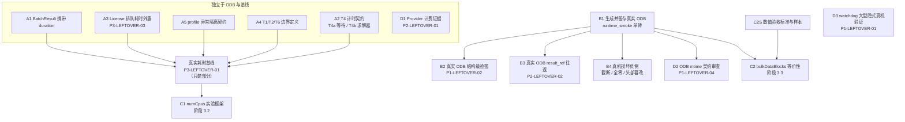

# 跨阶段任务图与执行顺序

本文件把阶段 1～3 的未闭合项整理成**可核对的依赖图**，用于并行实施与统一验收。

它不是验收记录。本文件中的任何"计划""待验证"都不表示已完成。各阶段的实际验收状态以
`docs/phase-leftovers-tracking.md` 为准。

## 0. 标注约定

任务按**证据形态**分为四类，不得混用：

| 标记 | 含义 | 判定依据 |
| :--- | :--- | :--- |
| **[已核实]** | 已读过代码或产物，结论有直接证据 | 文件路径 + 行号 |
| **[待实现]** | 代码尚不存在或能力不完整 | 审计显示无对应实现 |
| **[待真机]** | 需要真实 Abaqus/Provider 运行才能闭合 | 当前证据仅为单元/模拟 |
| **[决策阻塞]** | 需要人工拍板后才能动 | 涉及主链路语义或契约依据 |

一条任务可以同时是 **[待实现]** 与 **[待真机]**：代码写完了但只有单元证据。

## 1. 已核实事实

以下事实由直接读取代码或产物确认，不是推断：

| # | 事实 | 证据 |
| :--- | :--- | :--- |
| F1 | 仓库内真实 `.odb` 样本数为 **0** | `find . -name "*.odb"` 全空 |
| F2 | `*.odb` 被 `.gitignore:28` 忽略，**真实 ODB 无法入库** | `.gitignore` |
| F3 | 本机已安装 Abaqus，`abq2025.bat` 可用 | `/c/SIMULIA/Commands/abaqus.bat`、`EstProducts/2025/` |
| F4 | 曾有一次真实成功运行，产物在 `machine_validation/b28_smoke.json` | `job_completed: true`、`odb_opened: true`、`return_code: 0` |
| F5 | `AnalysisRunner` 经 `JobController` 在 CAE 会话内提交 | `analysis_run.py:782`、`:979`、`jobs.py:49-64` |
| F6 | 主链路**不经过** `run_with_watchdog` | 调用点仅 `batch.py:108`、`solver.py:811` |
| F7 | `BatchExecutor._run` **丢弃** `proc.duration`，`BatchResult` 无耗时字段 | `batch.py:106-114`、`batch.py:33-38` |
| F8 | `_LicenseContext` 不测量排队耗时；`AnalysisRunner` 不引用 license/queue | `license.py:51-71`、`analysis_run.py` 无引用 |
| F9 | `phase_profile.py` 生产调用点为 **0**，仅 `telemetry/__init__.py` 导出 | 全仓库 grep |
| F10 | `bulkDataBlocks` 全仓库 **0 引用** | `grep -rn bulkDataBlocks src/ tools/ tests/` 空 |
| F11 | `numCpus` 仅硬编码为 4，无实验框架 | `tools/case_07_jounce_bumper_e2e.py:381,510` |
| F12 | `tools/runtime_smoke.py` 是单砖三维静力模型，0 处 `time.` 调用 | 文件内容 |
| F13 | `machine_validation/*.json` 入库，`runs/` 与 `machine_validation/*` 默认忽略 | `.gitignore:14-26,49` |

**F2 的直接后果**：真实 ODB 只能留在本机（`runs/` 或 `machine_validation/` 下被忽略的目录）。
可入库的证据只能是对 ODB 的**描述**——大小、SHA256、魔数探测、提取结果 JSON——而不是 ODB 本体。
任何"提交真实 ODB 样本"的计划都不成立。

## 2. 依赖图

**图的两条硬边**：

1. **B1 → {B2, B3, B4, D2, C2}**：没有真实 ODB，这五项全部只能停在合成样本层面。
2. **BASE → C1**：没有可信的求解器耗时（T4b），`numCpus` 加速比**无法归因**。
   这不是保守，是数据本身不支持结论。

**明确不成立的边**（避免把任务错误串联）：

- ~~B1 → D1~~：Provider 计费证据与 ODB 无关，可独立推进。
- ~~B1 → A1 / A3 / A5~~：计时基础设施与 ODB 无关，可独立推进。
- ~~B1 → D3~~：小型单砖 ODB **不能**替代大型隐式求解验证。它无法产生长时间刚度矩阵分解，
  因而无法证明看门狗不会误杀。D3 依赖大型算例与真实求解日志，不依赖 B1。
- ~~BASE → D3~~：D3 验证的是「长时间求解是否被误杀」，不是比性能，
  因此**不依赖**可信耗时基线，可独立准备测试方案与大型算例。

## 3. 任务清单

### 第 1 批：可立即并行（无前置）

| ID | 任务 | 类型 | 写范围 | 说明 |
| :--- | :--- | :--- | :--- | :--- |
| B1 | 用 `runtime_smoke.py` 生成并留存真实 ODB | [待真机] | `runs/`（不入库）、`machine_validation/*.json` | 记录运行环境、输入版本、作业状态、文件校验信息 |
| A1 | `BatchResult` 携带耗时 | **[已实现·单元级]** | `execution/batch.py` | 纯增量字段，默认 `None`；透传 `WatchedProcessResult.duration`，不重复测量 |
| A3 | License 排队耗时外露 | **[已实现·单元级]** | `execution/license.py`、`execution/queue.py` | 字段可读且有测试；**尚无调用方**送入 profiler，`P3-LEFTOVER-03` 未闭合 |
| A5 | profile 异常隔离契约 | **[已实现·单元级]** | `telemetry/phase_profile.py` + 测试 | `strict=False` 降级写入 `internal_errors`；记录失败永不掩盖真实异常 |
| D1 | Provider 计费证据采集 | [待真机] | `tools/live_token_benchmark.py` | 与 ODB 无关；需真实 Key，费用自负 |

### 第 2 批：依赖第 1 批

| ID | 任务 | 类型 | 前置 | 说明 |
| :--- | :--- | :--- | :--- | :--- |
| A4 | T1/T2/T6 阶段边界定义 | **[已定义·静态]** | 无（可与第 1 批并行） | 落于 `docs/phase-timing-boundaries.md`。**结论：T2 当前无可测边界**（`audit_inp_mesh_quality` 生产零调用，网格生成混在 `apply_plan` 循环内） |
| B2 | 真实 ODB 结构级验签 | [待真机] | B1 | `verify_authentic_odb_structure` 的 `odbAccess.openOdb()` 路径从未对真实 ODB 执行 |
| B3 | 真实 ODB `result_ref` 往返 | [待真机] | B1 | 关闭 `P2-LEFTOVER-02` |
| B4 | 真机损坏负例 | [待真机] | B1 | 截断/全零/头部篡改，验证 Fail-Closed |
| D2 | ODB mtime 契约审查 | [待真机] | B1 | 关闭或修订 `P1-LEFTOVER-04` |
| C2S | `bulkDataBlocks` 数值验收标准 | [决策阻塞] | 无 | 规划要求浮点公差 `<1e-6`，需确认适用场景 |

### 第 3 批：依赖基线

| ID | 任务 | 类型 | 前置 |
| :--- | :--- | :--- | :--- |
| BASE | 真实耗时基线采集 | [待真机] | 第 1+2 批 |
| A2 | T4 计时契约 | **[契约定案·未实现]** | 无需改主链路（详见 §4） |
| C2 | `bulkDataBlocks` 等价性 | [待实现][待真机] | B1 + C2S |

### 第 4 批：性能实验与大型验证

| ID | 任务 | 类型 | 前置 |
| :--- | :--- | :--- | :--- |
| C1 | `numCpus` = 1/2/4/8 实验框架 | [待实现][待真机] | BASE + T4b（需算例 ≥ 60 s） |
| D3 | watchdog 大型隐式真机验证 | [待真机] | 大型算例（**不依赖 BASE**，验证误杀不需性能数据） |

### 不在本批次

阶段 4（声明式建模闭环、分类错误熔断与受控恢复）**不并入**。它与性能测量目标正交，
混做会扩大回归面。等阶段 3 遗留项清完后单独立项。

### 第 1 批的实际进展（2026-10-21）

| ID | 变化 |
| :--- | :--- |
| A1 | [待实现] → **[已实现·单元级]** |
| A3 | [待实现] → **[已实现·单元级]**（导出能力有了，真实数据仍无） |
| A4 | [待实现] → **[已定义·静态]**；**新增发现：T2 无边界** |
| A5 | [待实现] → **[已实现·单元级]** |
| B1 | 已完成：单砖真实 ODB 已生成并取得证据（见 `machine_validation/real_odb_validation.json`） |
| B2 / B3 / B4 / D2 | 证据已取得（单砖规模），**均未闭合**；需工程规模复验 |

A4 的结论曾抬高 BASE 的前提：**T2 无法在不改主链路的前提下测量**。
A2 的契约审查进一步确认：T4 可以不改主链路地拆为 T4a（等待）/ T4b（求解器），
但 **T2 仍需改主链路**（网格生成混在 `apply_plan` 循环内）。

因此 BASE 的当前可行范围是：

| 阶段 | BASE 能否覆盖 | 说明 |
| :--- | :--- | :--- |
| T1 / T5 / T6 | 能（需接线） | 边界已定义，未接线 |
| T3 | 能（需接线） | 字段已可读，未接入 profiler |
| T4a | 能 | 不改主链路 |
| T4b | 能（需先实现解析器） | 读 `.log`/`.dat`，有 1 s 量化 |
| T2 | **不能** | 无可测边界，需改主链路 |

所以 BASE 只能产出**部分基线**，不得称为完整 T1~T6 基线。

## 4. 决策阻塞项

### A2：主链路 T4 计时

**为什么曾阻塞**：`AnalysisRunner.run()` 走 `JobController` 在 CAE 会话内提交（F5），
不经过 `run_with_watchdog`（F6），拿不到 `WatchedProcessResult.duration`。

**当前状态：阻塞解除（契约定案，未实现）**。详见 `docs/a2-solver-timing-contract.md`。

| 概念 | 边界 | 是否改主链路 | 用途 |
| :--- | :--- | :--- | :--- |
| T4a | `jobs.submit(wait=True)` 进出 | **不改** | 端到端指标 |
| T4b | `.log` 的 `Standard Analysis` 段 / `.dat` 的 `WALLCLOCK TIME` | **不改**（读产物） | 求解器自身耗时 |

**决定变更的理由（基于真机产物）**：`runs/odb_sample_run/AIAgent_ODBSample.log` 显示
等待窗口内只有 7/15 s 是 `standard.exe`，其余为 `pre.exe` 与收尾。因此等待时间
**不能**代表求解耗时，必须拆分。但拆分不需要改主链路：`.log` 已有段落时间戳，
`.dat` 已有 `JOB TIME SUMMARY`。

**新发现的限制（必须随结论引用）**：`.dat` 的 `WALLCLOCK TIME` 与 `.log` 时间戳
均为 **1 s 量化**。该作业实际 7 s，`.dat` 却记为 `0`。因此秒级算例不能用于
性能结论；`numCpus` 归因需算例 ≥ 60 s。

### C2S：`bulkDataBlocks` 数值验收标准

规划要求浮点公差 `<1e-6`，但**未定义适用场景**。`bulkDataBlocks` 在 Abaqus 中用于
批量提取全场数据，若无明确场景与容差依据，等价比对会变成伪验收。需先确定：
哪些提取路径可用、哪些因集合语义不同不可等价、公差基于什么物理量级。

## 5. 证据留存规则

| 证据类型 | 存放位置 | 是否入库 |
| :--- | :--- | :--- |
| 真实 `.odb` 本体 | `runs/` 或被忽略的 `machine_validation/` 子目录 | **否**（F2） |
| ODB 描述（大小、SHA256、魔数、mtime） | `machine_validation/*.json` | 是 |
| 提取结果 JSON | `machine_validation/*.json` 或 `.cache/results/` | 结果入库，缓存不入库 |
| 原始运行日志 | `runs/` | 否 |
| 运行环境快照（版本、launcher 路径） | 随证据 JSON 一同记录 | 是 |

任何声称"已用真实 ODB 验证"的记录，必须能指向一个**当时存在**的 ODB 描述文件与校验和；
否则该记录不成立。

## 6. 与遗留项追踪的关系

本文件只负责**排序与依赖**。各遗留项的关闭条件、当前状态、为何未闭合，仍以
`docs/phase-leftovers-tracking.md` 为唯一事实来源。

本文件不新增遗留项编号，也不删除任何遗留项。

## 变更历史

| 日期 | 变更 |
| :--- | :--- |
| 2026-10-21 | 建立本文件：核实 13 条事实（F1～F13），给出四批任务依赖图，登记 2 项决策阻塞（A2 主链路 T4 计时、C2S `bulkDataBlocks` 数值标准）。明确小型 ODB 不能替代大型隐式验证，Provider/计时基础设施不依赖 ODB |
| 2026-10-21 | 第 1 批进展：A1/A3/A5 已实现（单元级），A4 已定义边界并**发现 T2 无可测边界**。该发现抬高了 BASE 的前置条件：完整 T1~T6 基线依赖 A2 决策先解开 |
| 2026-10-21 | A2 契约审查完成（`docs/a2-solver-timing-contract.md`）：根据真实 `.log` 将 T4 拆为 T4a（等待，15 s）/ T4b（求解器，7 s），证明等待≠求解；确认 `.dat`/`.log` 均为 1 s 量化且秒级算例不可用。**阻塞解除，且确认不需要改主链路**；T4b 解析器仍未实现 |
| 2026-10-21 | 按决定调整依赖图：D3 不再挂在 BASE 下（验证误杀不需性能基线），C1 仍强依 BASE |
